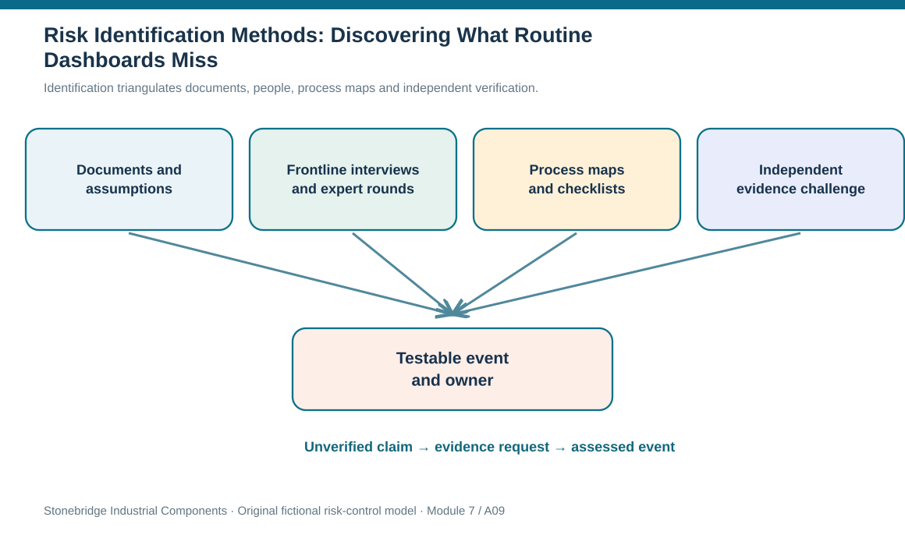
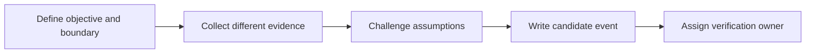

# 9. Risk Identification Methods: Discovering What Routine Dashboards Miss

## Learning objectives

After this topic, you should be able to:

- select complementary ways of discovering operational and strategic vulnerabilities
- distinguish collected claims from verified evidence and root causes
- structure an identification workshop so omissions and group bias are visible

## Concept in plain English

Risk identification asks a different question from daily KPI monitoring. A KPI may report that no delivery was late last month; the risk question asks whether a single shared component, facility, trade route or technology service could interrupt future delivery even though recent performance was normal. Finding such dependencies takes more than one method because every evidence source has blind spots.

Document and assumptions review begins with current process maps, contracts, incident histories, operational reports and the conditions on which the plan depends. A material-planning record may assume a backup site exists, but engineering evidence may show the alternate cannot make the approved design. Interviews with dispatchers, shift supervisors and partner contacts can expose informal workarounds that a corporate presentation omits. Brainstorming combines perspectives when a facilitator makes room for uncomfortable possibilities. Anonymous, iterative expert elicitation may help where power differences discourage candid opinions.

The company can supplement these methods with process mapping, risk checklists, root-cause analysis and a strategic strengths/weaknesses/opportunities/threats exercise. The aim is not to produce the longest list. Each method should generate a candidate condition that can be translated into a cause, an uncertain event, and consequences for defined objectives. Checklists provide reminders of historical failures but can create blind spots if the team assumes unfamiliar events are impossible. Process diagrams highlight handoffs and shared nodes; interviews test how the process actually runs.

Quality matters more than apparent consensus. If all workshop participants rely on the same supplier statement, five votes do not represent five independent observations. A facilitator should ask what evidence contradicts the assumption, which party has not been heard, what happens on the night shift, and whether the proposed alternate capacity has actually been demonstrated. The outcome of identification is an evidence request as often as a scored risk.

The output should be an auditable candidate-risk log with its discovery method, primary source, claim, verification need, owner, and disposition. Unverified claims belong on a follow-up list rather than in a confident quantitative model. Module 4 provides root-cause and quality-tool mechanics; Module 7 applies those tools to discover future exposure before failures become repeated incidents.

## Why it matters

Unusual risk often hides at interfaces: the emergency switch that works only in daylight, a terminal common to competing carriers, or a subcontracted administrator outside the primary system diagram. Combining process evidence with frontline observation uncovers those risks while retaining the discipline to verify them before a decision.

## Decision model and workflow

Identification triangulates documents, people, process maps and independent verification.

### Evidence retained through the workflow

| Evidence or control | Why required |
| --- | --- |
| Document evidence | Versions of plans, contracts and operational logs |
| People evidence | Role, date, observation and conflicting account |
| Process evidence | Shared nodes, handoffs, single points of failure |
| Verification | Specific test and responsible reviewer |

## Practical process flow

## Realistic example — Stonebridge Industrial Components

Stonebridge's daytime process workshop shows a tested power-transfer procedure. A night-shift supervisor explains the critical panel cannot be accessed without a facility contractor who is not on call after midnight. An independent interview and site walkthrough reveal a contingency vulnerability that past electrical availability charts cannot detect. The action is not to label the site unsafe without evidence; it is to test access, update the contact process, and quantify potential delay if the finding is confirmed.

## Applied decision artifact or worked calculation

The [original identification workshop log](../../assets/data/module-7/risk-identification-workshop.csv) records four findings from different methods, each with a verification request. The backup-fixture row calls for an alternate-process test; the carrier row calls for terminal confirmation; the technology row calls for credential review. This is a discovery record, not evidence that every finding is correct or has the same priority.

## Decision logic

1. Define the process or network boundary and operational objective.
2. Use documents, interviews, mapping and open expert elicitation for complementary coverage.
3. Record contradictory evidence and the independence of information sources.
4. Translate each credible finding into a testable event path with an owner.
5. Separate discovery from later risk rating; unresolved assumptions remain explicitly open.

## Trade-offs

| Decision tension | Implication |
| --- | --- |
| Coverage vs overload | Many weak ideas can obscure one critical verified dependency. |
| Group consensus vs independent evidence | Agreement does not prove that the underlying information is independent. |
| Speed vs root-cause confidence | A credible candidate can be registered before its causes are completely confirmed. |

## Commonly confused with

Risk identification discovers what may occur; root-cause analysis investigates why a problem occurred or might occur; risk assessment estimates its likelihood and consequences. They are sequentially connected but not interchangeable.

## Common mistakes

- Treating workshop voting as a statistical frequency estimate.
- Ignoring supplier, frontline or night-shift perspectives.
- Discarding candidate risks before testing an uncomfortable assumption.

## Original knowledge check

**Question.** A process map shows two outbound routes; an interview suggests both depend on one terminal. What should happen next?

A. Assign a precise numerical risk probability from the interview alone.

B. Eliminate interviews because only system records can detect risk.

C. Close the issue because historical on-time delivery is high.

D. Record the shared-terminal hypothesis, name an owner and verify it against actual routing evidence.

Answer and rationale

### Correct answer

**D. Record the shared-terminal hypothesis, name an owner and verify it against actual routing evidence.**

### Why it is correct

Correct: the discovery needs independent evidence before quantitative confidence.

### Why the other answers are wrong

- **A.** An interview alone does not establish frequency.

- **B.** Operational experience can reveal gaps not documented in formal systems.

- **C.** Past performance does not prove absence of future common-mode failure.

## Practitioner perspective

Compare the operating reality of night and weekend shifts with the formally documented process. An expert interview is valuable as a lead, but confirmation may require observing a transfer, reviewing an access log or exercising a spare fixture. Record who conducted each verification so that workshop agreement is not confused with measured event frequency.

## Related concepts

- [Module 4 — Root-Cause Methods](../../04-internal-operations-inventory/section-d-performance-and-continuous-improvement/07-basic-quality-tools-ii-pareto-and-cause-and-effect.md)
- [Module 6 — Supplier Evidence](../../06-supply-chain-relationships/section-b-supplier-and-supply-chain-relationships/13-supplier-performance-reporting-error-control-claims-and-remediation.md)

---

[Previous: Lesson 08](./08-iso-risk-management-standards-principles-techniques-and-vocabulary.md) · [Section overview](./README.md) · [Next: Lesson 10](./10-risk-statements-causes-triggers-horizons-and-register-integrity.md)
