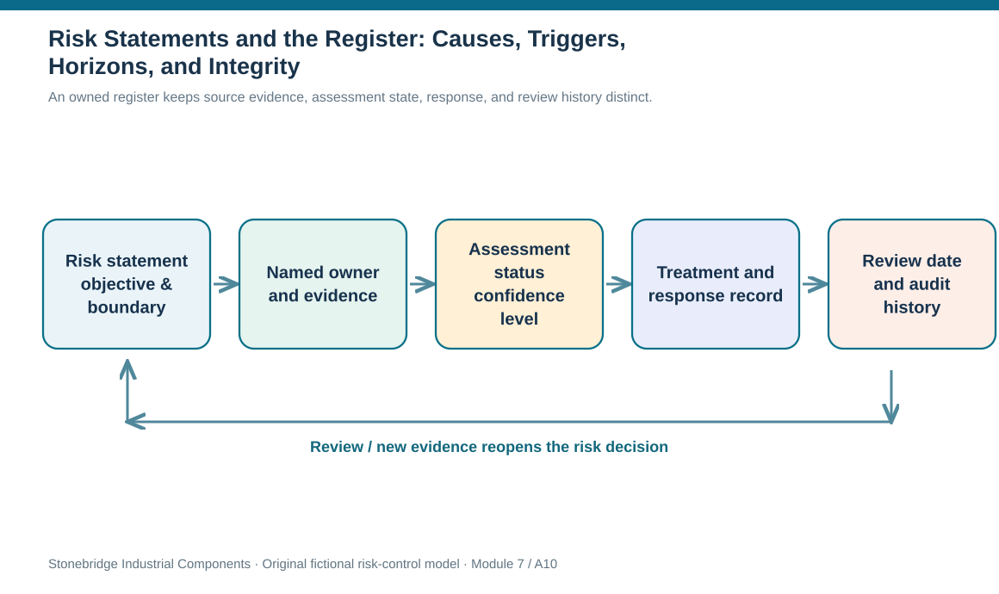
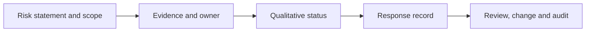

# 10. Risk Statements and the Register: Causes, Triggers, Horizons, and Integrity

## Learning objectives

After this topic, you should be able to:

- write specific cause–event–effect statements with a defined business boundary
- maintain a controlled risk register with owners, lifecycle states and evidence versioning
- distinguish an early indicator from an event and a realized incident

## Concept in plain English

A risk register is valuable only when two reviewers can understand what the recorded threat or opportunity actually means. A generic phrase such as 'warehouse risk' offers no clear boundary or response. A useful entry describes the causal condition, the uncertain event, the protected objective, plausible effects, and what scope is included. It also states the horizon: risks assessed for the next 30 days cannot be compared directly with events assessed over five years as if their probabilities were the same.

Causes, triggers and consequences are distinct. In a hypothetical connector supply interruption, the cause may be dependence on one test fixture; a maintenance or outage notice may be an early warning; the event may be the loss of qualified connector output; and the consequence is missed controller production and customer delivery. An early indicator can appear without the event occurring. A trigger is a defined condition requiring monitoring or action. An incident is a realized event requiring immediate execution. Maintaining those distinctions makes both the analysis and the operating response clearer.

The register typically starts with identification data and grows as risk evaluation and treatment decisions are approved. Some fields may legitimately read 'not yet assessed' rather than showing invented zeros. Core attributes include stable identifier, revision, statement, scope, objective, cause or dependency, accountable owner, horizon, likelihood and impact rationale if available, confidence, early indicators, assessment status, selected response, residual exposure, deadline, status, and next review. The register should link to source evidence rather than copy confidential files into an uncontrolled spreadsheet.

Version control protects the decision record. When a new engineering design changes the affected product range, the risk statement may need a revision; old status and control evidence should remain available for audit. A risk owner must not edit the probability field merely to fit a target score. Another safeguard is to check that the same common-mode event is not double counted as separate independent risks simply because two departments record its consequences. Related records can be linked while different losses remain visible.

A register also supports handoffs. Supply planning owns material constraints, logistics owns lane evidence, IT owns infrastructure recovery and risk management owns the consistency of assessment. A single row cannot make these different responsibilities disappear. In Section B the same record will acquire response alternatives, decision approvals and recovery evidence. At this stage the goal is an accurate description with enough specificity to support later decisions.

## Why it matters

A misleading register can create false assurance even when it is technically complete. If an open field defaults to zero or a risk is closed when its evidence becomes stale, leaders may mistake missing information for acceptable risk. A governed record is an operational control, not a decorative risk dashboard.

## Decision model and workflow

An owned register keeps source evidence, assessment state, response, and review history distinct.

### Evidence retained through the workflow

| Evidence or control | Why required |
| --- | --- |
| Identification | Stable ID, statement, cause, effect, scope and horizon |
| Assessment | Likelihood, impact, confidence, priority and date |
| Response | Action, owner, mandatory gates, funding and tests |
| Monitoring | Signal, owner, next review and revision history |

## Practical process flow

## Realistic example — Stonebridge Industrial Components

Stonebridge discovers that a new controller revision increases reliance on a specialist connector. The existing register entry SB-R01 covers the original family and a 12-month period. Rather than silently overwrite it, the Supplier Continuity Lead records a new revision expanding the exposed scope and requests a revised evidence pack. Procurement's supplier rating remains linked, but its score does not replace the new failure path.

## Applied decision artifact or worked calculation

The [versioned risk register sample](../../assets/data/module-7/risk-register-sample.csv) uses stable IDs and keeps qualitative and quantitative statuses separate. A qualitative state of 'pending' and a quantitative state of 'not assessed' are not zero risk. A controlled update record includes changed fields, reason, effective date, reviewer, and linked supporting evidence. Its next review date is an actual workflow obligation, not a convenient timestamp to fill an empty cell.

## Decision logic

1. Write the conditional cause–event–effect statement and affected business objective.
2. Specify location, product or partner boundary and the probability assessment horizon.
3. Assign an accountable owner and attach verifiable signal or source references.
4. Use explicit evidence and decision states, including pending and not assessed.
5. Version material changes while preserving the earlier approval history.

## Trade-offs

| Decision tension | Implication |
| --- | --- |
| Many fields vs maintainability | Retain fields that drive decisions and evidence, not unnecessary administrative decoration. |
| Detail vs comparability | Consistent structure permits comparison; risk-specific causes and outcomes remain distinct. |
| One event vs multiple effects | Link shared causal events so loss aggregation does not assume independence. |

## Commonly confused with

A leading indicator signals possible change; a trigger is a defined condition demanding action; a realized incident is no longer uncertain. A register is a living record, not itself a response plan.

## Common mistakes

- Recording risk probability = 0 when no estimate exists.
- Reusing a monthly probability for a yearly assessment without conversion or explanation.
- Deleting superseded decision history and losing accountability.

## Original knowledge check

**Question.** A risk analyst has not estimated the probability of a newly identified supplier failure. What is the correct entry?

A. Enter 0% so the dashboard remains complete.

B. Copy the probability from an unrelated supplier event.

C. Record not assessed, owner, horizon, source evidence and next analysis step.

D. Close the entry until a financial loss occurs.

Answer and rationale

### Correct answer

**C. Record not assessed, owner, horizon, source evidence and next analysis step.**

### Why it is correct

Correct: preserve uncertainty explicitly and assign further work.

### Why the other answers are wrong

- **A.** Missing evidence does not imply an impossible event.

- **B.** Another event does not provide a justified probability for this exposure.

- **D.** Risk identification precedes realization of a financial loss.

## Practitioner perspective

Attach supplier qualification, transport route and production-impact references to a stable risk ID rather than copying live transaction data into the register. When a bill of material changes, preserve the previous assessment revision, explicitly update the exposed product scope and schedule a new owner confirmation.

## Related concepts

- [Module 1 — Demand and Planning](../../01-supply-chains-demand-forecasting/README.md)
- [Module 6 — Supplier Performance](../../06-supply-chain-relationships/section-b-supplier-and-supply-chain-relationships/11-supplier-performance-measurement-and-kpi-governance.md)

---

[Previous: Lesson 09](./09-risk-identification-methods-and-evidence-gathering.md) · [Section overview](./README.md) · [Next: Lesson 11](./11-tangible-asset-loss-fraud-cargo-and-financial-controls.md)
