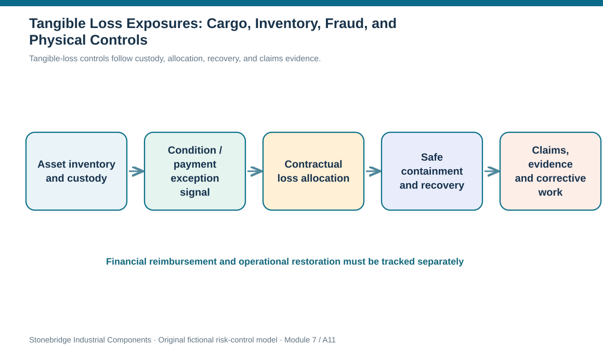

# 11. Tangible Loss Exposures: Cargo, Inventory, Fraud, and Physical Controls

## Learning objectives

After this topic, you should be able to:

- identify physical and financial supply-chain asset exposures and their downstream effects
- distinguish transportation custody, contractual risk allocation and inventory ownership
- design detection and evidence controls for loss, fraud and physical events

## Concept in plain English

A supply chain can lose tangible value through damaged or missing inventory, destroyed facilities, shipment theft, equipment failure, cash diversion or intentional wrongdoing. The mechanism matters because different preventive and investigative controls are needed. A broken load seal is not managed in exactly the same way as an unauthorized supplier bank-account change. Both are asset exposures, but the evidence, accountable owner, financial consequence and response authority differ.

Goods move through several custody boundaries. A manufacturer may dispatch parts to a carrier, transfer containers at a port, use a third-party warehouse and deliver to a customer. Each handoff creates operational exposure and a question about who is legally responsible for loss or damage. Trade terms, domestic contracts, insurance and title can have different roles. The point where ownership changes cannot automatically be treated as the same point where risk of loss transfers. Module 5 explains international transport and Incoterms in detail; here the risk decision is to identify the contractual boundary, verify current applicable terms, and retain evidence for claims and continuity planning.

Physical controls may include seal logging, condition monitoring, access restrictions, cycle counts, segregated receiving checks and verified carrier handoffs. Financial controls include independently approved vendor bank changes, segregation of duties, abnormal-payment review, invoice matching, and prompt escalation of suspected diversion. The organization also needs response procedures for injuries, unsafe conditions, theft, corruption and cyber-enabled fraud. Immediate protection of people and legal obligations takes priority over asset recovery.

An asset loss can cause several separate consequences: replacement cost, expedite spending, line stoppage, a rejected customer delivery, a claim to an insurer or partner, and a reputational problem. The amount paid by insurance and the time required to restore production are different variables. A warehouse might insure the inventory value but remain unable to replace a scarce component before an installation date. A good exposure record therefore captures both cash value and operational interruption.

Malfeasance and anti-corruption exposure requires caution. For suspected fraud or improper payments, preserve evidence and involve authorized compliance, security and legal personnel rather than publishing accusations or improvising investigation. Actual legal definitions and current jurisdiction-specific duties require qualified review; the educational exercise only identifies control boundaries and risk signals. Claims against a carrier likewise depend on contract, applicable law, documentation, and deadlines, not just a generic learning rule.

## Why it matters

Supply-chain professionals often optimize transport cost without seeing the value flowing through the handoffs. A low-cost lane with opaque custody records can create loss, delay and claims disputes far greater than the line-haul saving. Understanding tangible-loss pathways makes response investments and partner responsibilities explicit.

## Decision model and workflow

Tangible loss protection follows physical and financial evidence through custody, risk allocation, and recovery.

### Evidence retained through the workflow

| Evidence or control | Why required |
| --- | --- |
| Goods and property | Custody chain, seal/condition and damage report |
| Money | Bank authorization, dual control and payment trace |
| Contracts | Reviewed allocation of loss, claims and insurance conditions |
| Continuity | Restoration time, substitute inventory and customer impact |

## Practical process flow

## Realistic example — Stonebridge Industrial Components

Stonebridge ships instrumented panels to an integrator. A shock sensor flags unusual handling, but the delivery note is signed without a condition check. Finance later receives a damage claim and operations discovers the panel cannot be replaced within the customer's project window. The logistics owner links the condition evidence to the handoff and asks legal to confirm contract-specific liability. The risk owner also documents restart time rather than assuming that replacement value equals total loss.

## Applied decision artifact or worked calculation

The [tangible-loss control record](../../assets/data/module-7/asset-loss-control-record.csv) has three distinct examples: cargo damage, plant shrinkage and invoice diversion. Each has different physical and financial indicators. The shipment row intentionally records 'legal review pending' rather than asserting an Incoterm or domestic risk-of-loss outcome without the actual transaction. This separates the legal question from the operational need to contain a damaged shipment.

## Decision logic

1. Map the asset and every material custody or financial-control boundary.
2. Identify whether the loss is accidental, operational, dishonest or security related.
3. Check contractual allocation of risk of loss independently of ownership and insurance.
4. Retain event evidence, quantity, time, condition, financial exposure and operating consequence.
5. Escalate suspected illegal conduct through approved, evidence-preserving channels.

## Trade-offs

| Decision tension | Implication |
| --- | --- |
| Loss prevention vs delivery speed | Faster shipping can compromise evidence and control if handoffs are not verified. |
| Insurance vs continuity | Claim recovery can offset money while failing to restore product availability in time. |
| Early detection vs false accusation | An anomaly prompts controlled verification, not an unsupported allegation. |

## Commonly confused with

Title, custody, Incoterms delivery, contractual risk transfer and insurance coverage are distinct concepts. Fraud suspicion is not proof of wrongdoing; asset loss is not the same as lost customer-service capacity.

## Common mistakes

- Assuming every FOB expression means the same thing in domestic and international transactions.
- Treating a paid insurance claim as proof that the customer disruption was prevented.
- Bypassing segregation of duties during a high-pressure payment correction.

## Original knowledge check

**Question.** A damaged shipment crosses several custody points and its contract is not yet reviewed. What should the risk record say?

A. Risk of loss always follows legal title.

B. Document condition and custody evidence, protect supply, and request contract-specific risk allocation review.

C. Assume insurance guarantees on-time replacement.

D. Delete the earlier carrier events to simplify the claim narrative.

Answer and rationale

### Correct answer

**B. Document condition and custody evidence, protect supply, and request contract-specific risk allocation review.**

### Why it is correct

Correct: secure facts, continuity controls, and transaction-specific legal review.

### Why the other answers are wrong

- **A.** Ownership and contractual risk allocation need not coincide.

- **C.** Financial recovery does not guarantee timely product replacement.

- **D.** Claim integrity depends on retaining the chronology.

## Practitioner perspective

Inventory management can quantify damaged or missing units, logistics can reconstruct seal and custody history, and finance can trace monetary recovery. Those independent pieces should feed a combined continuity assessment that also asks when a replacement part could realistically restore customer production.

## Related concepts

- [Module 5 — Incoterms Fundamentals](../../05-forward-reverse-logistics/section-c-trade-considerations/07-incoterms-2020-fundamentals.md)
- [Module 4 — Inventory Controls](../../04-internal-operations-inventory/README.md)

---

[Previous: Lesson 10](./10-risk-statements-causes-triggers-horizons-and-register-integrity.md) · [Section overview](./README.md) · [Next: Lesson 12](./12-intangible-loss-ip-reputation-litigation-and-cross-border-due-diligence.md)
