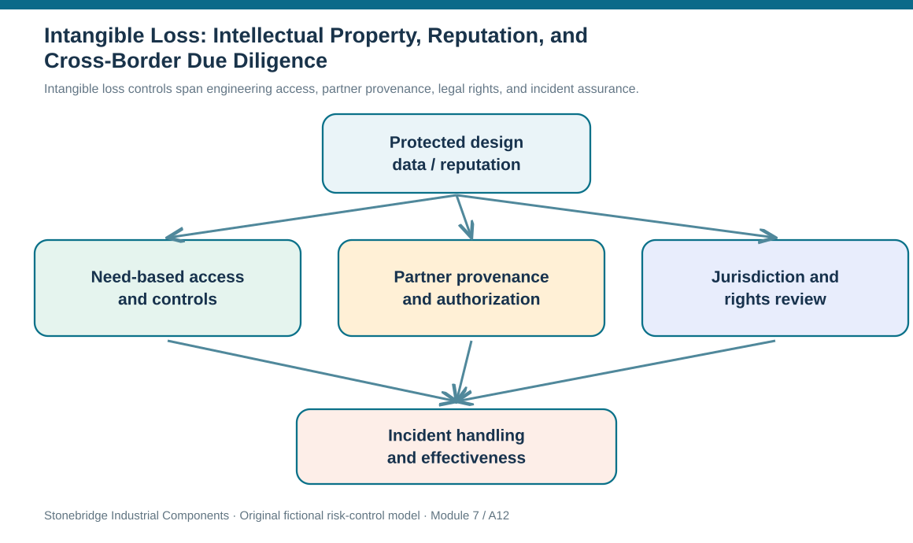
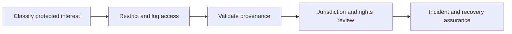

# 12. Intangible Loss: Intellectual Property, Reputation, and Cross-Border Due Diligence

## Learning objectives

After this topic, you should be able to:

- recognize IP, brand, information, reputation and litigation exposures in extended networks
- set access, confidentiality, authentication and legal review controls appropriate to the asset
- distinguish general risk-control principles from changing jurisdiction-specific law

## Concept in plain English

The assets most difficult to see on a warehouse floor may be essential to a business model. Engineering drawings, control software, trademarks, process knowledge, customer data, reputation and licenses can create more competitive value than the physical components that carry them. Global collaboration makes these assets useful to more partners and also makes unauthorized access, counterfeit supply, accidental disclosure, contract disputes and regulatory conflict harder to manage.

The first step is to describe the protected interest and where it travels. A supplier might need one connector drawing but not the full controller architecture or source code. A service partner may require controlled firmware access without owning redistribution rights. A distributor needs a product authenticity check to keep unauthorized or counterfeit parts out of legitimate orders. An appropriate control assigns access by need, records consent and contractual permission, and creates an audit trail that is usable after an incident.

Several intangible harms can occur together. Unauthorized production using a stolen design can displace legitimate sales and create safety issues if substituted products fail. A counterfeit bearing a similar mark may damage trust even if the legal owner later wins a claim. A misleading disruption announcement can damage customer confidence despite no direct property loss. These losses are difficult to estimate, so early qualitative classification should make assumptions and evidence quality visible rather than invent a precise reputation-dollar value.

Protection is geographically dependent. Patent, trademark, copyright, trade-secret, product-liability and enforcement rules differ by jurisdiction, time and rights involved. General statements in older learning texts about country-specific filings or broad international mechanisms should not be repeated as live legal advice. Before manufacturing, disclosing protected designs, or selling into a new jurisdiction, use qualified legal review of the actual rights, contracts, registrations, remedies and local procedures. The Patent Cooperation Treaty or another filing system is not a guarantee of worldwide patent rights.

Reputation and IP control also depend on operational processes. Engineering should manage version and access boundaries; purchasing should establish appropriate partner obligations; IT should manage identity and logging; quality should verify authenticity when substitute parts appear; legal should evaluate claims; and customer operations should approve external statements. The risk register connects these owners when one event can create several different harms. Module 3 retains ownership of product design and contracting fundamentals, while Module 7 decides which loss scenarios and protection gates justify action.

## Why it matters

An organization can technically manufacture a part with an external partner yet lose competitive control if more intellectual property is disclosed than the partner requires. It can also spend heavily on formal registration but overlook privileged system access. Effective risk control is both legal and operational, with separate evidence of each.

## Decision model and workflow

Intangible loss controls span engineering access, partner provenance, legal rights, and incident assurance.

### Evidence retained through the workflow

| Evidence or control | Why required |
| --- | --- |
| Protected asset | Engineering design, source code, data, mark or reputation interest |
| Access boundary | Who may view, use, copy or manufacture |
| Assurance | Logs, provenance, authenticity tests and contract record |
| Jurisdiction | Reviewed registration, enforcement, liability and notification obligations |

## Practical process flow

## Realistic example — Stonebridge Industrial Components

Stonebridge hires a specialist external tester for its industrial controller firmware. The contract permits testing selected binary files, not redistribution of full source code. The access review reveals the vendor still has repository-wide credentials from an earlier pilot. Security removes unneeded permissions and preserves the audit record, engineering confirms the minimum test materials, and legal assesses whether any contractual notice or claims actions are needed. The risk record remains open until access revocation and effectiveness are verified.

## Applied decision artifact or worked calculation

The [intangible-protection register](../../assets/data/module-7/ip-and-reputation-register.csv) covers firmware, brand authenticity and customer assurance. Each item has a different access boundary and evidence requirement. For example, the firmware row requires an audit trail and rights matrix; the product-mark row needs authentic-channel evidence and jurisdiction review. The rows are fictional controls, not definitive instructions for international filing or legal enforcement.

## Decision logic

1. Identify asset, authorized uses, access point, transfer parties and affected markets.
2. Check partner confidentiality and contract controls before giving protected information.
3. Apply identity, data-handling and provenance controls with named operating owners.
4. Prepare evidence preservation and customer communication rules for suspected misuse.
5. Obtain jurisdiction-specific legal advice and verify official rights/status before representing protection as established.

## Trade-offs

| Decision tension | Implication |
| --- | --- |
| Collaboration vs exposure | Share enough information for the partner to perform while protecting unnecessary intellectual property. |
| Registration vs operational security | Legal rights and access controls address different failure modes. |
| Speed of response vs evidentiary integrity | Protect customers rapidly without losing logs, provenance or contract records. |

## Commonly confused with

An IP right is a legal protection; an access policy is an operational control; brand reputation is stakeholder perception. None guarantees the other, and an international filing mechanism does not automatically grant enforceable rights everywhere.

## Common mistakes

- Treating all foreign jurisdictions as having identical filing and enforcement law.
- Granting whole-repository access for a limited component test.
- Treating a suspected counterfeit claim as established fact without provenance evidence.

## Original knowledge check

**Question.** A contracted tester needs one firmware binary but still has broad source-code repository access. Which response is strongest?

A. Keep the access because the supplier has a valid purchase order.

B. Restrict access to the authorized test scope, retain logs and review contractual rights.

C. Immediately publish a global accusation of theft.

D. Assume filing one international application provides full patent protection in every market.

Answer and rationale

### Correct answer

**B. Restrict access to the authorized test scope, retain logs and review contractual rights.**

### Why it is correct

Correct: least-necessary access, evidence and rights review address the exposure.

### Why the other answers are wrong

- **A.** A commercial agreement is not permission for unrestricted source-code access.

- **C.** An allegation without verified facts creates additional risk.

- **D.** International filing and national enforceability are not identical.

## Practitioner perspective

Access permission, engineering version control, contract rights and product authenticity checks should not be collapsed into one generic IP-control checkbox. A software-access revocation can be verified technically, but the determination of whether legal rights or filing coverage exists in another country requires jurisdiction-specific professional review.

## Related concepts

- [Module 3 — Product Design and Supplier Contracts](../../03-sourcing-strategy-product-design-supplier-execution/section-c-product-design-for-supply-chain/README.md)
- [Module 2 — Cybersecurity and Third-Party Risk](../../02-network-design-digital-connectivity-performance/section-b-connected-supply-networks-and-master-data/14-cybersecurity-and-third-party-risk.md)

---

[Previous: Lesson 11](./11-tangible-asset-loss-fraud-cargo-and-financial-controls.md) · [Section overview](./README.md) · [Next: Section review](./13-section-a-review.md)
