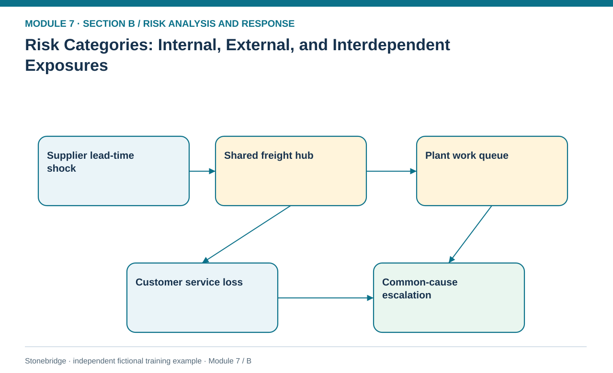
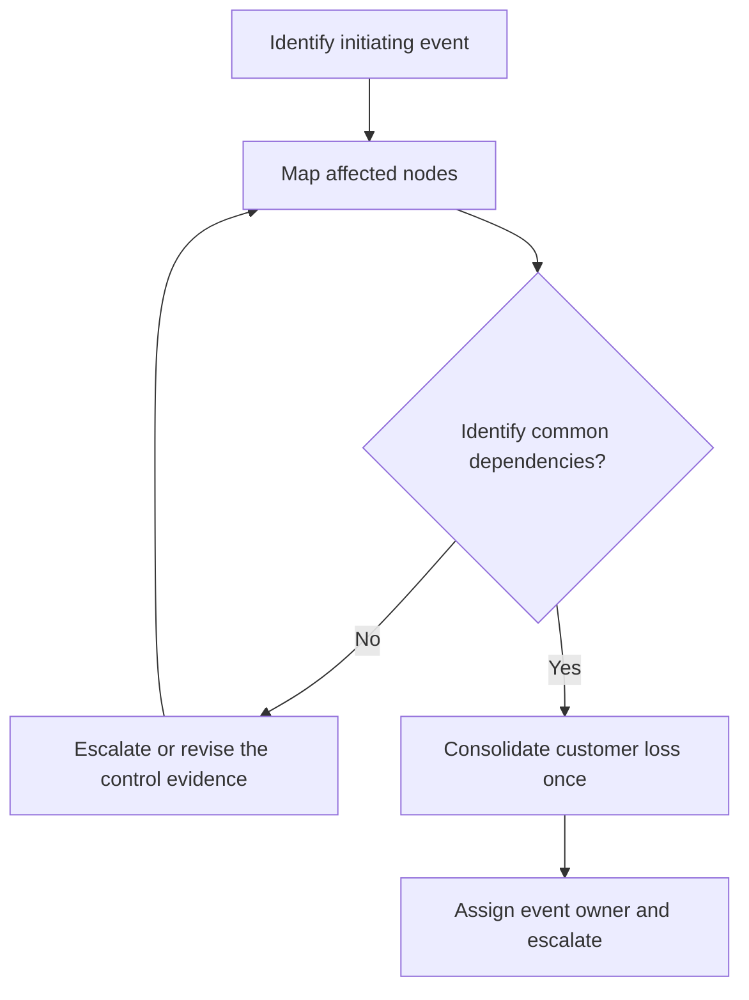

# 01. Risk Categories: Internal, External, and Interdependent Exposures

> **Fictional case context:** Stonebridge Industrial Components is used here to examine **risk categories internal external and interdependent exposures**. Any numeric values and policy thresholds describe this illustrative scenario, not observed industry performance or a universal certification rule.

## Learning objectives

After this lesson, you should be able to:

- classify disruptions by causal origin without treating the label as the root cause.
- trace one event into multiple operating consequences without double counting.
- identify common-mode dependencies that defeat apparent redundancy.

## Concept in plain English

Categories make a large risk register intelligible, but a category is a useful search index rather than a causal explanation. A supplier stockout can be called a supply risk; if it was induced by a mislabeled engineering revision, internal change management also matters. A political border closure may be external to the manufacturer while its choice of a single cross-border route is an internal design decision. Analysts should record both aspects instead of forcing each event into exactly one explanatory bucket.

The training taxonomy distinguishes strategic network, supply, demand, process, environmental, hazard, financial, malfeasance and litigation risks. These categories reflect different mechanisms and owners. Environmental obligations and force-majeure-type events should not be conflated: environmental compliance exposure can be foreseeable and controllable, while severe flooding can be difficult to prevent but potentially manageable through geographic redundancy. A risk register can carry a primary category and secondary contributing categories, but must have one accountable event owner.

Interdependence is the most important complication. Two suppliers may occupy separate firms yet send freight through the same consolidation terminal. A warehouse, supplier and production line may also share one power grid or identity system. The same initiating flood or cyber outage can therefore trigger several registered disruptions. Counting each as an independent event in EMV or simply combining service losses inflates or distorts the assessment. The analyst maps nodes and dependency edges first, then decides which impacts are incremental and which are alternate descriptions of one loss.

## Why it matters

Stonebridge is tempted to celebrate its two-vendor strategy because purchasing sees two names. Logistics sees both materials cross Northport Hub. If that hub fails, purchase-order redundancy does not translate into operational resilience. Classification must reveal this hidden architecture rather than simply increase the number of risk entries.

## Decision model and workflow

**Decision illustrated:** Stonebridge is tempted to celebrate its two-vendor strategy because purchasing sees two names. The visual highlights the relevant gate or causal connection; it does not imply that the fictional inputs are real disruption statistics.

### Evidence retained through the workflow

| Source field in the fictional training worksheet | Why it belongs in this decision |
| --- | --- |
| `risk_id` | Establish the exact object or decision instance before evaluating **risk categories: internal, external, and interdependent exposures**. |
| `category` | Confirm the event context, measurement basis, or resource status that changes this particular control decision. |
| `origin` | Test whether the assumed input supports the required decision: trace one event into multiple operating consequences without double counting. |
| `primary_event` | Preserve the operating constraint and response: Give one owner accountability for each registered event while identifying cross-functional consequence owners. |

## Practical process flow

## Realistic example — Stonebridge Industrial Components

The invented `risk-category-cases.csv` records five risks with origins, triggers, horizons and shared dependencies. R7-11 (chip unavailability) and R7-13 (river-road failure) both involve Northport. Operations should develop one combined hub-outage scenario, plus separate single-cause cases, before estimating losses. The supplier event stays under procurement ownership and the lane event under logistics, while a cross-functional incident commander coordinates the compound consequence.

## Applied decision artifact or worked calculation

Use an event-dependency worksheet with columns: initiating cause, exposed node, secondary effects, unaffected alternatives, shared infrastructure, responsible owner, and double-counting rule. For Northport, record one shock in the scenario root and branch into material delay and customer dispatch delay. Count the final economic consequence only once if those delays affect the same order.

## Decision logic

- Document a primary risk category, secondary causes and the initiating event rather than categorizing by the loudest consequence.
- Ask whether alternatives depend on the same geography, carrier, labor pool, application or power feed.
- Give one owner accountability for each registered event while identifying cross-functional consequence owners.
- Combine correlated consequences in a scenario tree before summing monetary losses.

## Trade-offs

| Tension | Decision implication |
| --- | --- |
| Simple taxonomy | Easy executive reporting, but hides coupled causes unless the shared-dependency field is mandatory. |
| Detailed dependency map | Better compound-risk insight, but source evidence and supplier transparency take time. |

## Commonly confused with

A risk **category** groups related causes; an **event** is the particular disruption; a **consequence** is the resulting damage. A failed delivery can be the consequence of a quality failure, freight closure or poor forecast. Renaming the consequence does not provide an independent initiating probability.

## Common mistakes

- Labeling every shortage as external while ignoring faulty internal planning assumptions.
- Treating two legal suppliers as independent despite one distribution chokepoint.
- Adding losses from the same customer-order delay more than once.

## Original knowledge check

**Question.** Two approved suppliers ship through the same vulnerable inland terminal. What is the most consequential weakness in a risk review?

A. Having more than one supplier complicates scorecards

B. The shared terminal creates a common-mode disruption despite separate suppliers

C. Supplier concentration has been completely eliminated

D. The risk category must always be financial

Answer and rationale

### Correct answer

**B. The shared terminal creates a common-mode disruption despite separate suppliers**

### Why it is correct

Correct: the two sources can fail together when an essential shared node is lost.

### Why the other answers are wrong

- **A.** The extra scorecard effort is not the underlying continuity failure.
- **C.** Different suppliers do not imply independent end-to-end delivery paths.
- **D.** A terminal outage is primarily a network/transport event with financial consequences.

## Practitioner perspective

Use a simple supplier–plant–lane–customer dependency graph before creating independent probabilities. The output belongs to the risk decision; detailed network routing and sourcing awards remain in Modules 2 and 3.

## Related concepts

- [01 Supply Chains Demand Forecasting](../../01-supply-chains-demand-forecasting/README.md)
- [02 Network Design Digital Connectivity Performance](../../02-network-design-digital-connectivity-performance/README.md)
- [06 Supply Chain Relationships](../../06-supply-chain-relationships/section-b-supplier-and-supply-chain-relationships/06-single-sole-and-multisourcing-concentration-and-relationship-risk.md)

---

[Previous: Section overview](./README.md) · [Section overview](./README.md) · [Next: Lesson 02](./02-qualitative-likelihood-impact-matrices-and-prioritization.md)
