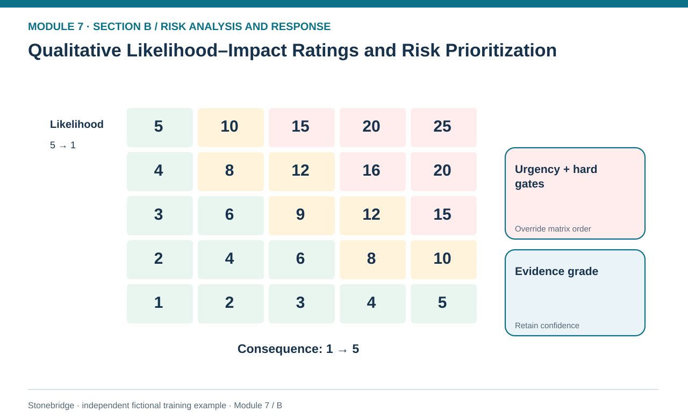
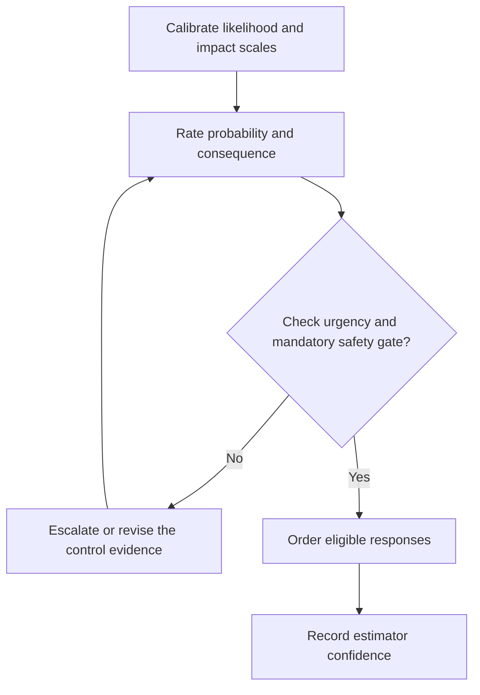

# 02. Qualitative Likelihood–Impact Ratings and Risk Prioritization

> **Fictional case context:** Stonebridge Industrial Components is used here to examine **qualitative likelihood impact matrices and prioritization**. Any numeric values and policy thresholds describe this illustrative scenario, not observed industry performance or a universal certification rule.

## Learning objectives

After this lesson, you should be able to:

- define anchored qualitative likelihood and consequence scales.
- use a 5-by-5 risk matrix as a prioritization aid, not a forecast of dollars.
- override matrix ranking when safety or legal limits demand immediate action.

## Concept in plain English

A qualitative rating is useful when an organization needs to triage many possible events without credible numerical event probabilities. A group of procurement, operations and customer-service experts agrees on definitions for likelihood and consequence. They assign an ordinal category to each, then use a matrix to flag which exposure requires analysis or action next. The labels mean little unless the organization anchors each scale to observable criteria and a common time horizon.

For an invented five-level scheme, likelihood 1 might mean very unusual within the coming year and 5 might mean repeatedly observed in comparable operations. Consequence 1 could mean negligible recoverable rework, while 5 denotes a prolonged critical service interruption or severe loss. Those are **training labels**, not ISO-mandated or statistically precise frequencies. Multiplying category numbers gives a convenient 1–25 ranking index, but it does not turn the ordinal scales into cardinal probabilities or dollars.

Mathematical score order is not the only decision rule. A rare catastrophic safety event may have a moderate product score and still require a stop-work response. Imminence also matters: a ten-day customs interruption beginning tomorrow can outrank a longer-term risk with a larger nominal matrix score. Record the rating, evidence confidence, affected objective, control gate and decision owner together. Treat differences of one point cautiously, especially if different functions estimated categories using different reference conditions.

## Why it matters

Stonebridge faces several simultaneous exposures. Leadership needs a transparent first-pass shortlist but must not allow a low qualitative score to average away an unacceptable worker-safety risk or a known customer contractual limit. The matrix should allocate investigation effort, not replace the decision-maker.

## Decision model and workflow

**Decision illustrated:** Stonebridge faces several simultaneous exposures. The visual highlights the relevant gate or causal connection; it does not imply that the fictional inputs are real disruption statistics.

### Evidence retained through the workflow

| Source field in the fictional training worksheet | Why it belongs in this decision |
| --- | --- |
| `risk_id` | Establish the exact object or decision instance before evaluating **qualitative likelihood–impact ratings and risk prioritization**. |
| `likelihood_1_to_5` | Confirm the event context, measurement basis, or resource status that changes this particular control decision. |
| `consequence_1_to_5` | Test whether the assumed input supports the required decision: use a 5-by-5 risk matrix as a prioritization aid, not a forecast of dollars. |
| `product_score` | Preserve the operating constraint and response: Escalate imminent triggers independently of the risk-score product. |

## Practical process flow

## Realistic example — Stonebridge Industrial Components

In the fictional qualitative dataset R7-11 rates likelihood 4 and consequence 4, giving a score of 16. R7-12 rates 3 and 5, giving 15, but carries a mandatory safety review and only a one-day urgency window. Stonebridge treats R7-12 as an immediate containment priority even though its arithmetic score is lower. This is an override, not an inconsistent calculation.

## Applied decision artifact or worked calculation

Maintain a rating rulebook and a review table with event ID, scale anchors, likelihood, consequence, computed score, urgency, evidence grade and mandatory gate. Compute R7-13 as `2 × 5 = 10`, then document why a possible critical route closure merits advance activation despite being below R7-11 in the numeric order.

## Decision logic

- Publish scale definitions and the planning horizon before scoring.
- Apply stop-work, security, compliance and contractual gates before score comparison.
- Escalate imminent triggers independently of the risk-score product.
- Reassess after controls change the operating exposure; keep pre- and post-control ratings distinct.

## Trade-offs

| Tension | Decision implication |
| --- | --- |
| Fast rating workshop | Practical with sparse data, but expert disagreement can hide behind a neat score. |
| Quantified frequency and loss | Improves economic comparison only if event and evidence definitions are reliable. |

## Commonly confused with

A matrix score of 16 is an **ordinal ranking index**, not a 16% annual probability and not a dollar amount. The matrix helps choose what to examine and manage next; the next quantitative lessons introduce explicit probability and impact units.

## Common mistakes

- Multiplying qualitative bins and announcing a precise financial EMV.
- Using different horizons for rated events without labeling them.
- Ignoring a mandatory safety response because another row scores 16 instead of 15.

## Original knowledge check

**Question.** A hazard scores 10/25 but violates an approved life-safety constraint if it occurs. How should managers use the matrix?

A. Apply the safety gate and escalate regardless of its score

B. Ignore the hazard until its score reaches 20

C. Convert 10/25 directly to a 40% event probability

D. Reduce the impact rating until its score matches the budget

Answer and rationale

### Correct answer

**A. Apply the safety gate and escalate regardless of its score**

### Why it is correct

Correct: non-negotiable limits are tested before relative priority ranking.

### Why the other answers are wrong

- **B.** The gate cannot be postponed solely on an arbitrary band.
- **C.** Ordinal category products are not calibrated probabilities.
- **D.** Adjusting scores to fit a budget defeats evidence-based assessment.

## Practitioner perspective

Facilitate rating workshops with a documented scale and independent pre-scores to reduce group influence. Keep a route to revisit disagreements or sparse evidence instead of presenting pseudo-precision as consensus.

## Related concepts

- [04 Internal Operations Inventory](../../04-internal-operations-inventory/section-d-performance-and-continuous-improvement/README.md)
- [06 Supply Chain Relationships](../../06-supply-chain-relationships/README.md)

---

[Previous: Lesson 01](./01-risk-categories-internal-external-and-interdependent-exposures.md) · [Section overview](./README.md) · [Next: Lesson 03](./03-risk-urgency-data-quality-and-estimate-confidence.md)
