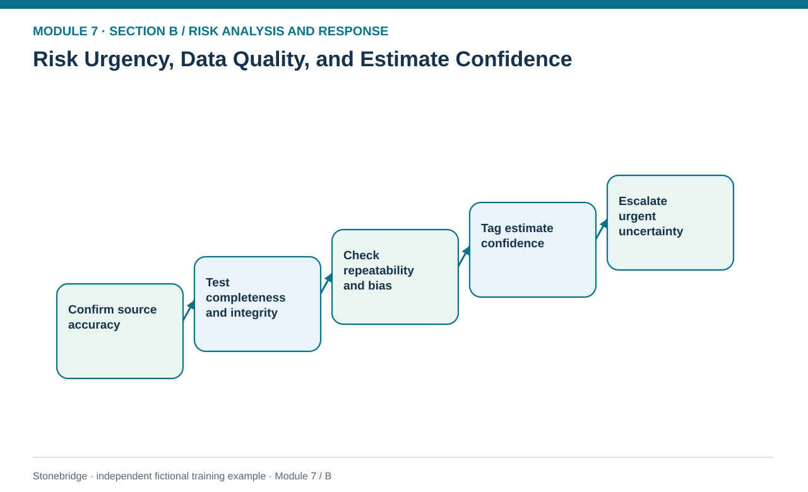
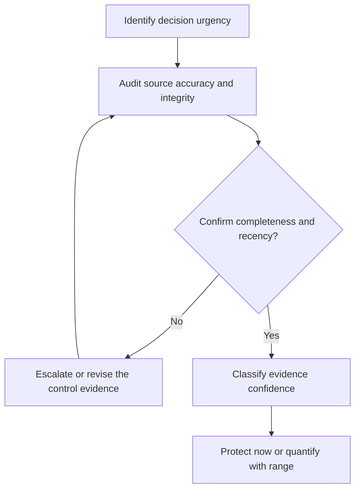

# 03. Risk Urgency, Data Quality, and Estimate Confidence

> **Fictional case context:** Stonebridge Industrial Components is used here to examine **risk urgency data quality and estimate confidence**. Any numeric values and policy thresholds describe this illustrative scenario, not observed industry performance or a universal certification rule.

## Learning objectives

After this lesson, you should be able to:

- distinguish urgency from severity and probability.
- evaluate accuracy, reliability, integrity and completeness of risk inputs.
- restrict spurious quantitative precision when evidence is inadequate.

## Concept in plain English

A model can calculate perfectly from evidence that is inaccurate, incomplete or no longer relevant. Data-quality assessment is therefore part of risk analysis, not an IT cleanup step deferred until after a recommendation. Accuracy asks whether the observation agrees with the underlying reality; reliability asks whether a consistent measurement would yield a similar answer again. Integrity is confidence that the recorded value has not been lost, corrupted or modified improperly over time. Completeness asks whether essential occurrences and exposure periods were captured.

Risk **urgency** concerns how soon a decision or protective action is required. An event may have uncertain probability but an actionable warning signal today. That uncertainty is not a reason to delay protection until a spreadsheet has a high-confidence decimal. The analyst can choose provisional conservative controls, restrict the authority of an estimate, request independent confirmation and set a near-term refresh. Confidence describes the evidence, not the gravity of the threat. A low-confidence exposure may deserve greater attention than a well-understood routine interruption.

Input bias is another hazard. Suppliers may overstate recoverability; plant teams may underrecord near misses; customer-service teams can overrepresent severe exceptions. Different sources use different definitions of 'late' or 'failed'. Stonebridge therefore stores the measurement method, data owner, observation count, last update, exclusions and transformation history before fitting any probability. A numerical model with six decimal places should not be treated as trustworthy when the underlying evidence covers seven incidents with unresolved cause classifications.

## Why it matters

The short path from a critical alarm to a possible shutdown makes data discipline operational. A stale failure rate used to dismiss a current alarm can be more harmful than openly treating the probability as unknown and activating protective rules.

## Decision model and workflow

**Decision illustrated:** The short path from a critical alarm to a possible shutdown makes data discipline operational. The visual highlights the relevant gate or causal connection; it does not imply that the fictional inputs are real disruption statistics.

### Evidence retained through the workflow

| Source field in the fictional training worksheet | Why it belongs in this decision |
| --- | --- |
| `risk_id` | Establish the exact object or decision instance before evaluating **risk urgency, data quality, and estimate confidence**. |
| `estimate_source` | Confirm the event context, measurement basis, or resource status that changes this particular control decision. |
| `observations` | Test whether the assumed input supports the required decision: evaluate accuracy, reliability, integrity and completeness of risk inputs. |
| `latest_review` | Preserve the operating constraint and response: When an urgent hard gate is open, protect first while validating evidence in parallel. |

## Practical process flow

## Realistic example — Stonebridge Industrial Components

R7-12 has only seven historical maintenance alarms, and failure-mode validation is missing. The fictional evidence file grades its confidence as low and its urgency as one day. Stonebridge must isolate the equipment, ask engineering to verify safety and gather logs before approving a restart. It must not infer a precise annual outage frequency from seven alarms that may not represent independent incidents.

## Applied decision artifact or worked calculation

Use a five-field evidence gate: source, completeness, reproducibility, freshness and dependence on changed operating conditions. Mark `protect_and_investigate` for R7-12. R7-11, with 38 confirmed shipment records and no missing data recorded, may be suited to a bounded scenario estimate, but still requires evidence that the sample spans the same horizon and supplier configuration.

## Decision logic

- Separate event urgency and evidence confidence from probability and financial severity.
- Lock definitions and data lineage before repeating a calculation in a shared workbook.
- When an urgent hard gate is open, protect first while validating evidence in parallel.
- Revise or withdraw quantitative results whenever the event population or measurement process changes.

## Trade-offs

| Tension | Decision implication |
| --- | --- |
| Act on incomplete evidence | Protects critical objectives but may require temporary costly controls. |
| Wait for confirmation | Reduces false alarms but can consume a narrow mitigation window. |

## Commonly confused with

**Accuracy** concerns correctness; **precision** concerns numerical resolution; **reliability** concerns repeatability; **integrity** concerns maintaining valid data. More digits do not make a risk estimate more accurate, and a recent record can still be wrong.

## Common mistakes

- Using a large data file whose event definitions differ across sites.
- Treating data confidence as if it lowers the actual harm of a hazard.
- Failing to document who verified the most recent measurement.

## Original knowledge check

**Question.** A test cell shows a critical alarm, but its historical frequency estimate comes from seven ambiguously classified logs. What is the strongest response?

A. Treat the seven observations as a statistically exact annual probability

B. Wait for a perfect estimate before protecting the work cell

C. Open an urgent containment and evidence-validation track in parallel

D. Assign the risk the lowest impact because the data quality is weak

Answer and rationale

### Correct answer

**C. Open an urgent containment and evidence-validation track in parallel**

### Why it is correct

Correct: urgent protection can proceed while probability evidence is verified.

### Why the other answers are wrong

- **A.** Ambiguous event classifications do not justify a precise population estimate.
- **B.** Delay may violate the imminent protective gate.
- **D.** Low evidence quality is not proof of low consequence.

## Practitioner perspective

Audit the dictionary of 'event', 'impact', and 'observation period' before comparing systems. A defect notification, rescheduled order and delayed shipment can all describe one incident in separate SAP records.

## Related concepts

- [02 Network Design Digital Connectivity Performance](../../02-network-design-digital-connectivity-performance/README.md)
- [04 Internal Operations Inventory](../../04-internal-operations-inventory/README.md)

---

[Previous: Lesson 02](./02-qualitative-likelihood-impact-matrices-and-prioritization.md) · [Section overview](./README.md) · [Next: Lesson 04](./04-quantitative-input-estimates-and-loss-distributions.md)
