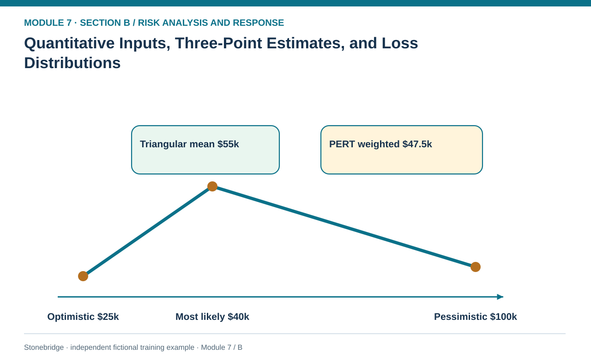
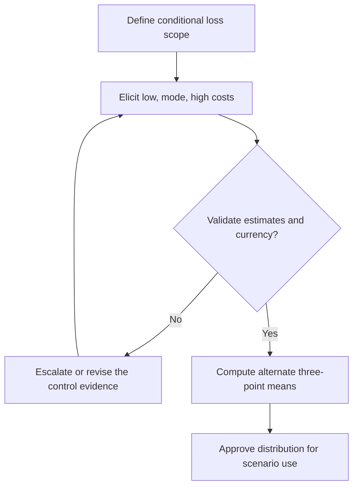

# 04. Quantitative Inputs, Three-Point Estimates, and Loss Distributions

> **Fictional case context:** Stonebridge Industrial Components is used here to examine **quantitative input estimates and loss distributions**. Any numeric values and policy thresholds describe this illustrative scenario, not observed industry performance or a universal certification rule.

## Learning objectives

After this lesson, you should be able to:

- define a defensible conditional loss distribution with a common event horizon.
- calculate simple triangular and weighted three-point means.
- distinguish uncertain consequence distributions from uncertain event probability.

## Concept in plain English

Quantitative analysis begins by defining exactly what a number represents. An event probability describes how likely a specified disruption is in the chosen time horizon. A loss distribution describes how costly the disruption might be **if** it happens. Estimating both with a single high–medium–low label hides uncertainty and complicates scenario economics. The distribution must also specify whether its values include premium freight, customer recovery, scrap, lost margin, penalties or duplicated cost categories.

Three-point elicitation is useful when enough historical incidents are unavailable for a full statistical fit but knowledgeable process owners can describe plausible bounds and a most-likely case. An equal-weight three-point average is `(low + most likely + high)/3`. A PERT-style weighted mean is `(low + 4 × most likely + high)/6`, giving four times the weight to the most-likely value. These are alternative summarization conventions, **not** measured probability laws automatically validated by three interviews. The arithmetic can be exact while the assumptions remain provisional.

A probability distribution is valuable when events have very unequal tail consequences. If loss can be $25,000 in an uncomplicated recovery or $100,000 after a quality hold, a single $40,000 estimate masks tail exposure. Analysts should test whether the optimistic, typical and pessimistic estimates are logically ordered, whether the tail has physical support, and whether dependencies allow the 'worst' scenario. Quantification should be rejected or clearly qualified if evidence quality is too weak or the scenario mixes inconsistent horizons.

## Why it matters

In an alternate-component incident, finance needs an indicative recovery-cost range to reserve resources. A cheap point estimate can understate premium freight and retesting exposure. The distribution helps identify which uncertainty matters most without making the organization pretend that it knows an exact event rate.

## Decision model and workflow

**Decision illustrated:** In an alternate-component incident, finance needs an indicative recovery-cost range to reserve resources. The visual highlights the relevant gate or causal connection; it does not imply that the fictional inputs are real disruption statistics.

### Evidence retained through the workflow

| Source field in the fictional training worksheet | Why it belongs in this decision |
| --- | --- |
| `scenario_id` | Establish the exact object or decision instance before evaluating **quantitative inputs, three-point estimates, and loss distributions**. |
| `description` | Confirm the event context, measurement basis, or resource status that changes this particular control decision. |
| `optimistic_usd` | Test whether the assumed input supports the required decision: calculate simple triangular and weighted three-point means. |
| `most_likely_usd` | Preserve the operating constraint and response: Choose a simple three-point method when it fits the available data; do not claim it is observed frequency. |

## Practical process flow

## Realistic example — Stonebridge Industrial Components

Stonebridge's fictional alternate-chip recovery has three cost estimates: $25,000 optimistic, $40,000 most likely and $100,000 pessimistic. The unweighted three-point average is `(25,000+40,000+100,000)/3 = $55,000`. The PERT-style mean is `(25,000+4×40,000+100,000)/6 = $47,500`. Both are conditional recovery-cost summaries, not annual EMVs.

## Applied decision artifact or worked calculation

Use the [fictional loss-distribution worksheet](../../assets/data/module-7/risk-probability-distributions.csv) to compare triangular and PERT-weighted conditional loss estimates. For the illustrative alternate-chip recovery case, the triangular mean is (25,000 + 40,000 + 100,000) / 3 = **$55,000 per event**, whereas the PERT-weighted mean is (25,000 + 4 × 40,000 + 100,000) / 6 = **$47,500 per event**. These are different assumptions about a single conditional loss, not independent annual event probabilities. Do not multiply either figure by an invented likelihood or label either an observed outcome.

Record `optimistic_usd`, `most_likely_usd` and `pessimistic_usd` in the source dataset, link each estimate to a recovery pathway and attach the estimator's justification. Add a second row for a quality interruption: `(10,000+4×30,000+80,000)/6 = $35,000`. Do not multiply either mean by an event likelihood unless a separate, supported probability is supplied.

## Decision logic

- Validate that low ≤ most likely ≤ high and that all amounts use the same event and currency basis.
- Retain the bounds and distribution assumption instead of publishing only one average.
- Choose a simple three-point method when it fits the available data; do not claim it is observed frequency.
- Escalate severe tail effects that breach appetite even when the average looks affordable.

## Trade-offs

| Tension | Decision implication |
| --- | --- |
| PERT weighted mean | Communicates a central scenario simply but can understate extreme tail exposures. |
| Full severity distribution | Supports simulations and quantiles but requires evidence, assumptions and validation. |

## Commonly confused with

The **PERT mean** is a conditional-cost estimate, while **EMV** weights outcomes by their occurrence probabilities. A $47,500 conditional-loss summary must not be called an expected annual loss until the occurrence model is explicitly combined with it.

## Common mistakes

- Treating a three-point estimate as proof of the likelihood of an event.
- Mixing event-level recovery dollars with annual operating cost without accounting for occurrence.
- Collapsing upper-tail loss into a mean before checking mandatory continuity limits.

## Original knowledge check

**Question.** An interruption has conditional recovery estimates of $25k, $40k most likely and $100k. What is the PERT-style conditional mean?

A. $55,000

B. $40,000

C. $33,000

D. $47,500

Answer and rationale

### Correct answer

**D. $47,500**

### Why it is correct

Correct: (25+4×40+100)/6 = 47.5 thousand dollars.

### Why the other answers are wrong

- **A.** This is the equal-weight three-point mean, not the weighted PERT-style mean.
- **B.** The mode alone ignores the other estimates.
- **C.** No documented weighting here produces this result.

## Practitioner perspective

The analyst should expose where each bound came from: site overtime, quality clearance, expedited freight and lost contribution. Sensitivity to the upper bound is often a more useful managerial discussion than a falsely precise central estimate.

## Related concepts

- [01 Supply Chains Demand Forecasting](../../01-supply-chains-demand-forecasting/README.md)
- [02 Network Design Digital Connectivity Performance](../../02-network-design-digital-connectivity-performance/README.md)

---

[Previous: Lesson 03](./03-risk-urgency-data-quality-and-estimate-confidence.md) · [Section overview](./README.md) · [Next: Lesson 05](./05-expected-monetary-value-single-and-multiple-outcomes.md)
