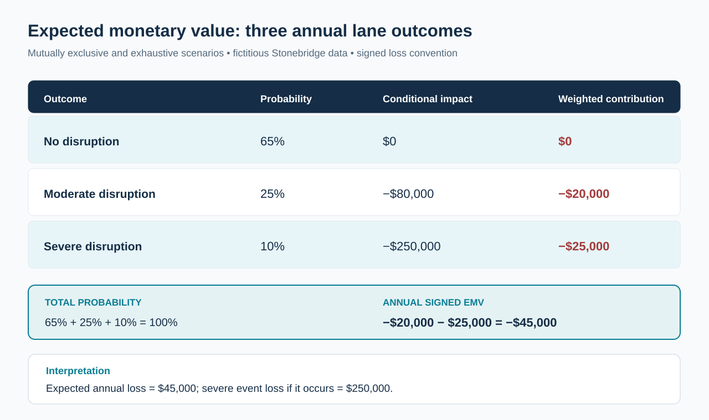
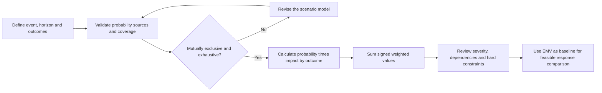

# 5. Expected Monetary Value for Single and Multiple Risk Outcomes

> **Training example:** Fictional Stonebridge Industrial Components; modeled assumptions are not industry frequencies.

## Learning objectives

After completing this lesson, you should be able to:

- calculate expected monetary value (EMV) of a single loss event for a stated period;
- calculate the probability-weighted net value of mutually exclusive scenarios, including gains and losses;
- distinguish a probability-weighted estimate from the severity of a realized disruption;
- identify when missing outcomes, poor probability estimates, and dependence between risks make a simple EMV unreliable; and
- hand a baseline expected-loss calculation to the response-economics decision in the next lesson.

## Concept in plain English

A risk may produce a large loss if it happens yet occur infrequently. Managers need to hold two separate ideas at once: **how severe an event would be** and **how likely it is within a specified time horizon**. Expected monetary value converts those dimensions into one decision-support number by multiplying each possible financial outcome by its probability, then adding the results across outcomes.

For a single negative event with conditional loss magnitude `L` and probability `p`, the baseline **expected annual loss** is `p × L` when probability refers to the next year. If the event could occur repeatedly, a one-event model may understate exposure; the model must make that assumption visible. EMV is an expectation over many comparable possibilities, not a forecast that this year's accounting ledger will show exactly the resulting amount. The actual year may contain no event at all or a loss near the modeled consequence.

For outcomes that are both mutually exclusive and collectively exhaustive, add `probability × outcome` for every branch. A zero-loss branch matters: leaving it out can cause probabilities to sum to less than one and distort the interpretation. Preserve signs when a scenario can create a gain; otherwise a benefit may accidentally be counted as a loss. For opportunities with a certain initial investment, evaluate the net economic decision with the full funding outlay, as addressed in the next lesson.

A good EMV model has an explicit unit, currency, horizon, definition of the event, population, and source of probabilities. Two risks with $40,000 EMV are not necessarily equivalent: one may involve common small interruptions, the other a rare catastrophic shutdown. Risk appetite, health and safety requirements, service priorities, correlated events, and survival threats may override a purely arithmetic ranking. This is why Section A established risk thresholds and management ownership before Section B introduced numerical ranking.

## Why it matters

Suppose a controller manufacturer can spend money strengthening cyber access, validating an alternate supplier, or avoiding a vulnerable corridor. Without financial modeling, decision makers might fund whichever event sounds most alarming. A defensible loss estimate connects probability to operational effect and gives a starting point for comparing feasible responses. It also exposes assumptions: an attractive numeric result cannot justify an intervention that fails a mandatory safety or security requirement.

The method is valuable for prioritization, not as a replacement for judgment. Estimate ranges and dependency scenarios should accompany point values when credible outcomes vary. A high-impact risk may warrant monitoring or protective action even when its expected value appears modest.

## Decision model and workflow

The diagram shows three hypothetical lane outcomes: no disruption, a moderate disruption, and a severe disruption. The *outcome probability*, *conditional impact*, and *weighted contribution* remain separate so the expected value can be checked at a glance.

### Evidence retained through the workflow

| Input | Definition and control |
| --- | --- |
| Risk event and horizon | A particular lane disruption during the next 12 months, not an undefined lifetime risk |
| Scenario probabilities | Must lie between 0 and 1 and sum to 1 for a full set of mutually exclusive outcomes |
| Conditional impact | Currency and operational effect **if** that outcome occurs; negative signs denote loss |
| Dependence assumptions | Record whether another simultaneous event could change either probability or severity |
| Review trigger | Recalculate when capacity, routing, contracts, or event evidence materially changes |

## Practical process flow

## Realistic example — Stonebridge Industrial Components

Stonebridge ships controllers through a combined road-and-rail corridor. It is considering resilience investments for the next calendar year. A fictional cross-functional review describes three **mutually exclusive annual outcomes**: a year without a lane disruption, a moderate interruption requiring overtime and premium freight, or a severe interruption requiring costly customer recovery and alternate transportation. These values are training assumptions; they are not observed industry frequencies.

The original [scenario dataset](../../assets/data/module-7/emv-outcome-scenarios.csv) uses loss as a negative signed outcome. The three probabilities are 0.65, 0.25 and 0.10, which sum to 1.00. The annual impacts are respectively $0, −$80,000 and −$250,000. The expected value can be independently checked without needing to simulate any random outcomes.

## Applied decision artifact or worked calculation

| Outcome | Assumed annual probability | Financial impact if outcome occurs | Contribution to expected result |
| --- | ---: | ---: | ---: |
| No disruption | 65% | $0 | $0 |
| Moderate interruption | 25% | −$80,000 | −$20,000 |
| Severe interruption | 10% | −$250,000 | −$25,000 |
| **All outcomes** | **100%** | — | **−$45,000** |

Therefore the modeled **expected annual loss is $45,000**, expressed as a positive magnitude, while the signed EMV of the net operating impact is **−$45,000**. The chance of any disruption in the simplified model is 35%, but it would be misleading to multiply that 35% by the severe $250,000 loss: the moderate and severe conditional outcomes are different.

A second, independent illustration of a single event is a fictional access-related production interruption with **18% annual probability** and **$260,000 loss if it occurs**. Expected annual loss is `0.18 × $260,000 = $46,800`. This second example is the baseline for the mitigation comparison in Lesson B06; it is not added to the logistics $45,000 unless a complete model clarifies joint occurrence and double-counting risks.

## Decision logic

- Define the period before choosing a probability; a five-year lifetime likelihood is not an annual probability.
- Treat severity as **conditional** on the event; distinguish it from expected loss.
- For a complete exclusive scenario tree, verify probabilities total exactly 100%, using a documented rounding tolerance if necessary.
- Keep gains positive and losses negative in the signed EMV; state the magnitude separately when reporting expected loss.
- Check independence or shared dependencies before aggregating separate risk estimates.
- Carry evidence limitations and extreme-loss constraints forward to the response decision rather than treating EMV as a standalone approval rule.

## Trade-offs

| Tension | Interpretation |
| --- | --- |
| Simplicity versus realistic tail outcomes | A three-case model is auditable but may miss rare compound events; enlarge it when the decision warrants that cost. |
| Numeric ranking versus resilience | Average financial loss can hide an unacceptable maximum service outage or safety exposure. |
| Historical frequency versus changed network | Old event rates may cease to fit after new suppliers, routing, technologies, or geopolitical conditions. |
| One-loss model versus correlated risks | Shared infrastructure can make independent-risk addition misleading. |

## Commonly confused with

**EMV** is a probability-weighted average outcome; **maximum possible loss** is the most adverse considered conditional result. In Stonebridge's lane example these are $45,000 and $250,000 respectively. **Expected annual loss** uses a particular time horizon, while an actual realized loss is a booked event. These are not interchangeable.

## Common mistakes

- Multiplying 35% probability of any disruption by the worst-case loss even though moderate and severe consequences differ.
- Omitting the no-loss branch when claiming the modeled scenarios are exhaustive.
- Combining unrelated risks without analyzing double counting and dependencies.
- Treating the expected $45,000 as the most likely realized dollar loss for a specific year.
- Mixing the signed EMV of a loss (`−$45,000`) with its positive expected-loss magnitude (`$45,000`).

## Original knowledge check

**Question.** A manufacturer estimates a 25% chance of a $40,000 penalty and a 10% chance of a distinct $150,000 penalty, with a 65% chance of no penalty. The outcomes are mutually exclusive. What is its expected annual penalty cost?

A. $47,500, because both penalty amounts must be added before probability weighting

B. $25,000, because only the most severe scenario matters

C. $21,250, because average probability should be multiplied by average loss

D. $25,000, because 0.25 × $40,000 + 0.10 × $150,000 = $25,000

Answer and rationale

### Correct answer

**D. $25,000, because 0.25 × $40,000 + 0.10 × $150,000 = $25,000.**

### Why it is correct

Separate scenarios contribute $10,000 and $15,000 to the expected annual loss. Their sum is $25,000. The no-penalty outcome contributes zero.

### Why the other answers are wrong

- **A.** Each conditional loss has a different probability and must be weighted separately.
- **B.** The moderate outcome contributes real expected exposure and cannot be discarded.
- **C.** Averaging probabilities and conditional losses loses their outcome-level pairing.

## Practitioner perspective

Forecast errors, supply delays, quality defects and customer-service issues may be tracked in separate planning and ERP records. A risk analysis should link those records to one consistent event definition before declaring the probability credible. In SAP-oriented production environments, a vendor delay, shortage, order reschedule and missed customer receipt might all be consequences of **one** disruption; counting each as an independent event can materially overstate expected loss. Preserve the chain from source evidence to scenario probability and resulting decision.

## Related concepts

- [Module 1 — Forecasting and Demand Alignment](../../01-supply-chains-demand-forecasting/README.md)
- [Module 2 — Performance and Financial Insight](../../02-network-design-digital-connectivity-performance/README.md)
- [Module 4 — Internal Operations and Inventory](../../04-internal-operations-inventory/README.md)
- [Module 5 — Forward and Reverse Logistics](../../05-forward-reverse-logistics/README.md)

---

---

[Previous: Lesson 04](./04-quantitative-input-estimates-and-loss-distributions.md) · [Section overview](./README.md) · [Next: Lesson 06](./06-response-economics-certain-costs-and-residual-risk.md)
