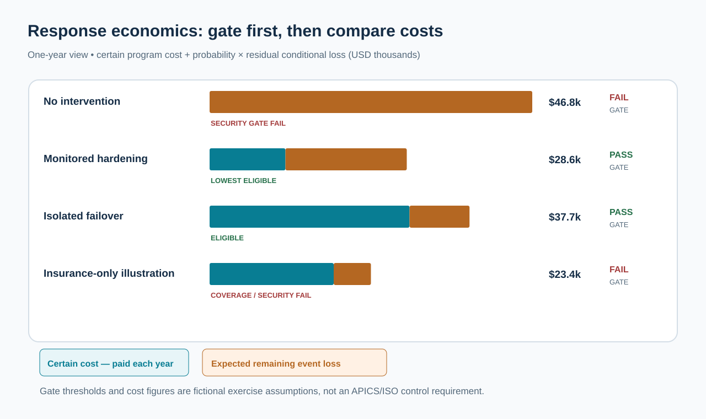
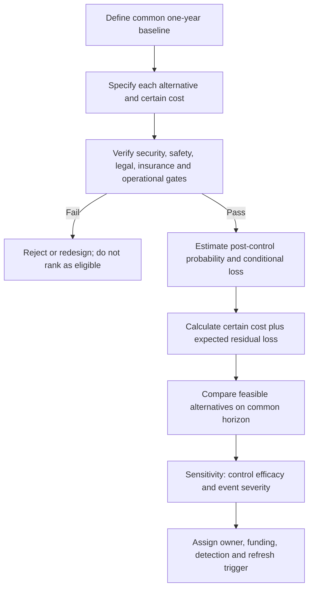

# 6. Risk Response Economics: Certain Costs and Residual Exposure

> **Training example:** Fictional Stonebridge Industrial Components; modeled assumptions are not industry frequencies.

## Learning objectives

After studying this lesson, you should be able to:

- distinguish an **unconditional mitigation expenditure** from a **conditional event loss**;
- calculate the total expected annual cost of a control alternative using compatible assumptions;
- apply safety, security, coverage and operating-feasibility gates **before** comparing expected financial costs;
- distinguish an intervention's reduced probability from its reduced conditional severity; and
- perform a sensitivity test that changes an economically preferred action without silently changing the baseline.

## Concept in plain English

A manufacturer may face a threat that costs money only if a disruption occurs. An intervention designed to reduce that threat may cost money **whether or not the disruption occurs**. Those are different cash-flow structures. Decision makers must not multiply a certain yearly control fee by the probability of the event, just as they must not charge a severe disruption loss in a year in which the event does not occur.

A useful one-event annual model is:

`Total expected annual cost = certain annual mitigation cost + P(disruption after control) × conditional residual disruption loss`

The expression assumes one modeled occurrence at most during the year, no additional material cash flows and costs valued on the same annual horizon. If a fixed investment spans several years, either use an agreed amortization/annualization convention or build a multi-year cash-flow model with a stated discount rate. This is not a universal formula for every insurance, financial or operational contract. It is an explicit model for the fictional alternatives evaluated here.

A **conditional loss** is what happens if the event occurs. An intervention might change the event's probability, its damage conditional on occurrence, or both. Security controls can make compromise less likely; tested recovery capacity can reduce downtime if compromise occurs. An insurance contract may transfer some specified financial loss while leaving the physical interruption, loss of trust, and uncovered exposures intact. The difference matters. Financial transfer is not the same as risk elimination.

The risk-management text's introductory net-impact example can deduct an initial cost within a conditional outcome tree when that is how its modeled scenario cash flows are defined. But this presentation convention must not be copied into a decision model in which the control outlay is **certain regardless of disruption**. Always show when a cost is incurred and to which events it belongs; then calculate the expected value branch by branch.

## Why it matters

Without separating probability from incidence, a manager can claim that a $30,000 always-paid preventive system costs only $3,000 because a relevant outage has a 10% chance. The financial case would be wrong by $27,000 before considering any benefits. A superficially favorable number can also hide an alternative that does not satisfy a mandated control, excludes the event under an insurance policy, or cannot be implemented before a known exposure window.

The best choice therefore emerges from two different tests. First ask whether the alternative is permitted and operationally credible. Only then compare financial results among those that pass. The sequence prevents a numeric score from canceling a serious legal, safety, security, or coverage failure.

## Decision model and workflow

The diagram divides each annual expected total into two visually distinct components: money spent in all years and probability-weighted loss. The cheapest nominal option fails coverage and security gates; it is shown for diagnostic purposes but is not a valid recommendation.

### Evidence retained through the workflow

| Required field | Role in the control decision |
| --- | --- |
| Current-state risk probability and conditional impact | Baseline expected loss and calculation horizon |
| Certain control cost and payment timing | Expense that must be counted even when no disruption occurs |
| Post-control risk probability | Measures prevention benefit; needs evidence and review trigger |
| Conditional residual loss | Measures recovery/severity benefit when an event still occurs |
| Feasibility / hard-gate result | Blocks candidates that cannot meet mandatory constraints |
| Owner, approved controls and monitoring trigger | Ensures the economics result in executable risk treatment |

## Practical process flow

## Realistic example — Stonebridge Industrial Components

Stonebridge depends on a supplier-hosted remote support connection to keep a controller test line operational. The risk owner defines a fictional one-year interruption scenario with an 18% event probability and a loss of $260,000 if the outage occurs. A strengthened access-control program, an isolated failover arrangement, and a cyber insurance proposal are considered. The proposal states that supplier-origin compromise is **excluded**, and the insurance-only route does **not** satisfy Stonebridge's fictional mandatory security-control requirement.

The decision owners agree to a fictional hard gate: funded options must reduce the modeled probability to at most **10% in the next 12 months**, with verified mitigation ownership. This threshold is a training-policy assumption, **not** an APICS, ISO or regulatory standard. The existing state and insurance-only proposal fail it. Both active controls pass the training gate, but they have different costs and effectiveness. Management must choose one feasible treatment and track whether the assumed efficacy materializes.

## Applied decision artifact or worked calculation

Start from the fictional, independently authored [risk-response options dataset](../../assets/data/module-7/emv-response-options.csv). All figures below are for **one year** and in USD. The conditional loss amounts are the expected loss magnitude *if* the modeled event occurs; the separate control costs are paid during the year regardless of occurrence.

| Option | Annual event probability | Loss if event occurs | Certain annual cost | Expected annual total | Eligibility |
| --- | ---: | ---: | ---: | ---: | --- |
| No new intervention | 18% | $260,000 | $0 | $46,800 | Fails mandatory security gate |
| Monitored hardening | 8% | $220,000 | $11,000 | **$28,600** | Pass |
| Isolated failover | 6% | $145,000 | $29,000 | **$37,700** | Pass |
| Insurance without controls | 18% | $30,000 modeled retained loss | $18,000 | $23,400 *nominal* | **Fail: security and coverage exclusions** |

### Independently check the arithmetic

- Baseline: `0.18 × $260,000 = $46,800` annual expected loss.
- Hardening: `$11,000 + 0.08 × $220,000 = $11,000 + $17,600 = $28,600`.
- Failover: `$29,000 + 0.06 × $145,000 = $29,000 + $8,700 = $37,700`.
- Insurance-only illustration: `$18,000 + 0.18 × $30,000 = $23,400`, **but this amount is not an insured expected-cost prediction** because the contract exclusion invalidates the simplified retained-loss assumption for the supplier-origin event. The candidate fails both eligibility gates and must not be ranked as a feasible alternative.

**Recommendation under the locked assumptions:** select monitored hardening, the lowest expected annual cost **among eligible candidates**. Against the untreated economic benchmark, the expected saving is `$46,800 − $28,600 = $18,200` per year. That benefit is conditional on the mitigation evidence supporting the assumed probability and severity reductions.

### A decision-changing sensitivity

Suppose control efficacy deteriorates and the post-control disruption probability increases from 8% to **17%**, while the $11,000 certain expense, $220,000 conditional loss, baseline probability and all other figures remain unchanged.

Revised hardening total = `$11,000 + 0.17 × $220,000 = $48,400`. It now costs **$1,600 more** in expectation than the untreated benchmark of $46,800, and it also fails the fictional 10% mandatory security gate. Under this scenario, hardening is **not approved** as the standalone treatment. The isolated failover option remains feasible under the model at $37,700 and becomes the preferred eligible alternative, subject to validating its actual isolation and recovery capability.

For additional monitoring, hardening loses its pure **economic advantage over untreated risk** when its post-control annual event probability exceeds `($46,800 − $11,000) / $220,000 = 16.2727%`. However, the stricter fictional **10% gate** requires a response or redesign long before that economic cross-over. These thresholds represent different decision rules and must not be conflated.

## Decision logic

- Match cash-flow incidence to event incidence; record every certain cost outside probability weighting.
- Estimate both post-control probability **and** conditional loss; a control can affect either, both, or neither.
- Keep all options on the same time horizon and currency basis; do not compare annual expenses with undiscounted multi-year losses.
- Check insurance exclusions, safety, legal and operational readiness before interpreting a nominally low modeled cost.
- Apply the stated hard gate first, then rank only eligible alternatives.
- Run at least one meaningful sensitivity; if the recommendation changes, define the evidence trigger and owner.
- Reassess after technology, supplier access, customer criticality or threat environment changes.

## Trade-offs

| Choice | Risk-management consequence |
| --- | --- |
| Always-paid preventive spend versus risk-adjusted loss | Controls can be justified when they reduce loss enough, but certain costs count in every outcome. |
| Lower occurrence versus faster recovery | Preventive access controls and tested failover capacity address different dimensions of the event. |
| Transfer versus elimination | An insurer may reimburse part of a covered financial loss; disruption and excluded risk remain. |
| Lowest modeled cost versus eligibility | A cheaper option that fails the mandatory coverage or security gate is not selectable. |

## Commonly confused with

**Cost of mitigation** is what an intervention requires to deploy or operate. **Expected residual loss** is the probability-weighted consequence that remains after the intervention. Their sum may be compared in a defined model. **Risk transfer** may shift who pays part of a covered loss, but it does not automatically reduce event probability or restore physical production. **Risk avoidance** changes the plan to remove the exposure; it is not merely purchase of insurance.

## Common mistakes

- Multiplying a certain insurance premium or system subscription by outage probability.
- Counting the same control benefit once as a lower probability and again as an unrelated dollar credit.
- Treating an insurance exclusion as a valid modeled reduction in conditional loss.
- Ranking candidates by a weighted score that hides a failed mandatory security gate.
- Quoting a mitigation saving without locking the time horizon, assumptions and severity calculation.
- Reporting a decision-changing scenario without specifying how the organization would detect declining control efficacy.

## Original knowledge check

**Question.** A prevention service costs $12,000 every year, whether or not a disruption occurs. With the service, the annual disruption probability is 8% and the conditional loss is $150,000. Which is the correct expected annual total cost?

A. $12,960, calculated by multiplying the service fee by 8% and adding the event loss

B. $24,000, calculated as the certain $12,000 fee plus `0.08 × $150,000` conditional expected loss

C. $162,000, because both costs occur in every year

D. $12,000, because a prevention service eliminates the event loss from the decision

Answer and rationale

### Correct answer

**B. $24,000, calculated as the certain $12,000 fee plus 0.08 × $150,000 conditional expected loss.**

### Why it is correct

The service is paid in every modeled year; the loss is conditional on disruption. Thus `$12,000 + $12,000 = $24,000`.

### Why the other answers are wrong

- **A.** This incorrectly probability-weights an expense that is paid regardless of disruption.
- **C.** This charges the full conditional loss even if no event occurs.
- **D.** A lower probability is not zero probability; residual exposure remains.

## Practitioner perspective

Financial modeling should connect business controls to transaction evidence. A production outage may produce overtime, expedite fees, customer concessions and missed service commitments. Cost categories must not be counted twice simply because the same disruption appears in maintenance, inventory, planning and customer-service systems. A source-to-model trail should show the original incident identifier, probability source, cost breakdown, which costs are paid in all years, approval gate, owner and next review. ERP data can support the analysis, but the risk owner is still accountable for assumptions and escalation decisions.

## Related concepts

- [Module 2 — Digital Connectivity and Financial Performance](../../02-network-design-digital-connectivity-performance/README.md)
- [Module 3 — Supplier Selection and Contracting](../../03-sourcing-strategy-product-design-supplier-execution/README.md)
- [Module 4 — Internal Operations and Inventory](../../04-internal-operations-inventory/README.md)
- [Module 6 — Supply Chain Relationships](../../06-supply-chain-relationships/README.md)

---

[Previous: Lesson 05](./05-expected-monetary-value-single-and-multiple-outcomes.md) · [Section overview](./README.md) · [Next: Lesson 07](./07-decision-trees-scenarios-and-sensitivity-analysis.md)
