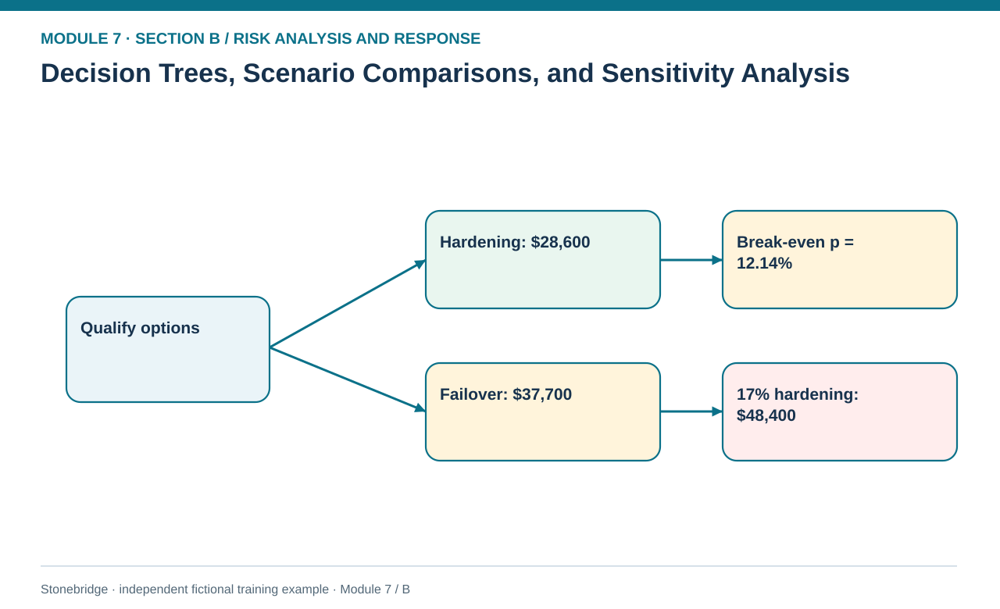
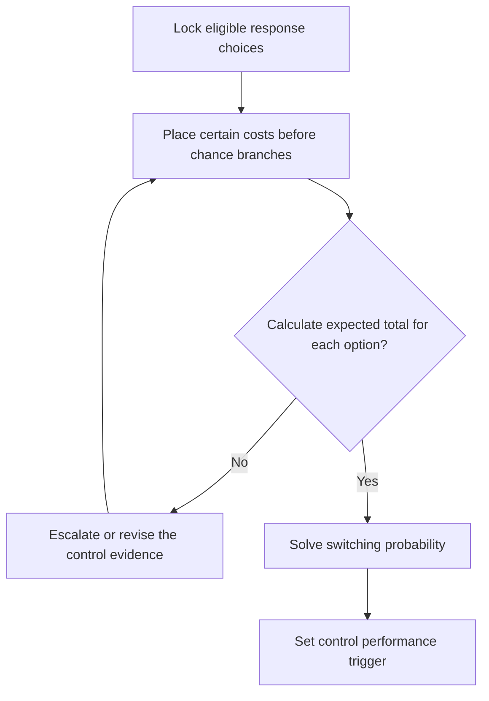

# 07. Decision Trees, Scenario Comparisons, and Sensitivity Analysis

> **Fictional case context:** Stonebridge Industrial Components is used here to examine **decision trees scenarios and sensitivity analysis**. Any numeric values and policy thresholds describe this illustrative scenario, not observed industry performance or a universal certification rule.

## Learning objectives

After this lesson, you should be able to:

- construct a decision tree that distinguishes choices from uncertain events.
- calculate the switching threshold for response economics.
- test one uncertain assumption at a time without quietly shifting alternatives.

## Concept in plain English

A decision tree separates actions managers can choose from uncertain outcomes they cannot directly choose. The decision node contains eligible alternatives, while each chance node contains conditional outcomes and their probabilities. A branch-specific cost is attached to the branch that incurs it; an unconditional annual fee belongs to every branch of the selected alternative. This tree discipline prevents a popular error in risk analysis: discounting a certain preventive expense by the disruption probability.

Sensitivity analysis then asks which assumptions can reverse the decision. Analysts vary one driver and hold the others fixed to find a switching value, rather than changing probability, severity and funding simultaneously and declaring the new option 'more realistic'. One-way sensitivity is a controlled diagnostic; scenario analysis may deliberately change several related inputs, but the changed combination and dependencies must be visible. A small numerical difference between two options signals that new evidence is worth acquiring, while a wide stable advantage indicates that effort might be better spent testing execution feasibility.

The decision tree cannot overrule an approved hard gate. Stonebridge's security hardening and isolated failover are both eligible; a nominally cheaper insurance-only proposal is excluded due to security-control and coverage failures. The correct question is not 'What is the absolute smallest number in the workbook?' but 'Which feasible action gives the best acceptable outcome under the assumptions and how fragile is that ranking?'.

## Why it matters

An intervention that looks economical at its optimistic assumed failure rate may cease to be the best choice when the control degrades. Decision sensitivity identifies precisely what must be monitored after launch and creates a trigger for re-evaluation rather than leaving a static recommendation in a slide deck.

## Decision model and workflow

**Decision illustrated:** An intervention that looks economical at its optimistic assumed failure rate may cease to be the best choice when the control degrades. The visual highlights the relevant gate or causal connection; it does not imply that the fictional inputs are real disruption statistics.

### Evidence retained through the workflow

| Source field in the fictional training worksheet | Why it belongs in this decision |
| --- | --- |
| `option` | Establish the exact object or decision instance before evaluating **decision trees, scenario comparisons, and sensitivity analysis**. |
| `annual_certain_cost_usd` | Confirm the event context, measurement basis, or resource status that changes this particular control decision. |
| `conditional_loss_usd` | Test whether the assumed input supports the required decision: calculate the switching threshold for response economics. |
| `assumed_event_probability` | Preserve the operating constraint and response: Solve an explicit indifference threshold before claiming a recommendation is robust. |

## Practical process flow

## Realistic example — Stonebridge Industrial Components

Under the independently reviewed B06 assumptions, hardening costs `$11,000 + p × $220,000` annually; failover costs `$29,000 + 0.06 × $145,000 = $37,700`. Solve `11,000 + 220,000p = 37,700`, giving `p = 26,700/220,000 ≈ 12.14%`. At 8%, hardening totals $28,600. At 17%, hardening totals $48,400; it is both more expensive than failover and **ineligible** under the 10% hard gate defined in B06. Failover remains eligible on the locked assumptions. The 12.14% break-even is a mathematical comparison point **outside the allowable range** for hardening, not the control-activation threshold.

## Applied decision artifact or worked calculation

Create a decision record with eligible choices, certain payments, conditional event branches, common annual horizon, probability rationale, response owner and one-way break-even. Set the **action trigger at the stricter fictional 10% mandatory eligibility limit**, with 12.14% retained only as the hypothetical economic indifference point. A changed estimate must be verified, and managers must not wait for 12.14% before meeting the 10% gate.

## Decision logic

- Draw chance branches under each eligible choice, including no-event outcomes.
- Post unconditional costs to the chosen decision regardless of chance outcome.
- Solve an explicit indifference threshold before claiming a recommendation is robust.
- Escalate safety, coverage or mandatory security failures before looking at decision-tree totals.

## Trade-offs

| Tension | Decision implication |
| --- | --- |
| Simple decision tree | Clearly assigns costs and events but can omit correlated multi-year consequences. |
| One-way sensitivity | Shows switching points cleanly but does not explore jointly changing economic regimes. |

## Commonly confused with

**Scenario analysis** varies a coherent set of assumptions; **sensitivity analysis** isolates the response to one changing input; a **decision tree** maps the choices and contingent branches. A Monte Carlo analysis samples distributions repeatedly and is addressed separately.

## Common mistakes

- Charging an annual control fee only in the event branch.
- Comparing options with different time horizons or uncovered event definitions.
- Changing more than one input while reporting a single-variable break-even.

## Original knowledge check

**Question.** At what post-control annual event probability are hardening ($11k + p × $220k) and failover ($37.7k) economically indifferent?

A. 8.00%

B. 12.14%

C. 17.00%

D. 37.70%

Answer and rationale

### Correct answer

**B. 12.14%**

### Why it is correct

Correct: ($37,700−$11,000)/$220,000 = 12.136%.

### Why the other answers are wrong

- **A.** 8% is the original hardening input, not the switching value.
- **C.** 17% is a stress case that makes hardening worse.
- **D.** This confuses a dollar total with a probability.

## Practitioner perspective

The threshold is a management monitoring target, not a causal estimate of efficacy. Incident frequency may need credible exposure normalization, and tail-risk appetite may still favor failover even below the economic switching probability.

## Related concepts

- [02 Network Design Digital Connectivity Performance](../../02-network-design-digital-connectivity-performance/README.md)
- [06 Supply Chain Relationships](../../06-supply-chain-relationships/README.md)

---

[Previous: Lesson 06](./06-response-economics-certain-costs-and-residual-risk.md) · [Section overview](./README.md) · [Next: Lesson 08](./08-simulation-monte-carlo-and-model-validation.md)
