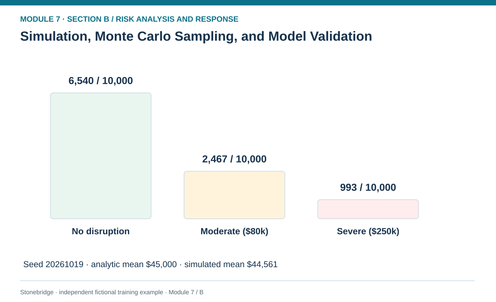
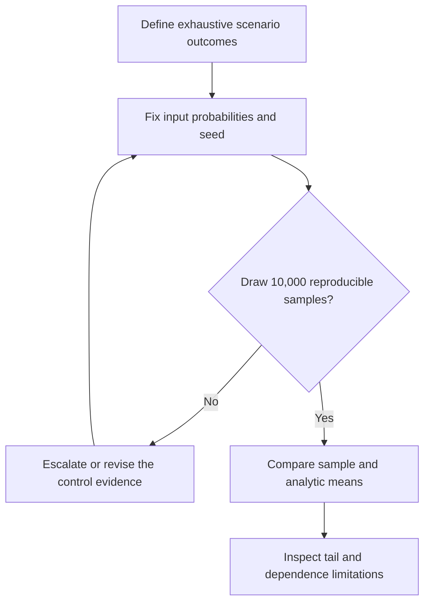

# 08. Simulation, Monte Carlo Sampling, and Model Validation

> **Fictional case context:** Stonebridge Industrial Components is used here to examine **simulation monte carlo and model validation**. Any numeric values and policy thresholds describe this illustrative scenario, not observed industry performance or a universal certification rule.

## Learning objectives

After this lesson, you should be able to:

- define the input probability model separately from simulated realizations.
- reproduce a seeded Monte Carlo exercise and explain sampling variation.
- evaluate tail quantiles and model assumptions without claiming false observational validity.

## Concept in plain English

A simulation generates possible operating outcomes from an explicit model. Monte Carlo methods use repeated random draws to propagate input uncertainty into a distribution of results. A run does not create new facts about the world: the output is conditional on the modeled scenario set, probability assumptions, loss values and dependence relationships. Thousands of simulated years can make a poorly defined event appear impressively precise, so the source of every input remains the governing evidence control.

Stonebridge's initial model is intentionally simple: exactly one annual outcome from three mutually exclusive categories. A uniform random number below 0.65 selects no disruption; a draw from 0.65 to below 0.90 selects a moderate $80,000 loss; the remaining 0.10 selects a $250,000 severe loss. A fixed integer seed makes the teaching result reproducible. The sample mean should approach—but will not typically equal—the analytic EMV of $45,000. The sampled event frequencies vary within finite-sample limits even when the input frequencies are held fixed.

Simulation is especially useful when a distribution or several uncertain inputs make algebraic analysis awkward. But it can be dangerously misleading if multiple disruptions are assumed independent merely for coding convenience. Supplier loss and port closure may share geography; power failure and cyber recovery may share authentication services. With correlated events, naive independent draws can suppress or exaggerate extreme outcomes. Validate event definitions, marginal distributions, joint dependencies, rounding, capacity constraints and output reasonableness before citing tail statistics.

## Why it matters

A manager may accept an average annual exposure while still needing protection against a single catastrophic year. Simulation makes the spread visible and allows decision makers to compare risk-tail consequences, provided the scenario model captures materially possible pathways.

## Decision model and workflow

**Decision illustrated:** A manager may accept an average annual exposure while still needing protection against a single catastrophic year. The visual highlights the relevant gate or causal connection; it does not imply that the fictional inputs are real disruption statistics.

### Evidence retained through the workflow

| Source field in the fictional training worksheet | Why it belongs in this decision |
| --- | --- |
| `run_id` | Establish the exact object or decision instance before evaluating **simulation, monte carlo sampling, and model validation**. |
| `seed` | Confirm the event context, measurement basis, or resource status that changes this particular control decision. |
| `draws` | Test whether the assumed input supports the required decision: reproduce a seeded Monte Carlo exercise and explain sampling variation. |
| `p_no_disruption` | Preserve the operating constraint and response: Compare the Monte Carlo mean with a hand-checkable analytic result when available. |

## Practical process flow

## Realistic example — Stonebridge Industrial Components

The dataset specifies seed 20261019 and 10,000 draws. Using Python `random.Random(20261019)`, the actual sampled outcomes are 6,540 years with $0 loss, 2,467 with $80,000 and 993 with $250,000. The simulated average is `(2467×80,000 + 993×250,000)/10,000 = $44,561`, compared with analytic $45,000. The empirical 95th-percentile loss is $250,000; this number depends on the simplified discrete model.

## Applied decision artifact or worked calculation

A reproducible calculation is saved as [`simulation-reproducibility.json`](../../assets/data/module-7/simulation-reproducibility.json) in the public training data register, with fixed seed, sample size, observed bucket counts, modeled mean and sample mean. Do not treat the sampled 9.93% severe share as an observed severe-disruption incidence in actual industry data. Any extension to independent supplier and freight events must first be justified through the dependency map in B01.

## Decision logic

- State the uncertain variables, distributions, units, time horizon and dependencies before simulation.
- Preserve random seed, run size, model version and summary statistics.
- Compare the Monte Carlo mean with a hand-checkable analytic result when available.
- Do not present simulated quantiles as measured organizational event frequencies.

## Trade-offs

| Tension | Decision implication |
| --- | --- |
| More random draws | Reduces simulation sampling noise but cannot fix wrong assumptions. |
| More complex dependencies | Improves plausibility but increases calibration and interpretation burden. |

## Commonly confused with

**Sampling error** is variation across repeated runs of a correct input model; **model error** is the gap between the model and reality. A million draws cannot fix an incorrect definition of annual failure likelihood or omitted correlated losses.

## Common mistakes

- Reporting simulation output without seed, distributions or scenario definitions.
- Using independent draws for shared-site hazards without justification.
- Assuming a sample mean must match the theoretical mean exactly.

## Original knowledge check

**Question.** A 10,000-draw model has an analytic expected loss of $45k and a seeded sample mean of $44,561. What follows?

A. The analytic EMV must be revised to $44,561

B. The risk has been proven low from observed incidents

C. The sample mean illustrates finite-sample variability under assumed probabilities

D. The model must automatically be rejected as arithmetically wrong

Answer and rationale

### Correct answer

**C. The sample mean illustrates finite-sample variability under assumed probabilities**

### Why it is correct

Correct: sampling variability explains a modest difference from the analytic expectation.

### Why the other answers are wrong

- **A.** A finite sample does not change the model input probabilities.
- **B.** These are simulated years, not recorded real-world incidents.
- **D.** Different sample and analytic means are normal in finite Monte Carlo runs.

## Practitioner perspective

A risk simulation becomes auditable when someone else can regenerate the numerical output and trace every parameter to a decision owner. Treat seed and counts as an engineering test rather than scientific evidence of real disruption frequencies.

## Related concepts

- [01 Supply Chains Demand Forecasting](../../01-supply-chains-demand-forecasting/README.md)
- [02 Network Design Digital Connectivity Performance](../../02-network-design-digital-connectivity-performance/README.md)

---

[Previous: Lesson 07](./07-decision-trees-scenarios-and-sensitivity-analysis.md) · [Section overview](./README.md) · [Next: Lesson 09](./09-accept-avoid-transfer-mitigate-and-response-selection.md)
