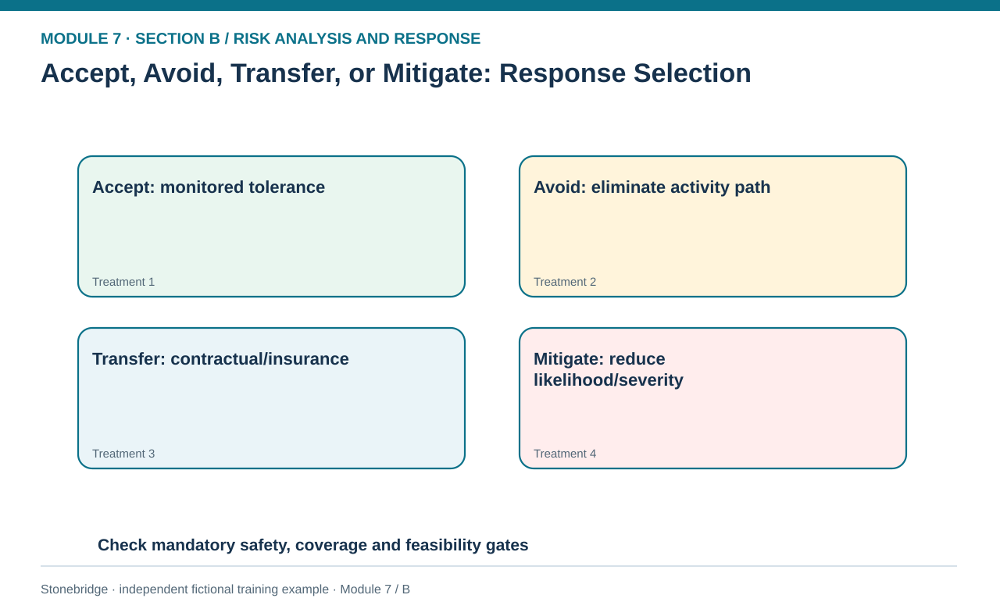
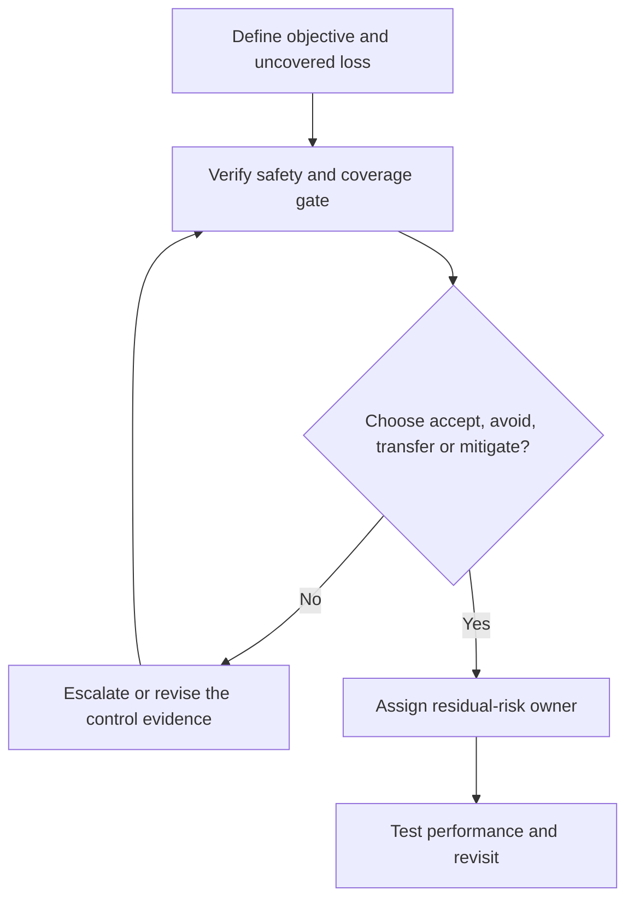

# 09. Accept, Avoid, Transfer, or Mitigate: Response Selection

> **Fictional case context:** Stonebridge Industrial Components is used here to examine **accept avoid transfer mitigate and response selection**. Any numeric values and policy thresholds describe this illustrative scenario, not observed industry performance or a universal certification rule.

## Learning objectives

After this lesson, you should be able to:

- distinguish four major threat treatments and their residual exposure.
- identify when insurance is a financing response rather than an operational recovery plan.
- choose response category only after mandatory control and evidence gates.

## Concept in plain English

Risk treatment begins with the threat's relationship to the organization's objectives and its appetite for exposure. Acceptance means a deliberate decision to retain risk, typically because it is tolerable, poorly actionable or more expensive to reduce than the value protected. Acceptance is not an excuse to leave an ownerless item in the register. The owner documents residual exposure, threshold, contingency and review date. Avoidance changes or cancels an activity so that a particular loss path no longer exists—for example, discontinuing a hazardous production step after engineering validation.

Transfer shifts specified financial responsibility or obligations to another party, often through contracts, insurance or a service arrangement. It does not necessarily transfer the interruption, injured worker, angry customer or reputational harm. Policy exclusions, limits, deductibles, counterparties and claims evidence must be understood before assuming the residual cash loss is low. Mitigation aims to reduce the event likelihood, its impact, or both through redundancy, preventive controls, quality checks and tested recovery options. Most material exposures will combine techniques.

For opportunities, treatment terminology can differ: pursue, enhance, share or accept positive uncertainty rather than mechanically applying negative-threat labels. Module 7 focuses mainly on managing downside supply-chain disruptions. A control choice is not a once-and-done classification. It is a governed action with expected effectiveness, funding, ownership, monitoring and authority. Where a safety, legal or security requirement exists, it is tested **before** an option's expected cost is compared.

## Why it matters

Labels are frequently confused in executive meetings. A cyber policy may transfer some insured loss yet leave the manufacturer without systems. A secondary plant can mitigate interruption without eliminating the triggering weather. Correct classification leads to realistic residual-risk accountability.

## Decision model and workflow

**Decision illustrated:** Labels are frequently confused in executive meetings. The visual highlights the relevant gate or causal connection; it does not imply that the fictional inputs are real disruption statistics.

### Evidence retained through the workflow

| Source field in the fictional training worksheet | Why it belongs in this decision |
| --- | --- |
| `risk_id` | Establish the exact object or decision instance before evaluating **accept, avoid, transfer, or mitigate: response selection**. |
| `method` | Confirm the event context, measurement basis, or resource status that changes this particular control decision. |
| `eligibility_gate` | Test whether the assumed input supports the required decision: identify when insurance is a financing response rather than an operational recovery plan. |
| `condition` | Preserve the operating constraint and response: Retain an accountable owner for residual harm after any transfer. |

## Practical process flow

## Realistic example — Stonebridge Industrial Components

In the [fictional risk-response methods register](../../assets/data/module-7/risk-response-methods.csv), R7-11 is assigned mitigation contingent on an approved alternate supplier. R7-12 proposes an engineering avoidance path that cannot operate without safety testing. R7-13 includes potential insurance transfer only after policy wording and insurer confirmation. R7-14 accepts limited demand variability subject to approved service tolerance. These are decision records, not blanket endorsements of any single treatment method.

## Applied decision artifact or worked calculation

Create a response-selection worksheet listing event ID, current exposure, proposed method, effect on probability, effect on conditional severity, uncovered losses, feasibility gate, owner and next review. For an insurance-only route, explicitly separate covered financial compensation from the unchanged physical service delay. For avoidance, verify that the alternative process does not introduce a more severe unassessed hazard.

## Decision logic

- Define the specific exposure being accepted, eliminated, transferred or reduced.
- Verify insurance exclusions and other contractual protections with competent internal owners.
- Retain an accountable owner for residual harm after any transfer.
- Select methods against binding service, security, compliance and personnel-safety constraints.

## Trade-offs

| Tension | Decision implication |
| --- | --- |
| Accept an exposure | Conserves budget but requires a formal tolerance and escalation trigger. |
| Transfer financial impact | Can smooth losses yet creates premium, coverage and counterparty dependencies. |
| Avoid an activity | May remove one risk while giving up revenue, capacity or customer value. |

## Commonly confused with

**Avoidance** removes a particular risk-bearing pathway; **mitigation** reduces its chance or consequences. **Transfer** can redistribute financial liability but does not automatically eliminate physical exposure. A response may combine multiple techniques; the register should state which loss portion remains.

## Common mistakes

- Claiming that insurance makes system downtime impossible.
- Accepting an exposure without explicit owner and review criteria.
- Assuming a supplier indemnity resolves customer-service and brand damage.

## Original knowledge check

**Question.** A company purchases business interruption insurance but has no alternate transport route. What response description is most accurate?

A. All transport risk has been avoided

B. Specified financial effects may be transferred, while physical delay remains

C. The insurance necessarily reduces the probability of lane closure

D. The event is now guaranteed to be below every risk threshold

Answer and rationale

### Correct answer

**B. Specified financial effects may be transferred, while physical delay remains**

### Why it is correct

Correct: contract coverage and operational continuity are distinct.

### Why the other answers are wrong

- **A.** The physical lane is still exposed.
- **C.** Buying a policy does not directly prevent the initiating event.
- **D.** Coverage wording and uncovered effects require explicit review.

## Practitioner perspective

Use an 'uncovered consequence' field. It forces the business to confront production downtime, customer defection, environmental harm and liability rather than treating a transfer contract as proof of resilience.

## Related concepts

- [03 Sourcing Strategy Product Design Supplier Execution](../../03-sourcing-strategy-product-design-supplier-execution/README.md)
- [06 Supply Chain Relationships](../../06-supply-chain-relationships/README.md)

---

[Previous: Lesson 08](./08-simulation-monte-carlo-and-model-validation.md) · [Section overview](./README.md) · [Next: Lesson 10](./10-risk-response-plans-ownership-and-register-controls.md)
