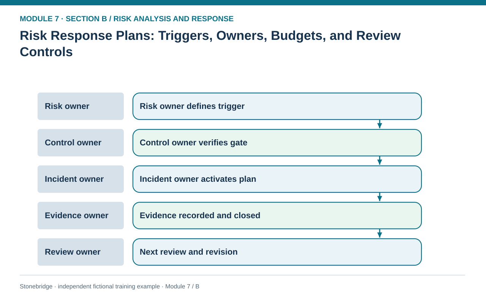
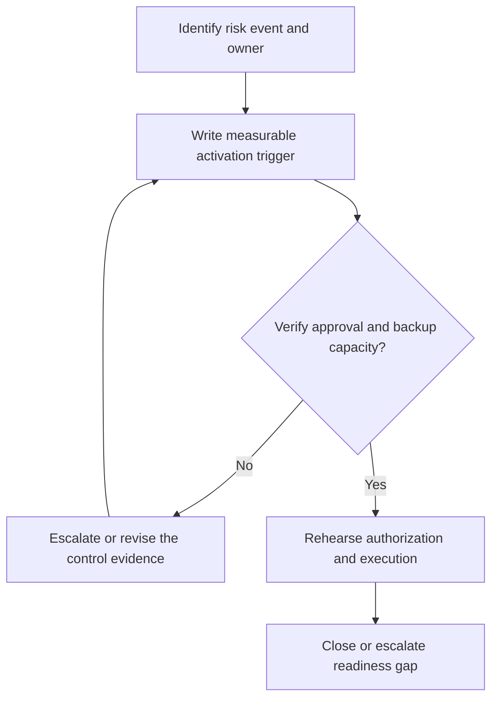

# 10. Risk Response Plans: Triggers, Owners, Budgets, and Review Controls

> **Fictional case context:** Stonebridge Industrial Components is used here to examine **risk response plans ownership and register controls**. Any numeric values and policy thresholds describe this illustrative scenario, not observed industry performance or a universal certification rule.

## Learning objectives

After this lesson, you should be able to:

- translate risk assessments into executable response records.
- assign preventive, contingent and verification responsibility separately.
- specify triggers, dates, resources and status to keep response plans actionable.

## Concept in plain English

A risk register says what might happen; a response plan says who does what when the situation changes. A meaningful plan is operational rather than aspirational. It identifies the event and root cause, evidence that signals escalation, preventive steps, contingent steps, responsible people, authorized expenditures, decision rights and expiry or next-review date. The plan should explain the intervention's intended effect on likelihood or damage and what evidence would show the intervention worked.

One person cannot always own every aspect of a crisis. A risk owner can be accountable for the overall exposure while a plant engineer owns a hard safety gate, procurement owns alternate supply, and customer service owns external commitments. Preventive work may happen over months, but a contingent response must be callable in hours. The organization needs clear authorization for safety shutdowns, emergency freight, controlled manual planning and communication to major customers. A phone tree without decision rights is not a response plan.

The state of a plan also matters. 'Written' does not mean 'ready'. An alternate supplier that lacks quality approval is a candidate, not an executable recovery capacity. A transport backup without confirmed carrier space is not a usable contingency. Status should therefore distinguish proposed, approved, tested, conditionally ready, activated and closed, with the evidence retained for each transition. Outdated contact lists and unreviewed dependencies can make a detailed document fail during its first real use.

## Why it matters

An executive may approve safety stock on paper while operations assumes a supplier has been qualified. The response-plan gate makes the missing quality release visible before a disruption and prevents an invalid workaround during a crisis.

## Decision model and workflow

**Decision illustrated:** An executive may approve safety stock on paper while operations assumes a supplier has been qualified. The visual highlights the relevant gate or causal connection; it does not imply that the fictional inputs are real disruption statistics.

### Evidence retained through the workflow

| Source field in the fictional training worksheet | Why it belongs in this decision |
| --- | --- |
| `risk_id` | Establish the exact object or decision instance before evaluating **risk response plans: triggers, owners, budgets, and review controls**. |
| `action_id` | Confirm the event context, measurement basis, or resource status that changes this particular control decision. |
| `trigger` | Test whether the assumed input supports the required decision: assign preventive, contingent and verification responsibility separately. |
| `preventive_owner` | Preserve the operating constraint and response: Apply quality, safety, legal and customer-priority gates before declaring a route ready. |

## Practical process flow

## Realistic example — Stonebridge Industrial Components

Stonebridge's R7-11 plan activates when open chip orders exceed 14 days. Procurement owns prevention, operations owns emergency deployment, and quality must approve alternate material before production release. R7-13 has an eight-hour target to activate logistics alternatives, but its current status says carrier capacity is unconfirmed. The honest readiness status is not yet 'tested ready'.

## Applied decision artifact or worked calculation

The response-plan CSV contains trigger, owner, authorization gate, planned activation time, status and next review. Expand it during exercises with backup owner, contract reference, contact confirmation timestamp, actual activation result and unresolved deviations. A response plan should preserve the old version when a trigger or owner changes, because auditability matters during claims and post-incident analysis.

## Decision logic

- Assign named primary and backup owners for prevention, activation and verification.
- Define specific measurable triggers, not vague statements such as “when necessary.”
- Apply quality, safety, legal and customer-priority gates before declaring a route ready.
- Rehearse activation and capture actual response time against target.

## Trade-offs

| Tension | Decision implication |
| --- | --- |
| Detailed plan | Clarifies dependencies but creates upkeep burden. |
| Short crisis checklist | Works under pressure but only if supporting roles and decisions were prepared beforehand. |

## Commonly confused with

A **risk register** tracks assessed exposures; a **risk response plan** governs the selected actions and their activation; a **business continuity plan** coordinates recovery across interdependent activities at a predefined minimum service level. They must refer to common IDs without being treated as identical documents.

## Common mistakes

- Marking an unqualified alternative supplier as available.
- Defining a response without a named backup owner or financial authority.
- Failing to retire expired phone numbers, contract assumptions and carrier capacity claims.

## Original knowledge check

**Question.** A backup route is documented but its carrier has not confirmed capacity. What is its proper readiness interpretation?

A. Conditionally planned, not yet a verified executable contingency

B. Ready for full activation because a route map exists

C. Completed because the logistics owner is named

D. Removed from the risk register entirely

Answer and rationale

### Correct answer

**A. Conditionally planned, not yet a verified executable contingency**

### Why it is correct

Correct: execution requires verified availability and relevant approvals.

### Why the other answers are wrong

- **B.** A map does not prove capacity or operational authorization.
- **C.** Ownership is necessary but not proof of readiness.
- **D.** The unresolved exposure must remain tracked.

## Practitioner perspective

Connect each risk plan to evidence already owned by purchasing, IT, quality, transport or customer service. The response owner integrates this evidence; the risk function should not duplicate each source system.

## Related concepts

- [04 Internal Operations Inventory](../../04-internal-operations-inventory/README.md)
- [05 Forward Reverse Logistics](../../05-forward-reverse-logistics/README.md)
- [06 Supply Chain Relationships](../../06-supply-chain-relationships/README.md)

---

[Previous: Lesson 09](./09-accept-avoid-transfer-mitigate-and-response-selection.md) · [Section overview](./README.md) · [Next: Lesson 11](./11-preventive-versus-contingent-actions-and-response-economics.md)
