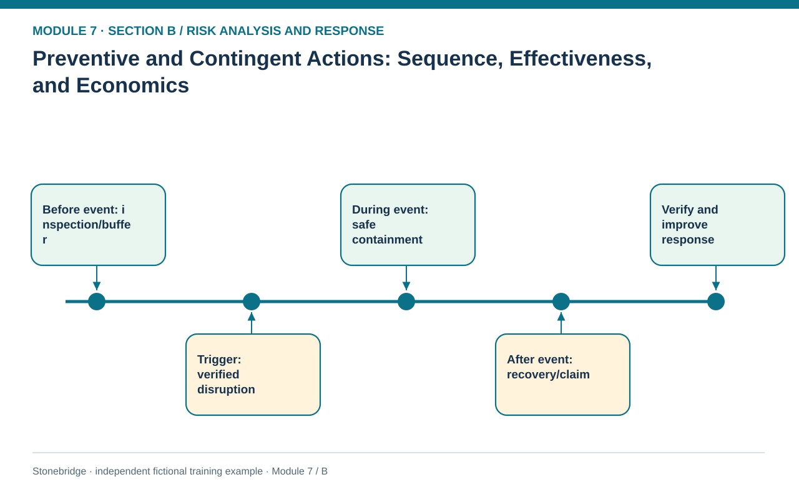
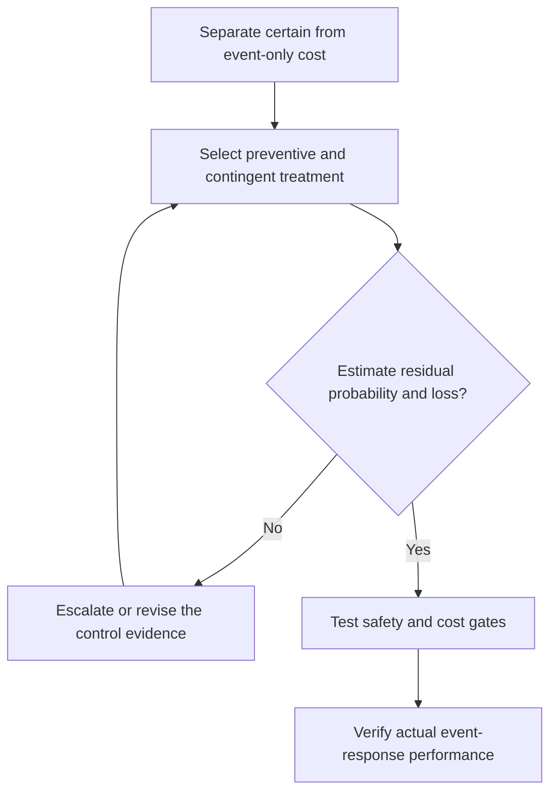

# 11. Preventive and Contingent Actions: Sequence, Effectiveness, and Economics

> **Fictional case context:** Stonebridge Industrial Components is used here to examine **preventive versus contingent actions and response economics**. Any numeric values and policy thresholds describe this illustrative scenario, not observed industry performance or a universal certification rule.

## Learning objectives

After this lesson, you should be able to:

- differentiate action before versus after disruption activation.
- compare prevention and contingency as complementary mechanisms.
- calculate a one-year expected-cost comparison with unconditional versus conditional spending.

## Concept in plain English

Prevention acts before a harmful event to reduce its likelihood or conditional damage. Examples include inspection, alternate-source approval, critical-system patching, route diversity and appropriate buffers. Contingency acts during or after an event: divert an order, switch to qualified equipment, apply an approved allocation protocol or execute a disaster-recovery procedure. Contingency is not merely a plan to be written; it must be practiced so the organization knows how to activate it safely and on time.

The economic treatment follows the timing. An annual inspection expense occurs in both disruption and no-disruption years. An event-triggered expedite or recovery payment occurs only if the event happens. For the simplified one-event model, total expected annual cost equals the certain preventive fee plus probability multiplied by the contingent conditional recovery cost. If the contingency requires a standing annual retainer or a guaranteed reserved vehicle, that retainer is certain and must be added outside the probability term. Conversely, an occurrence-only vendor call-out charge belongs in the conditional loss.

Prevention and contingency should not be framed as mutually exclusive where the risk appetite demands both. A preventive control may fail; a contingency may also have activation limits. The response plan should test preventive efficacy using observed signals and recovery efficacy using drills, quality approvals, RTO checks and reliable information. A simple average-value economic comparison cannot compensate for a failed life-safety or mandatory security gate.

## Why it matters

Stonebridge's critical process can suffer interruption even with preventive inspection. Management needs a funded response that reduces expected loss **and** a practicable safe-work plan for the remaining disruption. Counting only the low frequency from prevention and omitting recovery readiness understates risk.

## Decision model and workflow

**Decision illustrated:** Stonebridge's critical process can suffer interruption even with preventive inspection. The visual highlights the relevant gate or causal connection; it does not imply that the fictional inputs are real disruption statistics.

### Evidence retained through the workflow

| Source field in the fictional training worksheet | Why it belongs in this decision |
| --- | --- |
| `strategy` | Establish the exact object or decision instance before evaluating **preventive and contingent actions: sequence, effectiveness, and economics**. |
| `annual_preventive_cost_usd` | Confirm the event context, measurement basis, or resource status that changes this particular control decision. |
| `event_probability` | Test whether the assumed input supports the required decision: compare prevention and contingency as complementary mechanisms. |
| `conditional_recovery_cost_usd` | Preserve the operating constraint and response: Apply protection policy and safety requirements before economic ranking. |

## Practical process flow

## Realistic example — Stonebridge Industrial Components

The fictional worksheet models an untreated annual event probability of 20% with $140,000 conditional loss, or $28,000 expected annual loss. A combined inspection/buffer control costs $10,000 each year, reduces probability to 10%, and leaves $120,000 conditional loss, totaling `$10,000 + 0.10×$120,000 = $22,000`. A recovery-only package costs $3,000 annually plus expected 20% of $120,000, totaling $27,000. The untreated alternative fails an invented protection-policy gate; the combined option has the lowest eligible modeled total.

## Applied decision artifact or worked calculation

The [fictional preventive-versus-contingency control worksheet](../../assets/data/module-7/preventive-contingency-model.csv) separates standing preventive commitments from event-triggered recovery costs. Record prevention cost, changed event probability, residual loss, event-triggered response obligations, mandatory gates, and effective date. Then separately log the actual contingency drill, including whether the recovery owner met the activation threshold. Do not infer preventive effectiveness from an absence of incidents over an unrepresentative short period.

## Decision logic

- Treat standing preventive costs as certain and incident-only costs as conditional.
- Verify that recovery measures are usable under the same triggering event.
- Apply protection policy and safety requirements before economic ranking.
- Retest both detection and recovery timing after material process changes.

## Trade-offs

| Tension | Decision implication |
| --- | --- |
| Spend on prevention | Can reduce frequency but sometimes creates continuing budget commitments. |
| Spend on recovery | May limit conditional harm, but response time and activation reliability remain critical. |

## Commonly confused with

A **preventive action** reduces exposure before an event; **contingent action** is activated when the event materializes. Corrective action following a loss may prevent recurrence, but it should not be retrospectively labeled as a preventive control for that occurrence.

## Common mistakes

- Multiplying the annual inspection fee by the probability of an incident.
- Counting safety stock as the only continuity mechanism.
- Assuming a checklist proves an emergency team can activate within its recovery target.

## Original knowledge check

**Question.** A preventive control costs $10,000 per year and reduces event probability to 10%, with $120,000 conditional loss. What is total expected annual cost?

A. $12,000

B. $10,000

C. $22,000

D. $1,000

Answer and rationale

### Correct answer

**C. $22,000**

### Why it is correct

Correct: $10,000 + 0.10 × $120,000 = $22,000.

### Why the other answers are wrong

- **A.** This omits the certain annual control expense.
- **B.** This ignores residual losses when the control fails.
- **D.** This discounts the annual control fee incorrectly and omits most losses.

## Practitioner perspective

Make spending basis explicit in procurement and finance extracts. A reserved recovery contract, an annual retainer and a per-incident activation fee have different expected-cost treatment despite appearing under one supplier name.

## Related concepts

- [02 Network Design Digital Connectivity Performance](../../02-network-design-digital-connectivity-performance/README.md)
- [04 Internal Operations Inventory](../../04-internal-operations-inventory/README.md)

---

[Previous: Lesson 10](./10-risk-response-plans-ownership-and-register-controls.md) · [Section overview](./README.md) · [Next: Lesson 12](./12-strategic-supply-chain-and-network-concentration-risk.md)
