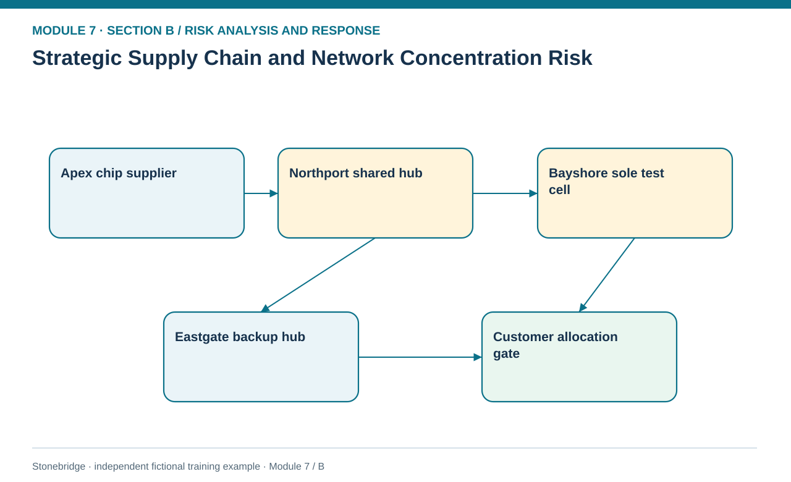
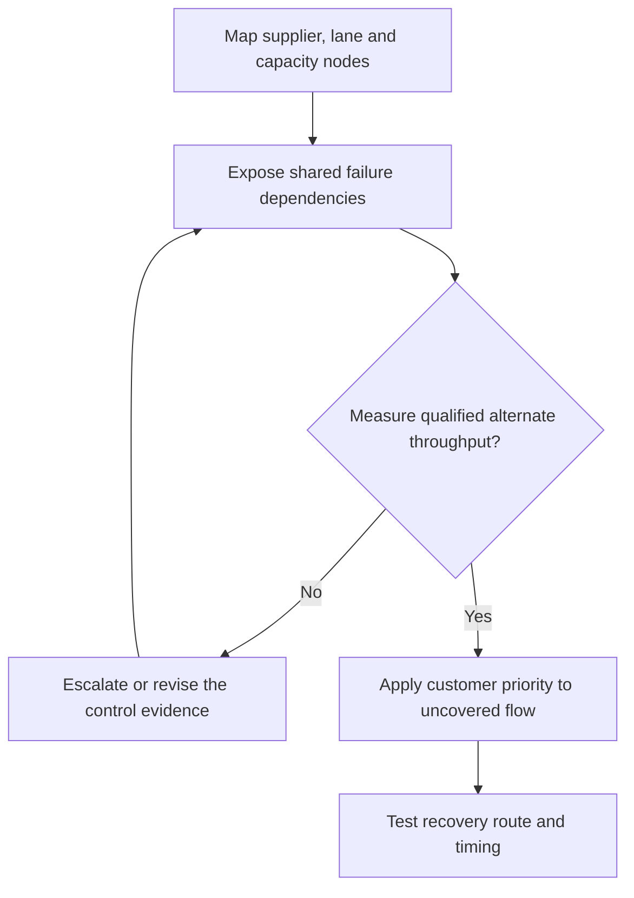

# 12. Strategic Supply Chain and Network Concentration Risk

> **Fictional case context:** Stonebridge Industrial Components is used here to examine **strategic supply chain and network concentration risk**. Any numeric values and policy thresholds describe this illustrative scenario, not observed industry performance or a universal certification rule.

## Learning objectives

After this lesson, you should be able to:

- identify critical nodes and common-cause dependencies in a network.
- compare resilience through alternate capacity, recovery time and qualification.
- define continuity decisions without duplicating network optimization.

## Concept in plain English

Strategic supply-chain risk arises when the design of the overall network creates excessive dependence on a location, source, process or information service. Cost-minimizing a network can concentrate flow through highly utilized assets and reduce flexibility exactly when a disruption occurs. This is not an argument for universal duplication. The decision is to understand which critical capabilities need redundancy, which can recover quickly, which can be redesigned, and which depend on common infrastructure that may fail together.

A map that connects suppliers to production and customer lanes should include production qualification and transferable capacity, not merely geography. An alternate plant that cannot test the specified control product is not genuinely available; a second freight node with the same upstream bridge offers little protection from the bridge failure. Resilience options might include geographically independent distribution, common component substitution, flexible process routing, qualified backup capacity, cross-docking contracts and revised customer allocation rules.

A strategic decision considers more than the cost of the backup. It tests service impact, activation lead time, sunk tooling, demand volatility, cross-border constraints and correlated hazards. The objective is acceptable end-to-end recovery, not necessarily the most inventory or the most suppliers. Redundancy can help resilience while increasing capital requirements, carrying cost and coordination complexity. The decision should therefore specify target service, critical event, tested response capacity, economic cost and conditions for retiring or increasing protection.

## Why it matters

Northport is attractive because it consolidates cargo cheaply, but it also carries both a critical inbound chip flow and outbound finished controllers. Without that dependency map, separate purchasing and logistics teams each assume another function has handled continuity.

## Decision model and workflow

**Decision illustrated:** Northport is attractive because it consolidates cargo cheaply, but it also carries both a critical inbound chip flow and outbound finished controllers. The visual highlights the relevant gate or causal connection; it does not imply that the fictional inputs are real disruption statistics.

### Evidence retained through the workflow

| Source field in the fictional training worksheet | Why it belongs in this decision |
| --- | --- |
| `node` | Establish the exact object or decision instance before evaluating **strategic supply chain and network concentration risk**. |
| `role` | Confirm the event context, measurement basis, or resource status that changes this particular control decision. |
| `flows_units_week` | Test whether the assumed input supports the required decision: compare resilience through alternate capacity, recovery time and qualification. |
| `dependency` | Preserve the operating constraint and response: Specify temporary customer priority when backup capacity is lower than demand. |

## Practical process flow

## Realistic example — Stonebridge Industrial Components

The fictional network table shows Northport serving 800 units per week. Eastgate has a 450-unit *facility* capacity, but only 400 units of backup lane throughput is validated in the specific Northport contingency. Even if Eastgate operates independently, the backup cannot instantly replace an 800-unit flow. Management must define priority customers and maximum sustainable throughput and verify the alternate carrier's capacity before claiming the network is resilient.

## Applied decision artifact or worked calculation

Maintain a critical-node worksheet with node, weekly flow, unique capability, shared dependency, eligible alternate, verified weekly alternate capacity, estimated restore time and acceptance gate. If the primary 800-unit flow fails and a verified backup can handle 400 units, the initial uncovered capacity is **400 units per week** before inventory buffers or demand curtailment. The capacity gap is an operational planning measure, not an annual probability.

## Decision logic

- Identify infrastructure common causes across nominally different alternatives.
- Treat qualified alternate throughput as the usable protective capacity.
- Specify temporary customer priority when backup capacity is lower than demand.
- Link network redesign proposals to Module 2 rather than rebuilding optimization theory here.

## Trade-offs

| Tension | Decision implication |
| --- | --- |
| High utilization | Reduces unit cost but leaves little emergency slack. |
| Independent backup | Improves resilience but adds operating and qualification expense. |

## Commonly confused with

**Redundancy** means more available capability; **independence** means those capabilities do not fail for the same reason. Two warehouses with a shared server and one transport bridge may be redundant on paper but not independent in practice.

## Common mistakes

- Calling an alternate plant available despite missing product qualification.
- Ignoring an inbound/outbound logistics hub used by multiple partners.
- Claiming protection of all 800 units when the tested backup handles only half.

## Original knowledge check

**Question.** A primary hub carries 800 units weekly and a verified backup can handle 400. With no usable buffer, how much weekly flow remains uncovered?

A. 0 units

B. 200 units

C. 800 units

D. 400 units

Answer and rationale

### Correct answer

**D. 400 units**

### Why it is correct

Correct: 800−400 = 400 weekly units require another decision.

### Why the other answers are wrong

- **A.** Backup capacity is below original flow.
- **B.** No data supports this number.
- **C.** This ignores the qualified backup capacity.

## Practitioner perspective

Escalate strategic network choices through the integrated planning and risk forum: procurement sees supply continuity, logistics sees alternate lanes, operations sees qualified processing, and sales owns prioritization commitments.

## Related concepts

- [02 Network Design Digital Connectivity Performance](../../02-network-design-digital-connectivity-performance/README.md)
- [05 Forward Reverse Logistics](../../05-forward-reverse-logistics/README.md)
- [06 Supply Chain Relationships](../../06-supply-chain-relationships/README.md)

---

[Previous: Lesson 11](./11-preventive-versus-contingent-actions-and-response-economics.md) · [Section overview](./README.md) · [Next: Lesson 13](./13-supply-availability-quality-and-lead-time-response-plans.md)
