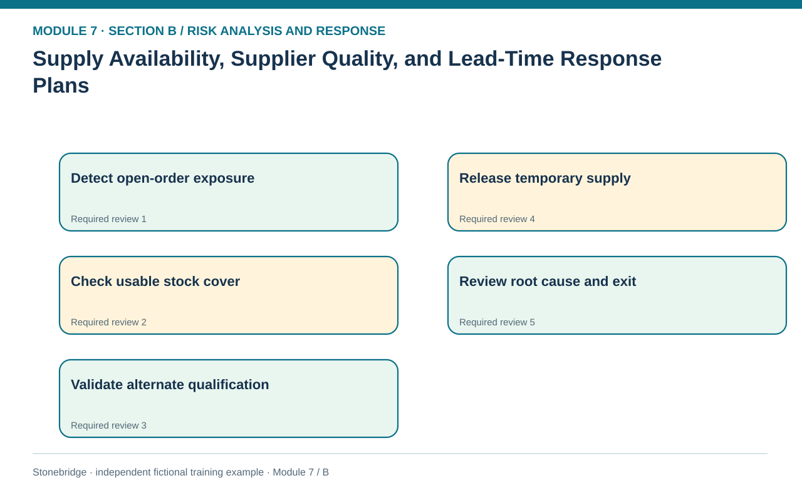
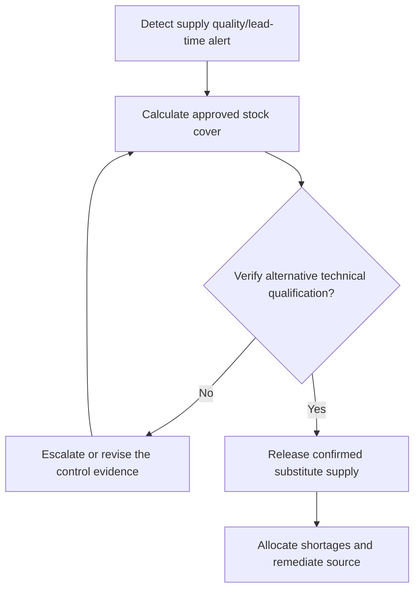

# 13. Supply Availability, Supplier Quality, and Lead-Time Response Plans

> **Fictional case context:** Stonebridge Industrial Components is used here to examine **supply availability quality and lead time response plans**. Any numeric values and policy thresholds describe this illustrative scenario, not observed industry performance or a universal certification rule.

## Learning objectives

After this lesson, you should be able to:

- assess supply cover using usable inventory and demand rates.
- distinguish approved alternate sourcing from an unqualified candidate.
- coordinate continuity controls with supplier quality and relationship owners.

## Concept in plain English

Supply interruption is more than a late purchase order. Material can be nominally in inventory yet unavailable due to quarantine, insufficient shelf life, unresolved provenance, wrong engineering revision or the absence of a required customer approval. Qualified cover should therefore use only usable on-hand stock and realistic consumption. A supplier's assertion that it could double production is not a confirmed capacity commitment without process capability, allocation, lead time and contractual verification.

Preventive controls include supplier financial or capacity monitoring, quality audits, alternative approvals, practical inventory buffers, flexible specifications and joint risk reviews. The contingent response might be controlled customer allocation, order expediting, substitute component qualification, prioritization of critical maintenance parts or rerouting through an independent lane. Procurement owns the commercial supplier decision, while engineering and quality must own technical release. Response urgency must never force unauthorized material substitutions into production.

The resilience decision also depends on how long an alternate becomes usable. A second vendor requiring 42 days to qualify cannot replace material tomorrow, even if its quoted unit price is attractive. Cover days and qualification timing should be compared against expected demand, not against loosely defined lead times. Supplier diversification itself can create new complexity and weaker oversight; risks are reduced only when the alternative is independently capable and can meet the authorized product requirements.

## Why it matters

A supplier can be financially secure yet fail to deliver because a quality process collapses. Conversely, a late shipment may have no customer impact when genuinely usable inventory covers the interruption. Evaluating these conditions together prevents both unnecessary panic and risky substitution.

## Decision model and workflow

**Decision illustrated:** A supplier can be financially secure yet fail to deliver because a quality process collapses. The visual highlights the relevant gate or causal connection; it does not imply that the fictional inputs are real disruption statistics.

### Evidence retained through the workflow

| Source field in the fictional training worksheet | Why it belongs in this decision |
| --- | --- |
| `supplier` | Establish the exact object or decision instance before evaluating **supply availability, supplier quality, and lead-time response plans**. |
| `part` | Confirm the event context, measurement basis, or resource status that changes this particular control decision. |
| `weekly_demand_units` | Test whether the assumed input supports the required decision: distinguish approved alternate sourcing from an unqualified candidate. |
| `available_usable_stock_units` | Preserve the operating constraint and response: Compare inventory cover against qualification and delivery lead-time requirements. |

## Practical process flow

## Realistic example — Stonebridge Industrial Components

Stonebridge's fictional CT-7 controller component consumes 120 units each week and has 240 usable stock units, giving exactly **2 weeks of cover** before other receipts. Apex has no approved alternative capacity. Nova could provide 80 units per week but has conditional lab approval and requires 14 days for qualification. Nova must not be counted as released supply until its quality gate closes; after approval it covers two-thirds of ordinary weekly demand, leaving a 40-unit weekly gap without another action.

## Applied decision artifact or worked calculation

The continuity worksheet includes part, weekly consumption, usable stock, approval state, qualification days, confirmed alternate weekly output, contracted lead time and escalation. Calculate cover as 240/120 = 2 weeks under constant-demand assumptions. Record how forecast surges and hold quantities would shorten that cover, and name the quality-release owner who can authorize activation.

## Decision logic

- Exclude quality-blocked inventory from usable protection.
- Verify alternate supplier approval and source independence before activation.
- Compare inventory cover against qualification and delivery lead-time requirements.
- Escalate unresolved gap through customer prioritization and documented contingency.

## Trade-offs

| Tension | Decision implication |
| --- | --- |
| Safety stock | Buys limited time but incurs cost and cannot cover indefinite failure. |
| Second-source qualification | Creates flexibility but takes engineering effort and may not remove shared infrastructure exposure. |

## Commonly confused with

**Single sourcing** chooses one supplier despite alternatives; **sole sourcing** means only one feasible supplier exists. Both can create exposure, but the plan to qualify another source differs. Supplier award mechanics remain in Module 3; Module 7 focuses on the disruption and the approved continuity response.

## Common mistakes

- Counting unqualified material as a viable substitute.
- Using total inventory rather than usable/approved stock to compute cover.
- Assuming alternate quoted volume is firm, timely capacity.

## Original knowledge check

**Question.** A part consumes 120 units weekly, has 240 usable units, and an alternate needs 14 days to qualify. What is the correct immediate interpretation?

A. Exactly two weeks of inventory cover, but alternate supply still requires approval

B. Four weeks of cover because qualification time adds protection

C. The alternate is ready because its quoted capacity is 80 units weekly

D. All supply risk is removed by the second supplier name

Answer and rationale

### Correct answer

**A. Exactly two weeks of inventory cover, but alternate supply still requires approval**

### Why it is correct

Correct: 240/120=2 weeks; conditional approval is a separate gate.

### Why the other answers are wrong

- **B.** Qualification delay consumes time rather than creating inventory.
- **C.** Quoted or conditional capacity is not released supply.
- **D.** Shared dependencies and capacity gaps remain to be assessed.

## Practitioner perspective

Risk teams should consume current supplier, QA, batch and purchasing evidence rather than estimating availability from vendor master records alone. Link any emergency substitution to controlled engineering and quality approval.

## Related concepts

- [03 Sourcing Strategy Product Design Supplier Execution](../../03-sourcing-strategy-product-design-supplier-execution/README.md)
- [04 Internal Operations Inventory](../../04-internal-operations-inventory/README.md)
- [06 Supply Chain Relationships](../../06-supply-chain-relationships/README.md)

---

[Previous: Lesson 12](./12-strategic-supply-chain-and-network-concentration-risk.md) · [Section overview](./README.md) · [Next: Lesson 14](./14-demand-volatility-forecast-and-service-risk-response.md)
