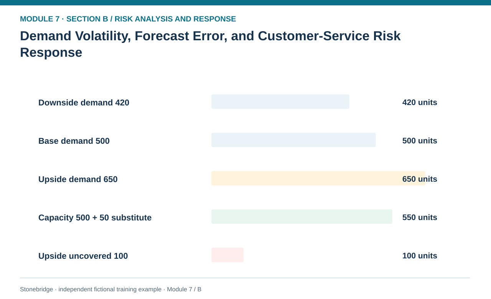
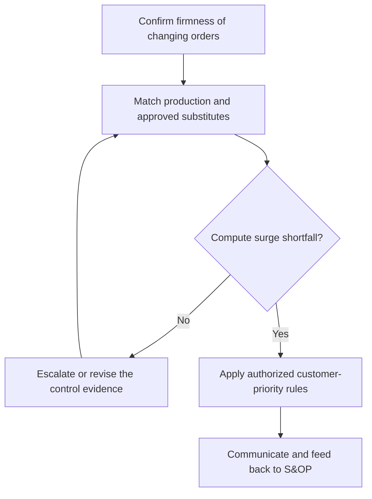

# 14. Demand Volatility, Forecast Error, and Customer-Service Risk Response

> **Fictional case context:** Stonebridge Industrial Components is used here to examine **demand volatility forecast and service risk response**. Any numeric values and policy thresholds describe this illustrative scenario, not observed industry performance or a universal certification rule.

## Learning objectives

After this lesson, you should be able to:

- differentiate statistical forecast error from a disruption-response trigger.
- calculate a bounded capacity shortfall under a demand surge.
- connect S&OP and customer prioritization to risk contingency without repeating forecasting.

## Concept in plain English

Demand uncertainty matters when it changes operating decisions, not merely when a forecasting dashboard shows a high error percentage. Ordinary prediction errors are handled by the demand-planning process. Module 7 considers the failure scenarios: unexpected demand spikes that exhaust constrained components, cancellations that strand perishable inventory, promotion changes that overload distribution, and customer-priority conflicts that make service promises incompatible with available capacity.

A sensible response separates demand sensing from the formal commitment decision. Orders, promotional commitments, returns and distributor signals may have different degrees of firmness. A sudden large order should not be automatically treated as permanent demand, nor should a weak forecast cause the business to violate an existing binding customer commitment. The organization can use S&OP escalation, authorized allocation, substitute products, postponement, customer consultation, short-term capacity and contingency freight. Every option must respect validated product fit and customer contract conditions.

The decision horizon is essential. A one-week spike may be absorbed through overtime but a sustained new run rate requires a different capacity and sourcing response. Analysts need to state whether the scenario counts confirmed orders or nonbinding leads and whether the available capacity includes recoverable downtime, approved substitutes and inventory already committed elsewhere. Customer recovery should be guided by documented strategic/service priorities instead of ad hoc intervention by whoever escalates loudest.

## Why it matters

If demand rises faster than a shared controller chip can be obtained, the same event propagates into inventory allocation, missed customer promises and premium transport cost. Coordinated risk response protects credibility without pretending that a revised forecast creates physical capacity.

## Decision model and workflow

**Decision illustrated:** If demand rises faster than a shared controller chip can be obtained, the same event propagates into inventory allocation, missed customer promises and premium transport cost. The visual highlights the relevant gate or causal connection; it does not imply that the fictional inputs are real disruption statistics.

### Evidence retained through the workflow

| Source field in the fictional training worksheet | Why it belongs in this decision |
| --- | --- |
| `case` | Establish the exact object or decision instance before evaluating **demand volatility, forecast error, and customer-service risk response**. |
| `confirmed_demand_units` | Confirm the event context, measurement basis, or resource status that changes this particular control decision. |
| `available_weekly_capacity_units` | Test whether the assumed input supports the required decision: calculate a bounded capacity shortfall under a demand surge. |
| `reliable_substitute_units` | Preserve the operating constraint and response: Apply approved customer priority and product substitution gates before promising recovery. |

## Practical process flow

## Realistic example — Stonebridge Industrial Components

Stonebridge's fictional weekly baseline demand is 500 units with 500 ordinary production capacity. In an upside case demand reaches 650. A reliably approved substitute offers 50 additional units, leaving `650 − 500 − 50 = 100 units` of weekly shortfall. The training alert is a confirmed OEM firm-order level above 550 units. This trigger starts allocation planning; it does not imply that every week will reach the upside case.

## Applied decision artifact or worked calculation

Maintain a demand scenario table with demand horizon, commitment firmness, approved supply and substitute units, shortage, priority rule and owner. Use a weekly dashboard that separately reports baseline forecast error and *risk-activation exceptions* when confirmed demand exceeds capacity. Review who can authorize offer changes, alternate products and customer notification.

## Decision logic

- Use verified demand signals and document which orders are binding.
- Compute shortage with qualified supply and already allocated stock only.
- Apply approved customer priority and product substitution gates before promising recovery.
- Send forecast-model improvement to Module 1 and keep disruption governance in Module 7.

## Trade-offs

| Tension | Decision implication |
| --- | --- |
| Rapid surge response | Protects service but can incur overtime and expedite cost. |
| Strict prioritization | Protects high-criticality commitments but may create dissatisfaction in deprioritized segments. |

## Commonly confused with

**Forecast error** is the difference between forecast and realized demand; a **demand risk trigger** is an agreed condition that requires protective action. Higher forecast accuracy can reduce exposure, but it cannot guarantee that every unforeseen demand surge will be prevented.

## Common mistakes

- Treating a promotional sales lead as firm, production-ready demand.
- Promising 650 units while counting only 550 qualifying units of output.
- Changing customer priority without contractual or governance approval.

## Original knowledge check

**Question.** Confirmed demand is 650 units, normal available output 500, and an approved substitute provides 50. What shortfall must the risk plan address?

A. 50 units

B. 100 units

C. 150 units

D. 0 units

Answer and rationale

### Correct answer

**B. 100 units**

### Why it is correct

Correct: 650−(500+50)=100 units.

### Why the other answers are wrong

- **A.** This ignores the amount above total usable supply.
- **C.** This ignores the approved substitute.
- **D.** The modeled demand exceeds approved output.

## Practitioner perspective

Retain a consistent bridge from independent customer demand to MPS/MRP evidence and contractual allocation. The risk team should not build a competing forecast system merely to manage an incident.

## Related concepts

- [01 Supply Chains Demand Forecasting](../../01-supply-chains-demand-forecasting/README.md)
- [04 Internal Operations Inventory](../../04-internal-operations-inventory/README.md)
- [06 Supply Chain Relationships](../../06-supply-chain-relationships/README.md)

---

[Previous: Lesson 13](./13-supply-availability-quality-and-lead-time-response-plans.md) · [Section overview](./README.md) · [Next: Lesson 15](./15-process-it-quality-capacity-and-operational-failure-responses.md)
