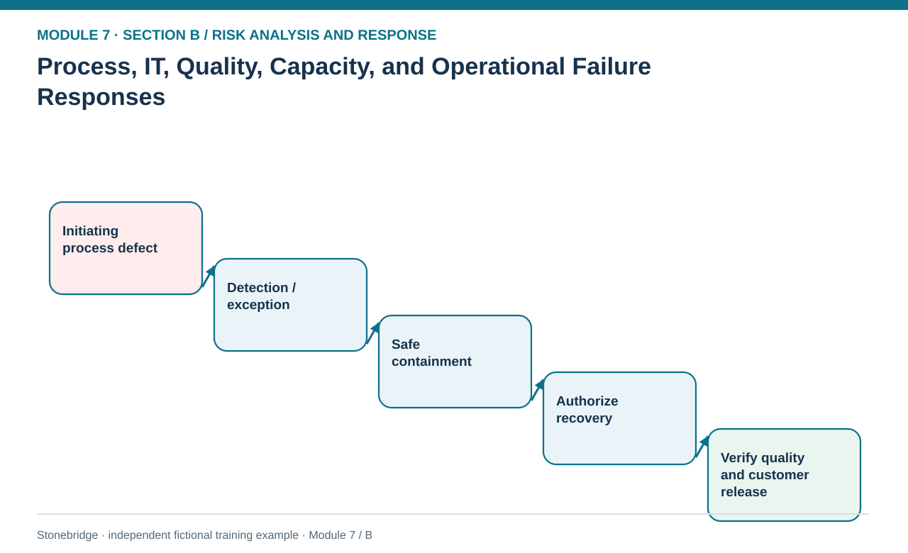
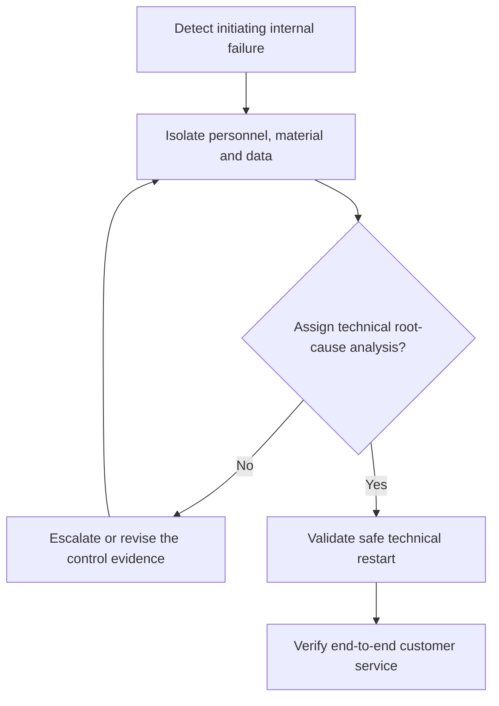

# 15. Process, IT, Quality, Capacity, and Operational Failure Responses

> **Fictional case context:** Stonebridge Industrial Components is used here to examine **process it quality capacity and operational failure responses**. Any numeric values and policy thresholds describe this illustrative scenario, not observed industry performance or a universal certification rule.

## Learning objectives

After this lesson, you should be able to:

- trace an internal failure through multiple supply-chain functions.
- distinguish technical root-cause repair from protective incident governance.
- apply release and access gates before restarting service.

## Concept in plain English

Internal risks include defective master data, equipment breakdown, system outages, quality escapes, poor change control, uncontrolled SKU proliferation and workforce skill gaps. These failures can create secondary supply and service risks that appear unrelated in separate functional reports. A bad BOM revision might increase component use, disrupt production capacity, create an apparent supplier shortage and eventually delay an OEM customer—all from one underlying specification problem.

The first control is detection: what evidence reliably distinguishes a true failure from an ordinary process variation? Production alarms, access logs, traceability records, inventory exceptions and customer complaints may each show part of the chain. The second control is containment, which protects people, product and information before anyone searches for a convenient workaround. Then the technical owner investigates root cause and validates corrective actions. A documented restart gate confirms that equipment, quality records, users and interfaces are safe and authorized.

Risk response governance complements, but does not replace, the technical disciplines taught elsewhere. Capacity planning and production control belong to Module 4; cybersecurity architecture to Module 2; customer issue management to Module 6. Module 7 integrates the possible cascade and manages residual loss, intervention authority, escalation and proof of recovery. A faster restart is not a success if it releases incorrect product or reconnects an untrusted system to the live plant.

## Why it matters

Local functional targets can make emergency workarounds attractive. Stonebridge needs a shared hierarchy: protect personnel and product, isolate the initiating fault, recover the critical business service, then reconcile orders and data. A service target is not permission to bypass validation.

## Decision model and workflow

**Decision illustrated:** Local functional targets can make emergency workarounds attractive. The visual highlights the relevant gate or causal connection; it does not imply that the fictional inputs are real disruption statistics.

### Evidence retained through the workflow

| Source field in the fictional training worksheet | Why it belongs in this decision |
| --- | --- |
| `failure_id` | Establish the exact object or decision instance before evaluating **process, it, quality, capacity, and operational failure responses**. |
| `initiating_condition` | Confirm the event context, measurement basis, or resource status that changes this particular control decision. |
| `propagated_effect` | Test whether the assumed input supports the required decision: distinguish technical root-cause repair from protective incident governance. |
| `detect_control` | Preserve the operating constraint and response: Require specific IT, engineering and quality approvals for restoration. |

## Practical process flow

## Realistic example — Stonebridge Industrial Components

The fictional process-failure path PF-02 begins with compromised remote access and leads to suspended production-schedule visibility. The proposed containment is isolated failover; restart is blocked until IT security authorizes reconnection. PF-01 involves a critical test rack and requires safety validation plus quality signoff before releasing controller batches. The two cases share the idea of staged release but require different accountable experts.

## Applied decision artifact or worked calculation

Use an incident propagation map: initiating condition, first detection, affected process, customer effect, interim containment, authorized recovery method, required evidence, control owner and recurrence trigger. Preserve event links across alarms, production orders and customer cases to avoid falsely multiplying the outage count.

## Decision logic

- Declare a single initiating incident ID and connect functional consequences.
- Use safe containment first, with clear stop-work authority.
- Require specific IT, engineering and quality approvals for restoration.
- Verify customer delivery, not only local IT or machine restart status.

## Trade-offs

| Tension | Decision implication |
| --- | --- |
| Fast manual workaround | May temporarily restore throughput but can weaken data integrity or traceability. |
| Controlled staged recovery | Takes longer but protects safety, product conformity and auditability. |

## Commonly confused with

**Containment** limits current harm; **corrective action** fixes causes; **preventive action** reduces future likelihood. A process owner may close the technical ticket while the customer commitment remains unmet, so risk recovery requires end-to-end confirmation.

## Common mistakes

- Reopening customer-facing service solely because the local system is online.
- Bypassing quality release because a work center has restarted.
- Treating repeated schedule exceptions from one outage as separate independent risks.

## Original knowledge check

**Question.** A test-cell failure is repaired, but the validation test has not passed. What should determine release of customer product?

A. A manager’s desire to meet weekly throughput

B. Receipt of a vendor invoice

C. The authorized safety and quality release gates

D. A reduced estimated downtime cost

Answer and rationale

### Correct answer

**C. The authorized safety and quality release gates**

### Why it is correct

Correct: controlled validation gates govern safe product release.

### Why the other answers are wrong

- **A.** Throughput targets do not override product and safety requirements.
- **B.** Commercial billing is not evidence of product suitability.
- **D.** Lower costs do not make unverified product compliant.

## Practitioner perspective

Carry incident traceability across MRP exceptions, quality holds, equipment logs and customer-order consequences. A single root event should not yield separate unrelated loss estimates just because ERP records reside in different processes.

## Related concepts

- [02 Network Design Digital Connectivity Performance](../../02-network-design-digital-connectivity-performance/README.md)
- [04 Internal Operations Inventory](../../04-internal-operations-inventory/README.md)
- [06 Supply Chain Relationships](../../06-supply-chain-relationships/README.md)

---

[Previous: Lesson 14](./14-demand-volatility-forecast-and-service-risk-response.md) · [Section overview](./README.md) · [Next: Lesson 16](./16-environmental-hazards-disasters-and-route-contingencies.md)
