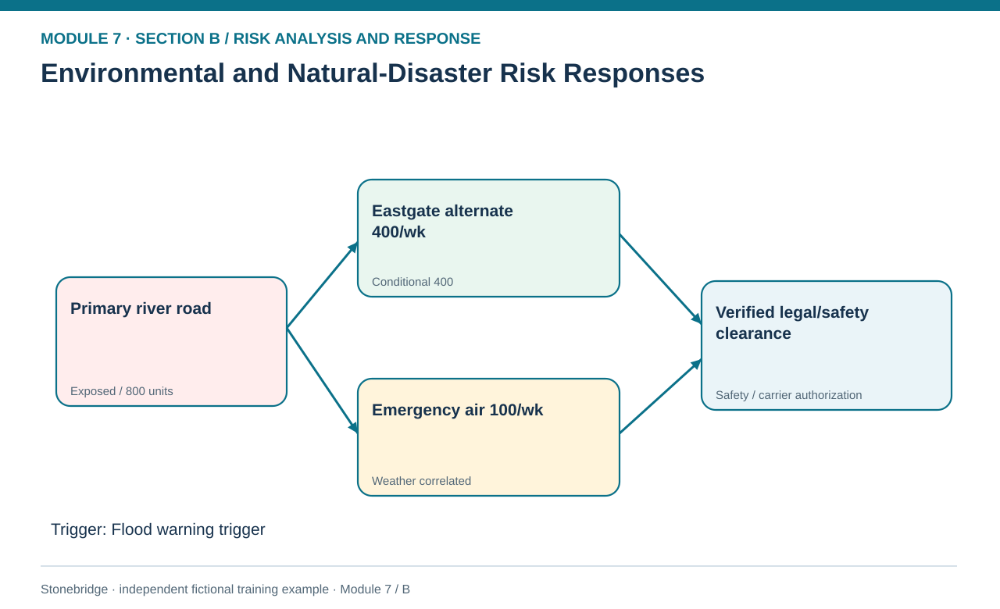
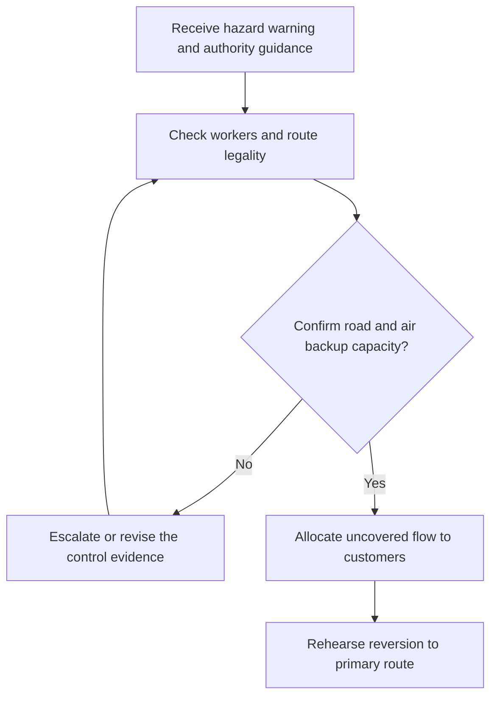

# 16. Environmental and Natural-Disaster Risk Responses

> **Fictional case context:** Stonebridge Industrial Components is used here to examine **environmental hazards disasters and route contingencies**. Any numeric values and policy thresholds describe this illustrative scenario, not observed industry performance or a universal certification rule.

## Learning objectives

After this lesson, you should be able to:

- distinguish long-term environmental obligations from short-term extreme-weather hazards.
- design a safe alternate-lane activation sequence.
- calculate realistic emergency route throughput and uncovered demand.

## Concept in plain English

Environmental and hazard categories overlap in everyday conversation but prompt different risk treatments. Emissions or waste compliance can require continuing monitoring, legal obligations and process redesign. Floods, windstorms, earthquakes and major fires are often acute disruption events that require facility and lane continuity. Both can damage supply, but the initiating causes, authority, evidence and permissible responses differ. An organization must not assume that an insurance payment restores physical movement or that rerouting automatically meets customs and safety conditions.

Preparedness begins before a weather alert. Logistics identifies exposed routes, alternative infrastructure and realistic capacity; facilities secures people and critical material; sourcing evaluates upstream geographic correlation; customer service prioritizes commitments. When a warning arrives, the event commander confirms route safety and authorities' restrictions before dispatch. Alternate freight may have less capacity, longer lead time or a different insurance profile. Emergency air freight can itself be disrupted by the same storm, making the paths less independent than their labels suggest.

A workable contingency includes activation triggers and backout conditions. It must say who can change a shipping route, how customer priority is decided, what quality or temperature requirements travel with the shipment, and what evidence shows the alternate can receive and dispatch freight. Plans should include testing for a two-node failure when the primary lane and emergency air network share weather exposure. The objective is maintaining minimum acceptable service, not simply moving cargo onto whichever route has available-looking space.

## Why it matters

Stonebridge's primary hub can be lost during heavy flooding just as supplier inbound and customer outbound demand peak. A purely geographical backup map can understate the true supply gap when alternate modes share weather dependencies or carrier capacity is not contracted.

## Decision model and workflow

**Decision illustrated:** Stonebridge's primary hub can be lost during heavy flooding just as supplier inbound and customer outbound demand peak. The visual highlights the relevant gate or causal connection; it does not imply that the fictional inputs are real disruption statistics.

### Evidence retained through the workflow

| Source field in the fictional training worksheet | Why it belongs in this decision |
| --- | --- |
| `lane` | Establish the exact object or decision instance before evaluating **environmental and natural-disaster risk responses**. |
| `scheduled_shipments_week` | Confirm the event context, measurement basis, or resource status that changes this particular control decision. |
| `storm_exposure` | Test whether the assumed input supports the required decision: design a safe alternate-lane activation sequence. |
| `potential_capacity_week` | Preserve the operating constraint and response: Model capacity and common-weather effects across alternatives. |

## Practical process flow

## Realistic example — Stonebridge Industrial Components

The invented route ledger shows a primary weekly shipment load of 800 units. Eastgate can potentially carry 400 units each week after capacity confirmation, and the proposed emergency air route can handle 100 but is marked weather correlated. If both alternatives are verified usable, capacity is 500 and the uncovered amount is 300 units weekly. If air service is unsafe or canceled, only 400 is qualified and the gap becomes 400.

## Applied decision artifact or worked calculation

Maintain a hazard-to-route matrix with warning source, authority restriction, primary and alternate throughput, customer priority, authorization, carrier confirmation, cargo constraints and next weather review. Show two explicit states—air eligible and air blocked—rather than counting the same 100 units in both. Put staff safety and route legal clearance ahead of cost optimization.

## Decision logic

- Distinguish compliance duties from acute hazard recovery triggers.
- Confirm public safety and route authority before emergency dispatch.
- Model capacity and common-weather effects across alternatives.
- Require customer allocation and communication when alternate throughput falls short.

## Trade-offs

| Tension | Decision implication |
| --- | --- |
| Flexible transport contracts | Buy option value but incur reservation and higher shipment cost. |
| Geographically separate contingency | Reduces correlated exposure but may extend transit times. |

## Commonly confused with

A **hazard warning** is an event trigger, not a known date of impact. **Environmental risk** can also involve ongoing regulatory, resource or pollution exposure. The same category term does not imply a single universal response method.

## Common mistakes

- Counting weather-correlated air freight as independent flood protection.
- Dispatching before route or cargo safety clearance.
- Claiming full recovery from 500 emergency units against an 800-unit weekly commitment.

## Original knowledge check

**Question.** Primary flow is 800 units per week. Verified road backup is 400; weather grounds proposed 100-unit emergency air. What is the remaining uncovered weekly flow?

A. 300 units

B. 100 units

C. 0 units

D. 400 units

Answer and rationale

### Correct answer

**D. 400 units**

### Why it is correct

Correct: 800−400 = 400 units per week.

### Why the other answers are wrong

- **A.** This incorrectly counts weather-blocked air capacity.
- **B.** No such protected total follows from the data.
- **C.** The approved backup is insufficient.

## Practitioner perspective

Link weather triggers to actual lanes, operating constraints, incident communications and customer commitments. Transportation planning itself remains Module 5; the risk lesson determines when the approved fallback is safe and economically warranted.

## Related concepts

- [05 Forward Reverse Logistics](../../05-forward-reverse-logistics/README.md)
- [02 Network Design Digital Connectivity Performance](../../02-network-design-digital-connectivity-performance/README.md)
- [06 Supply Chain Relationships](../../06-supply-chain-relationships/README.md)

---

[Previous: Lesson 15](./15-process-it-quality-capacity-and-operational-failure-responses.md) · [Section overview](./README.md) · [Next: Lesson 17](./17-hazard-security-people-and-safety-response-gates.md)
