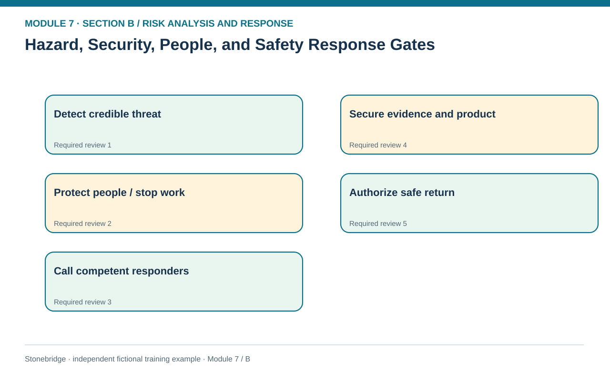
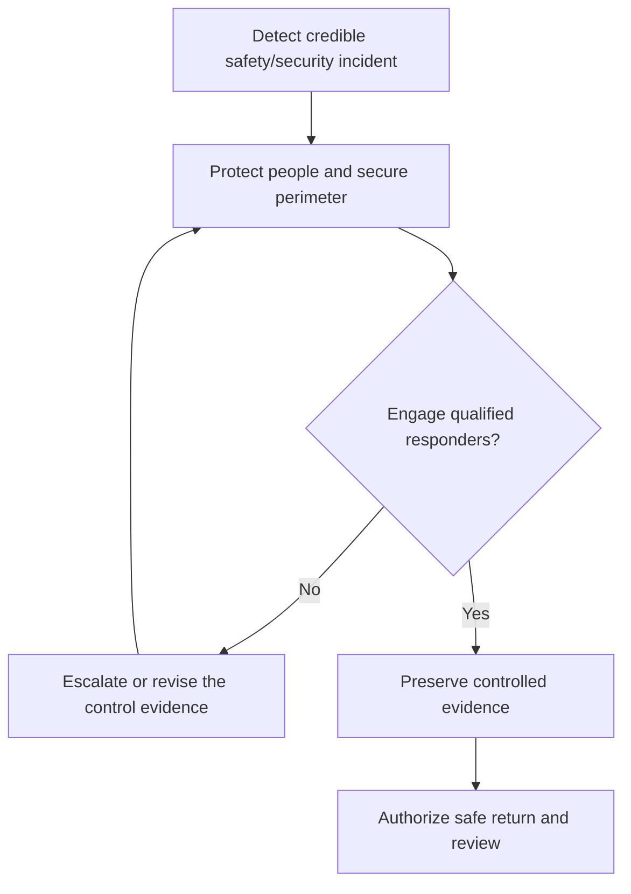

# 17. Hazard, Security, People, and Safety Response Gates

> **Fictional case context:** Stonebridge Industrial Components is used here to examine **hazard security people and safety response gates**. Any numeric values and policy thresholds describe this illustrative scenario, not observed industry performance or a universal certification rule.

## Learning objectives

After this lesson, you should be able to:

- identify when immediate life safety overrides economic scoring.
- separate incident response authority from normal operating performance management.
- preserve traceability and evidence when security or counterfeiting risks arise.

## Concept in plain English

Security and people risks include workplace violence, theft, sabotage, hazardous exposure, counterfeit material, abduction threats and workforce interruptions. Some call for facility controls, while others require external authorities or specialist responders. Their common feature is that the organization must establish life-safety and legal requirements before applying a cost trade-off. An exposure can be numerically unlikely and still demand an immediate stop-work or evacuation procedure. No weighted financial score can make an unapproved hazardous restart permissible.

The first response is proportionate, lawful protection. Employees should know how to report a threat, who has authority to secure a perimeter or evacuate, which emergency services are called and where the incident record is maintained. Investigations should preserve relevant evidence without asking untrained employees to handle suspicious materials, physically confront threats or make legal conclusions. Business managers must communicate essential facts to employees and affected partners through approved channels, respecting privacy and investigations.

People resilience also involves predictable operational disruption from absences, labor disputes, training weaknesses or high turnover. Cross-training, safe workforce capacity and reliable communication can reduce exposure. But substituting an untrained operator to keep a line moving can increase safety risk. Similarly, a counterfeit-component alert needs inventory quarantine and genealogy checks before any supply is released. A supplier's replacement promise may improve future continuity but does not validate material already received.

## Why it matters

A supply-chain disruption sometimes tempts teams to trade safety for customer service. A stable response protocol lets incident commanders stop unsafe work and escalate recovery without turning every crisis into a new negotiation about minimum protection.

## Decision model and workflow

**Decision illustrated:** A supply-chain disruption sometimes tempts teams to trade safety for customer service. The visual highlights the relevant gate or causal connection; it does not imply that the fictional inputs are real disruption statistics.

### Evidence retained through the workflow

| Source field in the fictional training worksheet | Why it belongs in this decision |
| --- | --- |
| `scenario` | Establish the exact object or decision instance before evaluating **hazard, security, people, and safety response gates**. |
| `mandatory_gate` | Confirm the event context, measurement basis, or resource status that changes this particular control decision. |
| `preventive_owner` | Test whether the assumed input supports the required decision: separate incident response authority from normal operating performance management. |
| `incident_commander` | Preserve the operating constraint and response: Preserve quality, custody and system-access evidence without prejudging an investigation. |

## Practical process flow

## Realistic example — Stonebridge Industrial Components

Stonebridge's invented scenario register identifies a warehouse intrusion, a hazardous plant leak and a possible counterfeit-controller alert. Each has a separate mandatory gate. The hazardous-leak plan calls for evacuation and trained responders. The counterfeit case requires quarantine and quality release, with serial and genealogy records retained. The executive risk committee cannot override technical and legal authorization simply by accepting an expected loss.

## Applied decision artifact or worked calculation

Create a gate checklist with signal, immediate protective owner, incident commander, stop-work criteria, safe return authorization, evidence trail, partner/customer notification and escalation. Record exercises separately from live incidents so practice response times are not misinterpreted as measured incident frequencies.

## Decision logic

- Prioritize worker and public safety over financial optimization.
- Use trained and authorized emergency responders for hazardous conditions.
- Preserve quality, custody and system-access evidence without prejudging an investigation.
- Define who can formally authorize safe restart or release.

## Trade-offs

| Tension | Decision implication |
| --- | --- |
| Rapid shutdown | May impose short-term service cost while preventing catastrophic loss. |
| Layered monitoring | Improves detection but creates privacy, retention and governance obligations. |

## Commonly confused with

A **safety gate** is a binding decision condition; a **risk appetite score** is a management expression of acceptable exposure. They are not equivalent. Insurance or contract protection cannot retrospectively make a dangerous process safe.

## Common mistakes

- Treating a stop-work rule as a negotiable budget preference.
- Asking personnel without relevant training to investigate hazardous goods.
- Returning counterfeit-suspect inventory to use before documented quality release.

## Original knowledge check

**Question.** A credible chemical exposure occurs near the plant loading bay. Which first decision is consistent with supply-chain risk governance?

A. Execute the approved safety and emergency response before economic ranking

B. Continue shipping until an expected-loss model is completed

C. Ask an untrained forklift operator to collect a sample

D. Reclassify the event as low risk because no injury is yet recorded

Answer and rationale

### Correct answer

**A. Execute the approved safety and emergency response before economic ranking**

### Why it is correct

Correct: the mandatory personnel-safety procedure takes precedence.

### Why the other answers are wrong

- **B.** Waiting for modeled cost can worsen immediate exposure.
- **C.** Untrained handling can create more harm.
- **D.** Observed injury absence does not invalidate a credible active threat.

## Practitioner perspective

Write the non-negotiable gates in the same incident workflow as transport and production priorities. When escalation occurs, the planning team can then focus on alternatives that are actually safe and authorized.

## Related concepts

- [04 Internal Operations Inventory](../../04-internal-operations-inventory/README.md)
- [05 Forward Reverse Logistics](../../05-forward-reverse-logistics/README.md)

---

[Previous: Lesson 16](./16-environmental-hazards-disasters-and-route-contingencies.md) · [Section overview](./README.md) · [Next: Lesson 18](./18-financial-fx-malfeasance-and-litigation-risk-controls.md)
