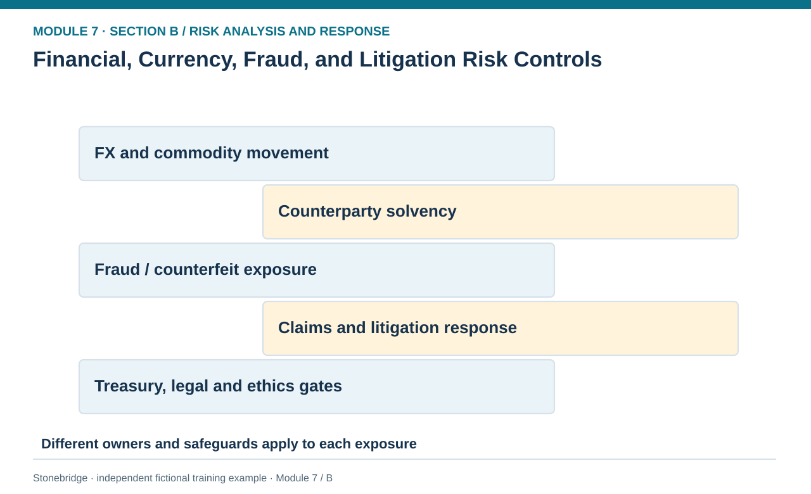
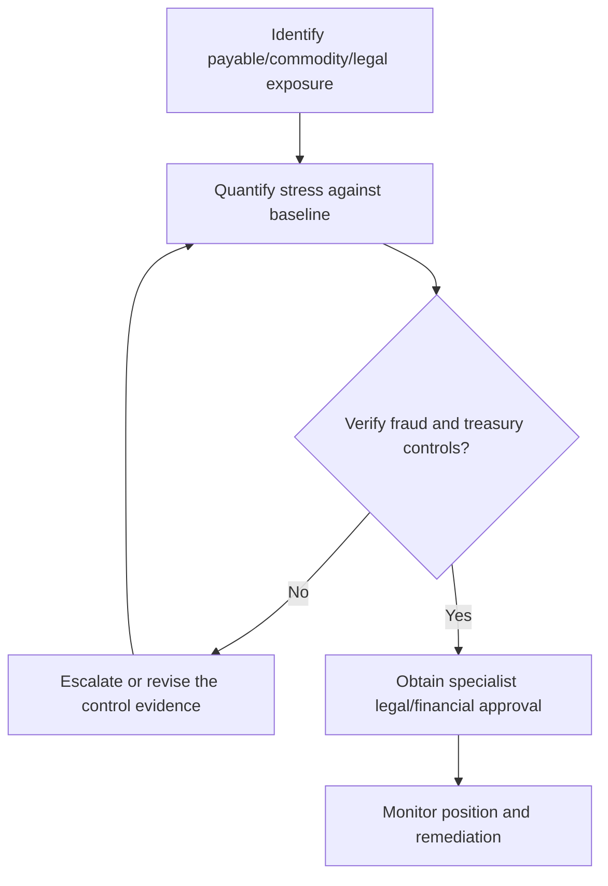

# 18. Financial, Currency, Fraud, and Litigation Risk Controls

> **Fictional case context:** Stonebridge Industrial Components is used here to examine **financial fx malfeasance and litigation risk controls**. Any numeric values and policy thresholds describe this illustrative scenario, not observed industry performance or a universal certification rule.

## Learning objectives

After this lesson, you should be able to:

- calculate clearly defined FX and commodity stress exposures.
- separate treasury hedging, anti-fraud and legal response responsibilities.
- identify loss-transfer limits and required specialist approval.

## Concept in plain English

Financial and malfeasance risks can threaten supply continuity without any machine failing. A supplier's insolvency may eliminate a component source; a currency change may make imports more expensive; commodity inflation can erode a production plan's economics. Theft, corruption and counterfeit product can trigger direct losses and secondary brand or regulatory consequences. Product liability and contract disputes introduce legal exposure that may not be well represented by a single expected dollar amount.

Financial risk response starts by separating operational exposure from the instrument used to manage it. Payment currency, quantity, settlement date, contract terms and the purchasing entity determine the genuine exposure. A hedge may reduce exchange-rate uncertainty but can create obligations of its own, and it does not ensure physical supply. Counterparty financial-health checks can support contingency decisions, but one weak liquidity ratio is a warning signal—not a definitive insolvency prediction. Anti-fraud controls include segregation of duties, verified bank-details changes, purchase-order/receipt/invoice reconciliation and protected reporting channels.

Litigation and IP responses require retained evidence, timely escalation and competent legal guidance. Supply-chain staff should avoid assuming that insurance necessarily covers every loss, that a contract provision will be enforceable across borders, or that business recovery can ignore preservation duties. The risk role is to map the operational path, isolate necessary records and connect subject-matter experts. It must not replace treasury policy, legal advice or specialized security investigation.

## Why it matters

An import program can stay on time and still miss its financial objectives if currency and steel prices rise together. A false vendor bank-account change can create immediate cash loss that is independent of plant performance. These exposures need their own early-warning and evidence controls.

## Decision model and workflow

**Decision illustrated:** An import program can stay on time and still miss its financial objectives if currency and steel prices rise together. The visual highlights the relevant gate or causal connection; it does not imply that the fictional inputs are real disruption statistics.

### Evidence retained through the workflow

| Source field in the fictional training worksheet | Why it belongs in this decision |
| --- | --- |
| `case` | Establish the exact object or decision instance before evaluating **financial, currency, fraud, and litigation risk controls**. |
| `exposure` | Confirm the event context, measurement basis, or resource status that changes this particular control decision. |
| `currency_or_unit` | Test whether the assumed input supports the required decision: separate treasury hedging, anti-fraud and legal response responsibilities. |
| `base_value` | Preserve the operating constraint and response: Escalate fraud, sanctions, bribery and legal concerns through specialist authority. |

## Practical process flow

## Realistic example — Stonebridge Industrial Components

Stonebridge has a fictional €800,000 payable. The budget assumes USD/EUR 1.10, so the expected dollar outlay at that rate is $880,000. A stress rate of 1.17 raises it to $936,000, an additional **$56,000** before hedge effects. Separately, 50,000 kg of steel rising from $4.00 to $4.50/kg increases cost by **$25,000** on that volume. The two are independent scenario arithmetic illustrations, not forecasts that both changes will occur.

## Applied decision artifact or worked calculation

Use a financial-risk control ledger with position, units, contract currency, settlement date, baseline and stress price, authorized hedge or pricing policy, counterparty validation, legal/ethics escalation and exposure owner. A third fictional ledger row labels litigation uncertainty for counsel review; do not multiply claim amounts by arbitrary probabilities and label the result an approved reserve without legal and accounting review.

## Decision logic

- Quantify the underlying exposure before choosing a hedge or contract response.
- Require treasury approval for financial instruments and separate them from speculative trades.
- Escalate fraud, sanctions, bribery and legal concerns through specialist authority.
- Retain transaction, custody and quality evidence during disputes without reproducing protected information.

## Trade-offs

| Tension | Decision implication |
| --- | --- |
| Hedge a known payable | Improves budget certainty but can have fees or opportunity cost. |
| Hold commercial flexibility | Avoids some instrument obligations but leaves the organization exposed to market swings. |
| Formal claims process | Protects rights but requires disciplined evidence and legal review. |

## Commonly confused with

A **currency stress calculation** is the value difference between two assumed rates, not automatically a profit forecast or evidence of hedge effectiveness. A **risk transfer** may protect specified finance exposure but still leave supplier insolvency, quality loss or unmet customer orders.

## Common mistakes

- Using a notional payable as if it were the dollar loss from FX movement.
- Describing an unreviewed hedge as a guaranteed free protection.
- Assuming fraud and product-liability responses are ordinary purchasing approval tasks.

## Original knowledge check

**Question.** A €800,000 payable is budgeted at $1.10/€ and stresses to $1.17/€. What is the unhedged dollar increase?

A. $8,000

B. $56,000

C. $136,000

D. $936,000

Answer and rationale

### Correct answer

**B. $56,000**

### Why it is correct

Correct: €800,000 × ($1.17−$1.10) = $56,000.

### Why the other answers are wrong

- **A.** This does not equal the €800k × $0.07 change.
- **C.** There is no basis for this amount.
- **D.** This is the stressed total payable, not the incremental increase.

## Practitioner perspective

Keep the contract, cash-flow and date convention explicit. A strong control package combines purchasing evidence, validated banking changes, treasury exposure review and counsel-led dispute escalation rather than a single broad 'financial risk' score.

## Related concepts

- [02 Network Design Digital Connectivity Performance](../../02-network-design-digital-connectivity-performance/README.md)
- [03 Sourcing Strategy Product Design Supplier Execution](../../03-sourcing-strategy-product-design-supplier-execution/README.md)
- [05 Forward Reverse Logistics](../../05-forward-reverse-logistics/README.md)

---

[Previous: Lesson 17](./17-hazard-security-people-and-safety-response-gates.md) · [Section overview](./README.md) · [Next: Lesson 19](./19-business-continuity-management-recovery-and-partner-coordination.md)
