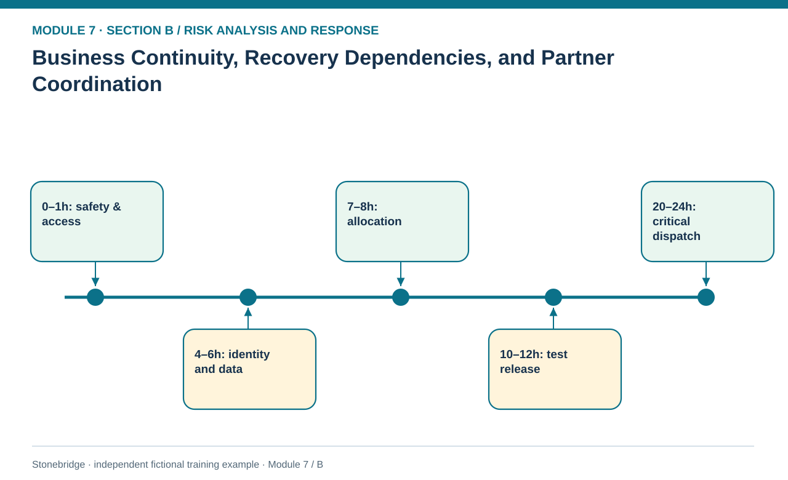
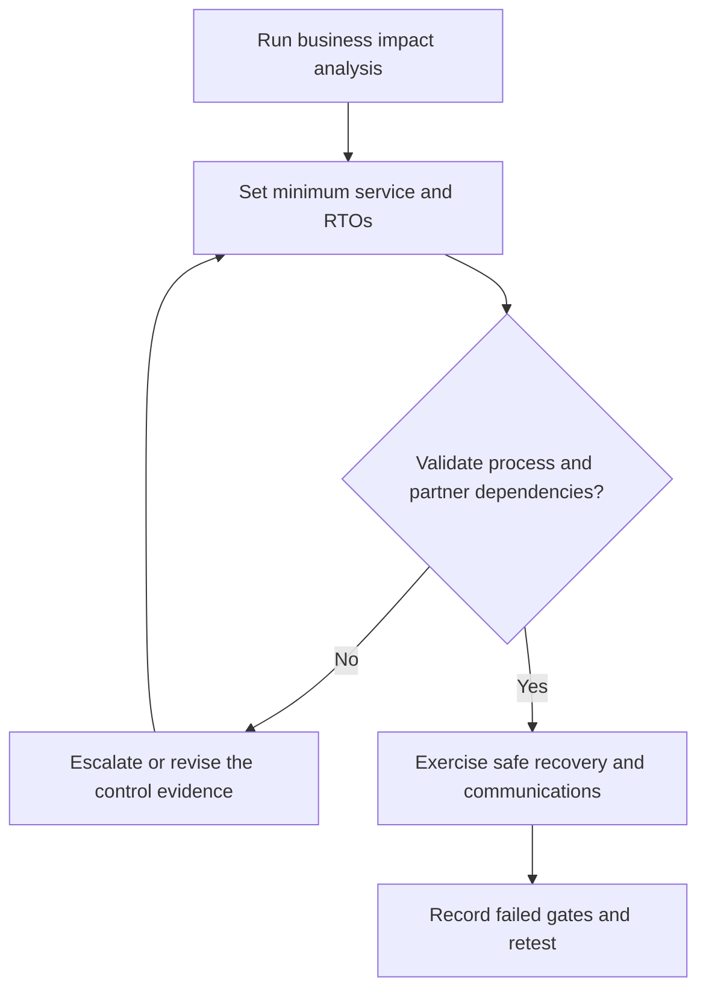

# 19. Business Continuity, Recovery Dependencies, and Partner Coordination

> **Fictional case context:** Stonebridge Industrial Components is used here to examine **business continuity management recovery and partner coordination**. Any numeric values and policy thresholds describe this illustrative scenario, not observed industry performance or a universal certification rule.

## Learning objectives

After this lesson, you should be able to:

- distinguish continuity at minimum service from isolated disaster recovery.
- apply time-based recovery targets and dependency gates.
- test crisis communication, cross-partner coordination and closure evidence.

## Concept in plain English

Business continuity is the organizational capability to deliver an acceptable predefined minimum level of service during and after a disruption. An IT system can be recovered while the supply chain remains unable to process orders, test goods or ship critical product. The continuity system therefore combines a business impact analysis, recovery objectives, dependencies, owned plans, communication, exercise results and continual improvement. Technology disaster recovery is an important subset, not the whole program.

The course material discusses a business continuity management system and references ISO 22301:2019, as well as ISO 28000:2022 for security-management requirements including supply-chain assurance. These edition references identify **the supplied training material**; readers must verify current editions and applicable requirements with authoritative sources before making certification or compliance claims. A document labeled BCMS is not evidence of conformity. The organization must demonstrate scope, preparedness, assigned responsibility, testing and closure of nonconformities.

Recovery objectives become meaningful when linked to dependencies. A four-hour identity restoration may not permit shipment if batch-quality clearance needs ten hours. Customer allocation may start from a secured snapshot only after data integrity is established, and transport bookings cannot be counted until a backup carrier confirms capacity. Recovery time objectives express a management target for each critical activity, while actual exercise times are observed performance. They should be compared and gaps remediated. A declared success requires service-level verification and safe release, not just a green technical status.

Partners should join risk identification, crisis contact testing and relevant tabletop drills because their decisions affect the same customers. Sharing or transferring risk should reduce total network exposure, not simply push the financial burden onto a weaker participant. Crisis communications need one approved spokesperson, accurate customer status, controlled update cadence and feedback from suppliers, carriers and sites.

## Why it matters

An isolated IT backup test says little about whether Stonebridge can build a certified controller, allocate scarce stock or deliver a customer order under a flood-and-system-outage scenario. The continuity plan must operate as an end-to-end service model.

## Decision model and workflow

**Decision illustrated:** An isolated IT backup test says little about whether Stonebridge can build a certified controller, allocate scarce stock or deliver a customer order under a flood-and-system-outage scenario. The visual highlights the relevant gate or causal connection; it does not imply that the fictional inputs are real disruption statistics.

### Evidence retained through the workflow

| Source field in the fictional training worksheet | Why it belongs in this decision |
| --- | --- |
| `activity` | Establish the exact object or decision instance before evaluating **business continuity, recovery dependencies, and partner coordination**. |
| `recovery_target_hours` | Confirm the event context, measurement basis, or resource status that changes this particular control decision. |
| `estimated_recovery_hours` | Test whether the assumed input supports the required decision: apply time-based recovery targets and dependency gates. |
| `dependency` | Preserve the operating constraint and response: Rehearse partner, customer and carrier communications and log actual performance. |

## Practical process flow

## Realistic example — Stonebridge Industrial Components

The invented dependency file gives a one-hour safety and site access target, six-hour identity/order visibility target, eight-hour allocation target, twelve-hour test-cell release target and twenty-four-hour critical dispatch target. Estimated recovery durations are respectively 1, 4, 7, 10 and 20 hours, but **they cannot all be assumed parallel**: each requires its own listed predecessor and release gate. The separate exercise file records that emergency roles took 19 minutes against a 15-minute target and alternate-freight confirmation took 160 against 120 minutes, creating two explicit corrective actions.

## Applied decision artifact or worked calculation

Use a business-impact table listing service activity, minimum acceptable output, target hours, dependency, alternate route, owner, recovery evidence and next exercise. Follow with a crisis action log: alert time, who acknowledged, safety status, customer-impact estimate, actual vs target, failed gate, correction owner and retest date. `crisis-exercise-actions.csv` provides three fictional exercise actions, two marked failed and one passed.

## Decision logic

- Start with business impact, minimum service and safety—not generic system restoration.
- Make each RTO conditional on the operational prerequisite and validation gate.
- Rehearse partner, customer and carrier communications and log actual performance.
- Apply the exercise findings to corrective action and retest instead of filing a successful-plan document.

## Trade-offs

| Tension | Decision implication |
| --- | --- |
| Aggressive recovery targets | Protect customers but can require expensive standby capability. |
| Lower-cost delayed recovery | May save fixed cost but breach essential customer or safety commitments. |
| Wide partner disclosure | Improves coordination but requires confidentiality and one approved message owner. |

## Commonly confused with

**BCMS** refers to ongoing management of continuity capacity; a **business continuity plan** is an executable component; **disaster recovery** focuses heavily on restoring IT and support infrastructure; **supply-chain continuity** refers to sustaining acceptable supply-chain operations. One completed backup test establishes none of these alone.

## Common mistakes

- Declaring readiness from a written, unexercised partner list.
- Adding recovery task durations as if every activity were independent—or parallelizing them when prerequisites are serial.
- Equating recovered ERP access with restored certified production and outbound service.

## Original knowledge check

**Question.** A plant IT restores order visibility in four hours, but quality has not cleared the test cell and no carrier has accepted the emergency load. Is continuity complete?

A. Yes, because the IT RTO is met

B. Yes, because all open purchase orders are still present

C. No, because minimum end-to-end service and release dependencies remain unverified

D. No, because every continuity plan requires a 48-hour outage

Answer and rationale

### Correct answer

**C. No, because minimum end-to-end service and release dependencies remain unverified**

### Why it is correct

Correct: tested production, quality and transport gates must support the promised service.

### Why the other answers are wrong

- **A.** System restoration is only one dependency.
- **B.** Data presence alone does not prove shipment capability.
- **D.** There is no universal mandated outage period.

## Practitioner perspective

Run tabletop and controlled live exercises with process owners from sourcing, planning, quality, transportation, IT and customer service. Capture partner acknowledgments and actual capacity rather than treating email delivery as proof of emergency readiness.

## Related concepts

- [02 Network Design Digital Connectivity Performance](../../02-network-design-digital-connectivity-performance/README.md)
- [04 Internal Operations Inventory](../../04-internal-operations-inventory/README.md)
- [05 Forward Reverse Logistics](../../05-forward-reverse-logistics/README.md)
- [06 Supply Chain Relationships](../../06-supply-chain-relationships/README.md)

---

[Previous: Lesson 18](./18-financial-fx-malfeasance-and-litigation-risk-controls.md) · [Section overview](./README.md) · [Next: Section B review](./20-section-b-review.md)
