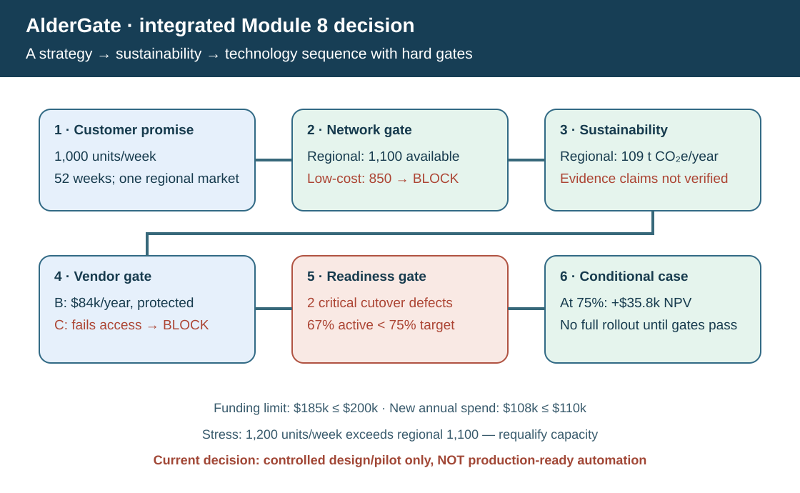
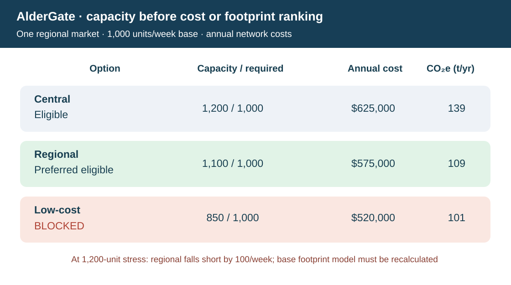
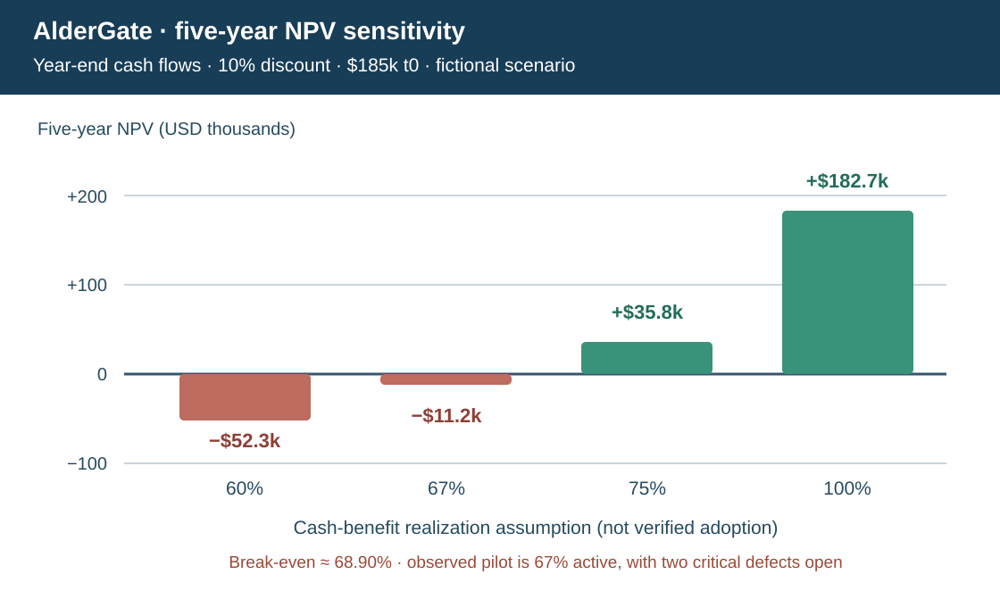
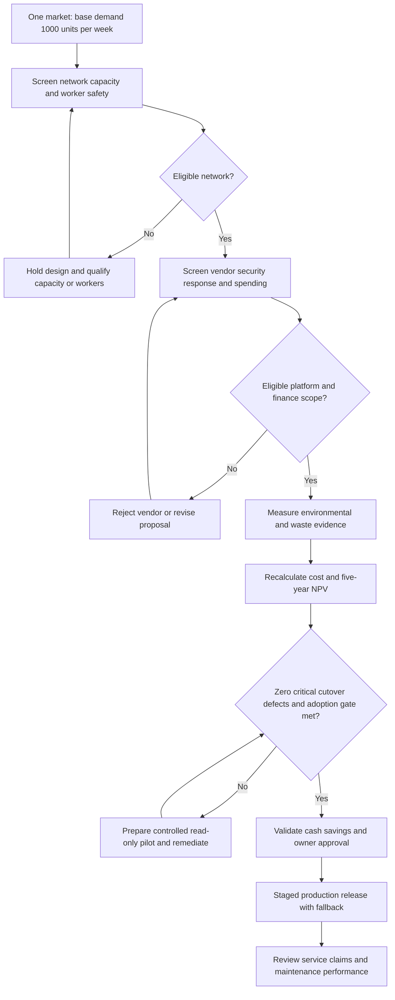

# AlderGate Transformation Investment — Integrated Module 8 Capstone

> **Original fictional case.** AlderGate Motion Products, the executives, costs, events, options, rates, targets, technology vendors, and governance decisions are invented for study. The privately provided **2026 APICS CSCP Module 8** defines the Section A (optimization), Section B (sustainability), and Section C (technology trends, implementation, change and maintenance) learning scope. This case is an independent application, not an ASCM exam question, published company claim, or certified vendor evaluation.

## Executive situation and decision request

AlderGate supplies engineered mechanical components through a regional distribution operation. A customer segment requires **1,000 finished units per week**; the network runs under the Section A hypothetical costs and capacity. Management is considering replacing the central distribution design with a regional network and introducing an order-event visibility and reconciliation service to reduce avoidable administration, improve recovery coordination, and strengthen sustainability reporting.

You are acting as the cross-functional transformation lead. Prepare **one gated investment recommendation** covering the **next five complete operating years after acceptance**. Executives want a feasible design, not an attractive weighted score that bypasses quality, worker welfare, cybersecurity, capital constraints, or operational readiness. You must state what can be approved now, what requires further evidence, the likely economics under several benefit-realization cases, and what breaks under higher demand.

**The business question:** Should AlderGate progress a regional network and protected technology option? How should the triple-bottom-line evidence change the decision? What must Procurement, Operations, Finance, Sustainability, Quality, Security, Change and IT verify before production cutover and public claims?

## Learning outcomes and cross-section integration

1. **Section A — Strategy and optimization:** Align service promises to capacity and network options; sum comparable costs; distinguish feasible optimality from the cheapest infeasible design; calculate discounted investment value and demand stress.
2. **Section B — Sustainability:** Compare economic and modeled environmental outcomes without blending incompatible units; check worker-safety, reporting and evidence gates; correctly aggregate site recycling percentages; qualify what any claim can support.
3. **Section C — Technology and execution:** Check vendor access and service feasibility; reproduce automated work economics; budget implementation and continuing support; test actual cutover, training and adoption against mandatory thresholds; assign stakeholders, change actions and asset-lifecycle ownership.
4. **Modules 1–7 handoff:** Keep demand population consistent (1), architecture integrity (2), supplier/contract approval (3), qualified operations (4), freight and waste scope (5), stakeholder participation (6), and risk/continuity gates (7). Do not re-do those modules' technical methods or assert their separate datasets share this case's quantities.

## Controlled datasets — every required input is directly linked

Use the **existing Section A/B/C numbers unchanged**. The additional capstone-only records put those independent lesson exercises under an explicitly connected fictional decision boundary; where a concept is illustrative rather than an actual measurement, label it as such.

| Decision scope | Direct source data | Used for |
| --- | --- | --- |
| Scope and fictional policy | [Executive policy and thresholds](../../assets/data/module-8/capstone/executive-policy.csv) | Five-year/10% horizon, base/stress demand, funding, adoption and launch gates |
| Section A network alternatives | [Existing location/design alternatives](../../assets/data/module-8/section-a/location-design-alternatives.csv) | Three comparable annual network operating costs and qualified weekly capacity |
| Section B footprint & social gates | [Original network sustainability choices](../../assets/data/module-8/capstone/network-sustainability.csv) | Annual warehouse-energy + outbound-transport footprint, worker and destination controls |
| Section B waste and traceability | [Existing site recycling records](../../assets/data/module-8/section-b/recycling-lineage.csv) | Correct two-site network-weighted mass rate and missing evidence |
| Section C qualified software vendors | [Existing selection proposals](../../assets/data/module-8/section-c/technology-selection.csv) | Privacy/access and response-time gates, score, annual price |
| Separated benefit drivers | [Original manual-work benefit drivers](../../assets/data/module-8/capstone/manual-work-benefits.csv) | Disjoint event and invoice populations, annual potential avoidable cost and Finance checks |
| Program expenses | [Original investment, training and support costs](../../assets/data/module-8/capstone/program-costs.csv) | Certain t0 funding and recurring support independent of vendor price |
| Scenario changes | [Original benefit-realization cases](../../assets/data/module-8/capstone/benefit-sensitivity.csv) | 60%, 67%, 75%, and 100% potential cash realization |
| Section C readiness | [Existing change pilot](../../assets/data/module-8/section-c/change-coalition.csv) and [cutover acceptance](../../assets/data/module-8/section-c/cutover-acceptance.csv) | Trained/active worker rates and unclosed critical test scenarios |
| Executive risk/governance | [Original action and control register](../../assets/data/module-8/capstone/governance-actions.csv) | Blockers, triggers, owners, initial status and dated escalation |

Use the [worked answer and decision controls](./solution-guide.md) only after completing your own recommendation. The [source calculation replay](../../calculations/module8-capstone/replay.py) is intended to reproduce the numerical case, including stress cases, directly from the linked CSVs.

## Locked decision boundaries and assumptions

**Base population and horizon:** The region has 1,000 finished units/week, 52 weeks per illustrative year, or 52,000 units/year. This is the **same** requirement used in Section A's network file, not the unrelated asset or freight loads in other chapters. The network dataset costs are one comparable illustrative year and are assumed constant for the five modeled **complete** operating years following signed acceptance. No actual calendar-year prediction is implied.

**Investment time convention:** One-time program investments occur at **time zero after acceptance**. Annual cash differences occur at **year end, years 1–5**, and are discounted at **10% annually**. There is no salvage, tax, inflation, financing interest, change in sales, or terminal value in this controlled model. The five-year case is a **decision scenario**, not a claim that today’s failing readiness tests have been fixed or that full benefits begin now.

**No double counting:** Section A's annual network cost totals include facility, transport, inventory and the specifically defined network **service-failure cost**. The separately modeled **manual order-event reconciliation** and **invoice dispute resolution** activities are **mutually exclusive process populations**, assumed excluded from *all four* Section A network cost components. The model must not add both a full labor saving and the unchanged manual labor expense a second time. Finance has **not yet verified that released labor time is avoidable cash cost**; treating it as cash rather than redeployed capacity is an explicit open gate.

**Technology expenses:** Section C vendor price is an **annual separate service fee**, absent from the network cost columns. The capstone's additional $24,000/year support expense also is *not* in the vendor fee or Section A network costs. All three t0 integration/change/data expenses are new and excluded from recurring spending. Do **not** capitalize/discount every year's recurring support as if paid at t0.

**Decision policy (invented):** One-time capital must be at or below **$200,000** and incremental annual **technology fee plus new support** must be at or below **$110,000**. Those are different limits. A critical cutover failure is not permitted; operational worker training must be at least **90%** and active process adoption at least **75%** of the 200 workers in the pilot. Data-security, product/safety, destination evidence and qualified-capacity checks precede rankings.

**Sustainability boundaries:** Modeled tonnes CO₂e/year cover only **warehouse-energy operations and outbound transportation for this single regional option**. The policy's **120-tonne aspiration is voluntary**, not a statutory emissions authorization gate; record both target achievement and independent permit/worker safeguards. Actual emission factors and source records have **not** been checked. The existing two-plant waste file is one reporting population, not a separate emissions reduction or alternative network cost. Two Plant B source exceptions block an unqualified **public claim** until reconciled. Do not treat voluntary GRI/UNGC alignment or ISO management-system terms as shipment permits.

**Adoption and benefits:** A scenario fraction (such as 75%) is a deliberately simple proxy for cash-benefit realization, **not** a validated mathematical equation from software logins to saved payroll. The existing pilot currently shows 90% training and 67% active use; full rollout has not met the 75% gate. Do not label cash benefits observed or expenditure already approved.

**Capacity stress:** A separate scenario increases volume to **1,200 units/week** while leaving the published candidate capacities unchanged. This **cannot** be scored using the base-year network cost/emissions totals as if they remained fully valid. Capacity gaps must be shown and cost, service, staffing and emissions re-estimated before selecting a stress response.

## Assignment — prepare one executive decision pack

### Task 1 — Establish the strategic and service baseline

Summarize the desired customer promise and network requirements. Convert the base 1,000 units/week into an illustrative 52-week annual volume. Name the cost components and explain why one region, one volume basis and one period must be used for all options. Show how these requirements connect to competitive position and customer value from [Section A](../section-a-optimizing-supply-chain-strategy-and-tactics/README.md).

### Task 2 — Screen network design before cost ranking

From the Section A [network data](../../assets/data/module-8/section-a/location-design-alternatives.csv), compute the total modeled annual cost for **central**, **regional** and **low-cost**, the capacity slack or deficit in units/week, and a pass/hold state against required volume. Then apply worker-safety and destination-evidence gates from the [sustainability file](../../assets/data/module-8/capstone/network-sustainability.csv). Select the least-expensive **eligible** alternative and state the annual network savings versus central. Do not allow the cheapest capacity-deficient design to win a weighted average.

### Task 3 — Evaluate sustainability on a defensible boundary

For every network, calculate warehouse-energy + outbound-transport tonnes CO₂e/year. Show whether the preferred option meets the **voluntary** 120-tonne target, its change from central both in tonnes and percent, and what source verification is still missing. Use [site recycling data](../../assets/data/module-8/section-b/recycling-lineage.csv) to compute Plant A, Plant B, and the mass-weighted overall recycling rate. List what the two unresolved Plant B supporting records mean for public reporting, and identify a worker/social hard gate independent of environmental ranking.

### Task 4 — Qualify technology and define a valid service case

Screen A, B and C from the Section C [vendor dataset](../../assets/data/module-8/section-c/technology-selection.csv) against mandatory secure access and response-time gates. Compare the eligible proposals' annual cost and documented fictional weighted scores. State why vendor C, despite its price and score, is excluded.

Calculate potential cash process benefit using [the two disjoint process populations](../../assets/data/module-8/capstone/manual-work-benefits.csv): annual events/cases × avoidable hours/case × avoidable USD/hour. **Do not** confuse removed work hours with a verified reduction in cash spending. Provide a Finance evidence plan.

### Task 5 — Construct the full five-year investment case

Using the [policy](../../assets/data/module-8/capstone/executive-policy.csv), [program costs](../../assets/data/module-8/capstone/program-costs.csv), chosen network and preferred eligible vendor:

1. Compute the one-time investment and incremental annual vendor-plus-support amount; test their **separate** funding caps.
2. Define the baseline annual operating ledger **including separate manual work**, and the proposed ledger at a fraction (f) of successfully realized labor saving.
3. Derive the **annual incremental net cash benefit**, explicitly showing avoided network cost, realized process saving and new annual technology spending.
4. Calculate the five-year annuity present-value factor at 10% and the **NPV at 75% modeled realization**, the undiscounted payback, and the 60%, 67% and 100% sensitivity cases.
5. Derive the approximate **break-even realization fraction** for nonnegative five-year NPV. Distinguish this *economic* crossover from the separate 75% *adoption* approval gate.

### Task 6 — Decide implementation and change readiness

From [change pilot records](../../assets/data/module-8/section-c/change-coalition.csv), calculate pooled training and active use against the stated thresholds. From [cutover tests](../../assets/data/module-8/section-c/cutover-acceptance.csv), calculate total pass percentage and count critical open failures. Define the difference between a **controlled read-only test**, a **business-released automated workflow**, and a **public sustainability statement**. Do not call any of these ready solely because investment NPV is positive in a fictional scenario.

Prepare a charter outline, RACI or equivalent decision rights, test/cutover choices, rollback and continuity measures, supplier communication, and maintenance/handover plan, referring to [Section C](../section-c-technology-trends/README.md).

### Task 7 — Stress capacity and test the business case boundaries

At 1,200 units/week, show each network's physical slack or deficit. State which preferred base option becomes insufficient and whether any currently modeled alternative covers 1,200 units/week. Explain why the original $50,000 savings, 109 tonnes CO₂e, and full-year operating cash case cannot be automatically carried into this stress scenario.

Optional: Explain how NPV changes if the regional-network savings become unavailable while the same vendor fee and conservative benefit assumptions persist. Label it a **partial, ceteris-paribus** stress, not a validated full 1,200-unit operating model.

### Task 8 — Make an owned recommendation

Use [governance-action records](../../assets/data/module-8/capstone/governance-actions.csv) to deliver a brief executive decision covering:

- **Proceed with design and controlled preparation**, full approval, or stop? Clearly separate conditional business-case attractiveness from operational go-live authorization.
- Mandatory security, cutover, capacity and safety/worker gates and the separate sustainability publication gate.
- The initial 30/60/90-day action and responsible-owner plan.
- Who validates that the process benefits are real *cash avoidance*, who owns the business service, and who owns continuing technical and asset support.
- One threshold or event that triggers executive reconsideration, and one backup response if partner or customer demand changes.

## Integrated operating flow and decision checks

The business release is a **sequence of dependent gates**, not one weighted score. The flow returns rejected alternatives for remediation rather than allowing economics to waive conditions.

The following are independently authored **self-checks**, separate from the complete worked solution. Open them after making your own executive judgment.

### Decision check 1 — Cheapest does not mean eligible

Can the $520,000/year low-cost network beat regional when it can process only 850 units/week against a 1,000-unit promise and also fails the worker gate?

Answer and rationale

**No.** It fails two mandatory conditions. Its cost and lower illustrative emission footprint remain diagnostic information but cannot justify selection. The regional design has 1,100/week nominal capacity and the best modeled annual cost among presently eligible options; it still requires proof of real throughput.

### Decision check 2 — Reporting evidence versus a percentage

Can AlderGate publicly claim a fully verified 66% network recycling rate simply because the mass-weighted computation is arithmetically valid?

Answer and rationale

**No.** The two Plant B record exceptions remain unresolved. Correct aggregation is a necessary arithmetic step, not sufficient reporting evidence. Sustainability owns the source reconciliation and the authorized wording of any future claim.

### Decision check 3 — Financial and eligibility boundaries

Why is vendor B preferred to vendor A or C when B has neither the lowest service fee nor the absolute highest composite score?

Answer and rationale

**B** meets the fictional data-security and response gates and costs $84,000/year plus $24,000 continuing support, totaling $108,000 within the $110,000 technology-spend limit. A reaches $116,000/year including support and exceeds that limit; C fails required security regardless of its lower price and higher score.

### Decision check 4 — Economic break-even versus operational adoption

The five-year financial crossover is about 68.90% of assumed avoidable cash benefits. Does that permit launch when observed process adoption is only 67% and two critical test failures remain?

Answer and rationale

**No.** The modeled 68.90% is a discounted financial sensitivity threshold conditional on real cash realization, not permission to override the separate 75% adoption gate or zero-critical-defect requirement. No observed one-to-one relationship from logins to cash savings has been established.

### Decision check 5 — Capacity and boundary sensitivity

At 1,200 units/week, can management keep the original regional network's $575,000/year cost and 109-tonne emission footprint in its final approved NPV?

Answer and rationale

**No.** Regional has a 100-unit/week nominal capacity deficit under that stress. Work methods, extra lanes or capacity, labor, actual service, costs and emissions must be requalified on the higher-volume scenario. The partial $50,000 savings-removal stress is only a limited illustration, not a recomputed operating model.

## Required deliverables and readiness checklist

Provide an executive summary; a scenario ledger with assumptions; network cost/capacity and sustainability comparison; technology-feasibility matrix; independently calculated investment model; quantified adoption/cutover dashboard; downside and demand-stress analysis; governance and risk register with named roles; and a realistic 30/60/90-day activation/decision plan.

**Readiness gate:** Your answer should reject infeasible options before ranking, distinguish cash realized from benefit scenarios, keep annual/t0 and USD/tonnes/units-per-week separate, avoid unsupported legal or emissions claims, and flag the specific current failures. If you cannot defend the source of a value, mark it provisional rather than inventing proof.

When finished, consult the [fully worked solution](./solution-guide.md) and run the [independent replay](../../calculations/module8-capstone/replay.py) against the same CSVs. Return to the [Module 8 learning path](../README.md).
