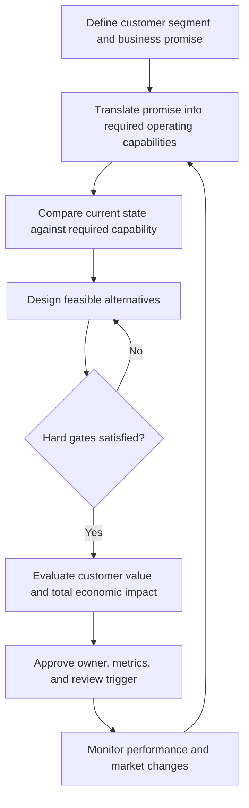

# 1. Strategy Hierarchy and Supply-Chain Alignment

## Learning objectives

Explain how enterprise direction, competitive positioning and supply-chain design interact; translate a customer promise into operating requirements; and recognize when functional targets conflict with strategy.

## Concept in plain English

Business and supply-chain strategies are connected but not interchangeable. Enterprise strategy establishes the company’s direction, business strategy defines how it intends to compete for chosen customers, and supply-chain strategy makes the competitive promise operational. A plan to win through dependable service, for example, cannot rely on a supply chain designed exclusively to minimize the cost of every individual warehouse, order or machine hour. Likewise, a standardized low-price offer does not automatically benefit from premium-speed custom handling for every transaction.

The choice is not between being effective and being efficient. Effectiveness asks whether the enterprise delivers the product, service and value its intended market needs. Efficiency asks how economically it uses resources to do so. Both matter, but efficiency should be measured inside a strategically sensible operating design. A plant can exceed a utilization target yet worsen enterprise performance by delaying urgent customer orders. A procurement group can report attractive purchase prices while increasing total landed cost through poor delivery reliability.

A business plan provides financial and operational context—investment capacity, intended revenue and cost structure, and the market proposition. It is not itself a substitute for a network strategy. Management must translate these intentions into sourcing boundaries, customer lead-time promises, capacity policies, inventory placement, logistics choices, digital visibility and partner responsibilities. Each choice should have an accountable owner and evidence that it supports the broader promise.

Different executives may favor different measures. Finance wants working capital under control, sales wants customer responsiveness, operations values stable production and procurement seeks dependable supply at acceptable cost. Successful alignment does not mean selecting one function’s metric and imposing it everywhere. It means making cross-functional trade-offs explicit, applying mandatory constraints first, and measuring outcomes across the whole business.

Strategic fit can drift. A product that was highly customized may become standardized. Customer expectations may shift; a distributor may start demanding shorter replenishment windows. Technology may reduce the cost of responding to changes. The organization needs a review mechanism that tests whether its capabilities still fit the business strategy instead of treating the initial network design as permanent.

## Why it matters

Local optimization is especially dangerous when the cost and service consequences are recorded by different functions. Closing a warehouse may reduce rental expense, but transportation cost and delivery delays may rise somewhere else. The strategic decision must capture net consequences for customers and stakeholders. A useful leadership conversation starts with the competitive promise, states the gaps in today's network, and identifies which trade-offs the proposed design changes.

## Decision model and workflow

The design decision is whether to approve a capability or process change that supports a chosen market promise under the available financial, physical and regulatory constraints. Retain a baseline, a candidate alternative, decision rights, applicable hard gates and review triggers.

### Evidence retained through the workflow

| Evidence | Use |
| --- | --- |
| Customer segments and service promise | Defines the intended competitive outcome |
| Network lead times, capacity and current service | Establishes what can actually be delivered |
| Cost and customer-value assumptions | Prevents local savings from masquerading as enterprise gains |
| Safety, quality, security and funding gates | Excludes unacceptable designs before ranking |
| Owner, chosen KPIs and review date | Makes the decision auditable and revisable |

## Practical process flow

## Realistic example — AlderGate Motion Products

AlderGate is a fictional producer of standard mechanical couplings and engineer-to-order repair assemblies. The sales team promises rapid delivery for emergency repairs, while the plant is measured only on long-run machine utilization. A change to smaller production lots could support faster repairs but would add setups. The right question is not whether shorter runs look efficient in isolation. It is whether the customer value and retained revenue justify the capacity and cost consequences without bypassing quality inspection.

## Applied decision artifact or worked calculation

AlderGate receives 200 expedited assembly orders during a fictional month. The existing system meets its promised date for 146 orders: **146 ÷ 200 = 73%** attainment. A pilot proposes meeting 186 of those 200 orders: **186 ÷ 200 = 93%** attainment, at an estimated incremental monthly conversion cost of $12,000. The difference is 20 percentage points, but that does not establish that the pilot is profitable. The team must still compare incremental contribution, expected avoided penalties, setup and inventory consequences, and capacity feasibility. These are training assumptions, not certification benchmarks.

Record the time horizon, underlying orders, assumed service counts, how conversion expense was determined, customer-value hypothesis, decision owner, and a trigger for reconsideration. If a required quality gate fails, the design is ineligible regardless of projected margin.

## Decision logic

- Define a measurable external promise before tuning internal KPIs.
- Identify the capabilities that support it and the constraints that may block it.
- Test mandatory safety, quality and financial feasibility before weighted or economic comparison.
- Compare total enterprise consequences, not one function’s reported improvement.
- Record ownership and monitor assumptions for changes.

## Trade-offs

| Tension | Consequence |
| --- | --- |
| Stable repetitive production versus urgent response | Higher utilization can conflict with response-time commitments |
| Lowest local spending versus lowest delivered cost | Savings may shift cost across functions |
| Shared capability versus specialized service | Segmentation improves fit but increases coordination needs |

## Commonly confused with

**Business strategy** describes the competitive advantage to pursue. **Supply-chain strategy** describes how supply, production, distribution and partner capabilities will support it. **A technology project** may implement part of the strategy but is not the strategy itself. Operational efficiency remains necessary but is not a complete definition of strategic success.

## Common mistakes

- Choosing a system before clarifying the customer promise.
- Assuming every product needs the same cost, inventory and service model.
- Treating a single-function KPI as proof of enterprise value.
- Ignoring operating, transition and customer consequences of cost reductions.
- Allowing performance measures to remain unchanged after the competitive promise changes.

## Original knowledge check

**Question.** AlderGate promises five-day emergency repair delivery but rewards its plant only for maximum long-run machine utilization. Which action best addresses the strategic problem?

A. Introduce a new dashboard without changing decision rights.

B. Translate the promise into cross-functional capability, service and feasibility requirements before selecting a process change.

C. Remove quality inspection to improve apparent lead time.

D. Require every standardized product to use the emergency service process.

Answer and rationale

### Correct answer

**B. Translate the promise into cross-functional capability, service and feasibility requirements before selecting a process change.**

### Why it is correct

The current metric does not reflect the customer promise. Connecting requirements to accountable capability and decision gates creates the basis for credible alternatives.

### Why the other answers are wrong

- **A.** Measurement alone cannot settle incompatible operational priorities.
- **C.** A mandatory quality gate cannot be discarded for responsiveness.
- **D.** Different segments may require different operating models; imposing a premium process everywhere is unsubstantiated.

## Practitioner perspective

In enterprise planning systems, strategy becomes visible through lead times, capacity assignments, sourcing preferences, forecast and service segmentation. A solution architect should trace these parameters to customer outcomes, preserve the rationale and revisit the design when business assumptions change. A new configuration setting is not evidence that the underlying strategy works.

## Related concepts

- [Module 1 — Supply and Demand Alignment](../../01-supply-chains-demand-forecasting/section-e-supply-demand-alignment/README.md)
- [Module 2 — Network Design](../../02-network-design-digital-connectivity-performance/README.md)
- [Next: Competitive Positioning](./02-competitive-positioning-and-operating-tradeoffs.md)

---

[Section overview](./README.md) · [Next: Competitive Positioning](./02-competitive-positioning-and-operating-tradeoffs.md)
