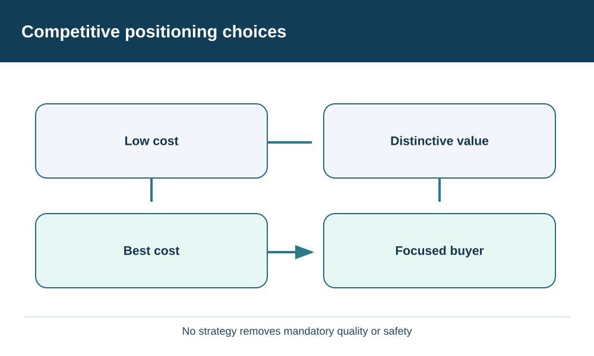
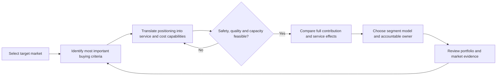

# 2. Competitive Positioning and Operating Trade-offs

## Learning objectives

Distinguish broad and focused competitive choices, evaluate their implications for cost, service and complexity, and avoid turning a strategic label into an unsupported operating rule.

## Concept in plain English

Competitive strategy asks why a defined set of customers will choose the organization's offer over alternatives. A **low-cost approach** competes by providing acceptable value economically, through repeatability, disciplined cost, effective resource use and fit-for-purpose process design. **Differentiation** competes through features, quality, reliability, service or another attribute that customers genuinely value. A **best-cost** offer tries to deliver an attractive combination of capability and price. A **focused** strategy restricts the market scope to particular buyers or needs, then competes on cost, differentiation or a chosen blend within that niche.

These choices should shape how operations and supply networks are designed, but they do not dictate one universal template. Being a low-cost provider does not automatically require outsourcing, offshore manufacturing, zero inventory or weaker inspections. Differentiation does not automatically justify unlimited customization or premium shipping. Neither plan works if a mandatory safety, quality or contractual condition is violated.

A product family also has different unit economics from its portfolio economics. A high-volume item can contribute more total money despite a smaller amount earned on each unit. A lower-volume engineered item may provide strategic customer value or higher contribution per constraint hour despite lower total sales. It is not sound to rank business models using either unit margin or volume alone. Decisions need an explicit common time horizon, activity-level costs, resource requirements and constraints.

AlderGate Motion Products, our independent fictional case, sells cost-sensitive standard couplings to distributors and custom repair assemblies to maintenance teams. The first segment places high weight on consistent availability and delivered price; the second places greater weight on qualification, technical fit and response during outages. AlderGate may use one enterprise system and physical network, but apply different planning and service policies by segment.

The operating design should make clear what will be **shared** and what will be **differentiated**. Shared materials and equipment may improve scale; protected assembly slots may improve emergency responsiveness. Segmenting every process increases coordination burden, so distinct operating policies require demonstrated business justification.

## Why it matters

Companies can gradually accumulate promises that their original operating model cannot support. Sales introduces urgent customization, while procurement and production retain incentives built for an inexpensive, standard offering. Apparent revenue growth can disguise additional expediting, returns and working-capital costs. Leaders must evaluate the complete contribution and customer impact rather than assume that more service or cheaper materials always create value.

Competitive fit should be evaluated periodically. Price-sensitive markets can change, a once-innovative product can mature, and customer-service expectations can evolve. The design needs stable decision ownership and clear triggers for reconsideration rather than continuous unstructured exception handling.

## Decision model and workflow

Low cost,Distinctive value,Best cost,Focused buyer

| Competitive emphasis | Supply-chain priority to test | Evidence required |
| --- | --- | --- |
| Low cost | Repetition, appropriate scale, cost stability | Unit and total delivered cost, quality, reliable fulfillment |
| Differentiation | Distinctive service or product value | Customer willingness to pay, reliability, qualified capability |
| Best cost | Balanced price and valuable attributes | Comparable contribution, feasibility, cost-to-serve |
| Focused market | Deep fit to a well-defined segment | Segment size, value, demand pattern and required response |

### Evidence retained through the workflow

Retain the segment's purchase criteria, comparable cost model, service target, operating constraints, viable alternatives, financial owner and reassessment trigger. Customer assumptions and the source of any capacity estimates must be traceable.

## Practical process flow

## Realistic example — AlderGate Motion Products

The distributor line runs in regular batches with common materials. Repair assemblies require variable specifications, equipment qualification and controlled rush capacity. AlderGate's leaders consider a fully standardized factory policy, but the maintenance customers would then experience delivery windows inconsistent with their high-value downtime situations. Instead, the team evaluates separate promise classes within shared operations, verifying the price premium and setup cost before approving the different treatment.

## Applied decision artifact or worked calculation

[Working data: competitive-contribution.csv](../../assets/data/module-8/section-a/competitive-contribution.csv)

In a fictional month, standardized couplings sell **6,000 units at $150** with **$113 variable cost per unit**, giving **6,000 × ($150 − $113) = $222,000** contribution before shared fixed expense. Engineered assemblies sell **3,300 at $210** with **$155 variable cost per unit**, giving **3,300 × ($210 − $155) = $181,500** contribution on the same basis.

The standard line has greater modeled *total* contribution for the month, while the engineered line has greater contribution *per unit*. Neither figure is enough to settle resource priority without capacity-hours, fixed overhead, market obligations and service costs. The resulting decision artifact must state price, volume, comparable cost scope, time horizon, constraints, and decision ownership. All numbers are fictional assumptions, not ASCM benchmark rates.

## Decision logic

- Establish customer value and target market before assigning an operating-model label.
- Keep quality, security, compliance and other hard gates separate from weighted rankings.
- Test total economic and service effects over a consistent horizon.
- Segment operating treatment only when it changes a genuine decision or outcome.
- Review cost-to-serve, margin and customer response together.

## Trade-offs

| Tension | Implication |
| --- | --- |
| Standardization versus tailored response | Shared resources save money but can limit urgent service |
| Availability versus working capital | Inventory protection consumes cash and can become obsolete |
| Premium experience versus margin | More service is valuable only if the net business case supports it |

## Commonly confused with

**Best cost** means an intentionally attractive value proposition at disciplined cost, not minimal cost at every process step. **Focused** refers to market scope, not automatically to high or low price. **Differentiation** requires customer-perceived value rather than simply more internal product features.

## Common mistakes

- Equating low price with the weakest permissible quality.
- Assuming that a premium product should win every scarce-capacity contest.
- Choosing a strategy from a single purchase-price, unit-margin or utilization metric.
- Using one supply-chain policy across very different product and customer needs without testing fit.
- Ignoring the cost of managing too many exception-specific operating models.

## Original knowledge check

**Question.** Standard couplings generate greater total monthly contribution than engineered assemblies, while the assemblies contribute more per unit. What can AlderGate conclude?

A. The engineered line must be discontinued.

B. The line with higher contribution per unit must always get capacity priority.

C. The company must assess customer value, constrained capacity, full cost scope and service feasibility before deciding.

D. Both lines should use the exact same operating model because they share a facility.

Answer and rationale

### Correct answer

**C. The company must assess customer value, constrained capacity, full cost scope and service feasibility before deciding.**

### Why it is correct

The calculation is scoped to variable contribution for one month. It does not incorporate scarce capacity, customer impact or all enterprise costs. Those inputs may change the best decision.

### Why the other answers are wrong

- **A.** Total contribution alone does not show whether exiting the product improves the enterprise.
- **B.** Per-unit figures ignore constraint consumption and demand.
- **D.** Shared assets do not imply identical service or replenishment policies.

## Practitioner perspective

In production planning and supply execution, commercial differentiation often appears as service classes, planning policies, resource assignment and product segmentation. These should be governed by a documented competitive purpose rather than one-off parameter changes. Record economic assumptions so future owners can reassess the rationale.

## Related concepts

- [Previous: Strategy Hierarchy](./01-strategy-hierarchy-alignment-and-decision-rights.md)
- [Module 3 — Sourcing Strategy](../../03-sourcing-strategy-product-design-supplier-execution/README.md)
- [Section overview](./README.md)

---

[Previous: Strategy Hierarchy](./01-strategy-hierarchy-alignment-and-decision-rights.md) · [Section overview](./README.md)
