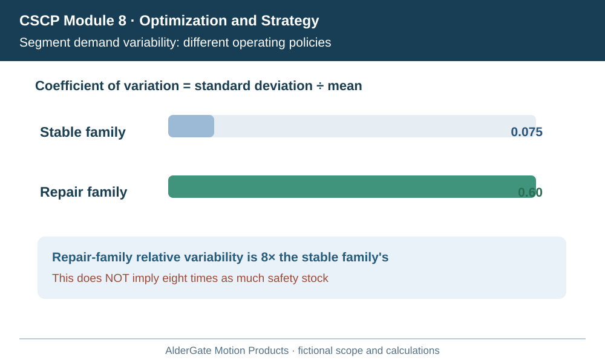
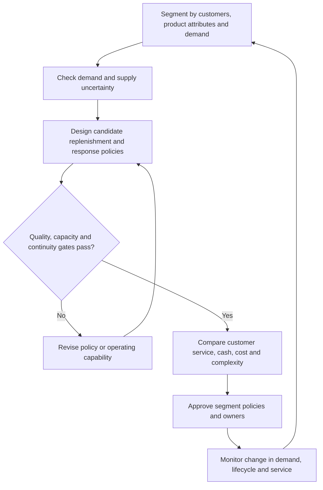

# 3. Product-Segment Fit and Multiple Supply-Chain Models

## Learning objectives

Identify when products need different supply-chain operating policies; distinguish demand-driven information from the elimination of forecasts; and evaluate responsiveness, efficiency and resilience with consistent evidence.

## Concept in plain English

One enterprise does not necessarily require one supply-chain operating model. Products with long life cycles, modest variety and relatively predictable demand often justify processes that emphasize stable replenishment, reliable utilization and economical fulfillment. Products with uncertain demand, shorter lives, changing configurations or urgent customer needs may justify more flexible capacity, component postponement and short response times. These are useful strategic starting points, not automatic prescriptions for a particular SKU.

A functional-type product is not inherently risk-free. Even when customer demand is stable, a supplier can fail or a transport lane can close. An innovative-type product is not inherently profitable simply because it commands a price premium. It may consume scarce engineering capacity, require expensive shipping or incur high obsolescence. Separate the questions: what do customers need, how uncertain is demand, what can supply realistically do, and what level of economic complexity is justified?

A forecast-driven system can amplify order fluctuations when each participant estimates demand from orders received from the previous participant and adds protective buffers. The result may be wide swings in upstream orders even though end-customer purchases change only modestly. A demand-driven network shares consumption information and can use actual demand to trigger replenishment or execution. However, this does **not** mean forecasts disappear. Equipment, labor and long-lead raw materials still require forward planning, and large unforeseen orders can exceed actual capacity. Demand signals, forecasting and contingency planning can coexist at different horizons.

A company can operate multiple models without constructing separate companies, factories or ERP systems. Common components, postponement points, differentiated lead-time promises and allocation rules may create the needed separation. The decision to add a warehouse or dedicated production line is more expensive and requires its own network economics. Operating-policy differentiation should be as extensive as necessary but no more complex than the customer and product evidence supports.

For a stable product, frequent changes to a forecast may create unnecessary schedule nervousness. For a volatile service product, refusing all short-term changes may destroy the customer promise. A deliberate operating design makes these consequences and decision rights visible to planning, sales, logistics, suppliers and finance.

## Why it matters

Company-wide averages can hide critical service failures. A stable high-volume family may make aggregate forecast accuracy appear strong while small, irregular repair demand produces the most severe customer outages. Treating all items with one blanket inventory percentage is no more defensible than assigning all items a single express freight policy. Segment decisions should follow the economic and customer consequences of being wrong.

The design also changes cash and obsolescence exposure. Finished-stock protection improves speed only if the right finished configuration is in demand. A modular product can sometimes protect common components and postpone its final configuration until the order is clearer. The option creates different risks—shared-component availability, assembly capacity and test qualification—that must be assessed explicitly.

## Decision model and workflow

Stable demand,Uncertain demand,Supply lead,Customer loss

Use demand characteristics, lifecycle state, service consequences, supply lead time and feasible capacity as joint evidence. No single metric classifies an item permanently. The record must identify what operating decision differs by segment.

### Evidence retained through the workflow

| Evidence | Purpose |
| --- | --- |
| Average and variability of actual demand | Quantifies forecast/consumption uncertainty |
| Service consequence and customer promise | Sets the significance of late or missing product |
| Supplier lead time and capacity response | Tests whether the planned policy is feasible |
| Common-material and postponement options | Identifies flexibility without unnecessary finished-goods stock |
| Carrying cost, obsolescence, setup and expedite cost | Makes the true economic trade-off visible |
| Named policy owner and review trigger | Enables responsible reclassification as markets change |

## Practical process flow

## Realistic example — AlderGate Motion Products

AlderGate's common couplings move steadily through distributors, while specialized repair assemblies are ordered during unpredictable equipment outages. Both share metal components and some factory work centers. The initial business rule uses the same forecasting cadence and finished-stock target for both products. The commodity line performs reasonably; the repair line accumulates slow-moving finished variants while occasionally missing urgent orders.

The improvement team evaluates routine replenishment of common couplings and protected common critical parts for the repair line. It considers postponing final assembly until the repair specifications are known. That does not bypass safety or traceability tests: a rapid repair remains unacceptable if the required technical qualification cannot be completed.

## Applied decision artifact or worked calculation

[Working data: segment-variability.csv](../../assets/data/module-8/section-a/segment-variability.csv)

For a fictional comparison, weekly demand for a stable family averages **800 units** with standard deviation **60 units**. For an engineered repair family, mean weekly demand is **150** and standard deviation **90**. The coefficient of variation (CV) is standard deviation divided by mean, so stable family CV = **60 / 800 = 0.075**, while repair family CV = **90 / 150 = 0.60**.

This shows materially different *relative* demand variability. It does **not** imply the repair family needs eight times as much safety stock: safety stock depends on lead-time distributions, planning horizon, service objective, dependencies and model assumptions. Nor does CV establish the correct network shape on its own. The segment decision must retain a time window, sample size, intermittency, supply lead-time evidence and service consequences before setting a replenishment rule.

## Decision logic

- Define the customer/operating decision that segmentation is intended to improve.
- Measure the relevant demand uncertainty and supply response, not just total sales volume.
- Use consumption signals where useful without pretending long-lead planning is unnecessary.
- Compare feasible policies for service, economics, sustainability and operating complexity.
- Revisit the classification when lifecycle, variability or supplier reliability changes.

## Trade-offs

| Trade-off | Design consequence |
| --- | --- |
| High finished-stock availability versus cash and obsolescence | Protect only valuable service outcomes with economically justified stock |
| Shared facilities versus dedicated response | Shared assets benefit scale; dedicated capacity can protect urgent promises |
| Forecast planning versus actual-demand pull | Different horizons can require different planning signals |

## Commonly confused with

**Demand uncertainty** describes changing customer requests; **supply uncertainty** describes reliability of resources and fulfillment. **Responsiveness** concerns adjustment to needs, while **resilience** concerns preparation and recovery from disruption. **Demand driven** does not mean there are no plans, forecasts or constraints.

## Common mistakes

- Using average forecast accuracy to conclude every important segment is predictable.
- Converting a CV ratio directly into an inventory multiplier.
- Treating a demand-driven policy as justification for deleting all forecasting.
- Building physically separate networks before examining low-cost policy and postponement options.
- Using one supply policy for every product solely to simplify administration.

## Original knowledge check

**Question.** The engineered repair family's demand CV is 0.60, versus 0.075 for common couplings. What should AlderGate do next?

A. Multiply repair safety stock by eight immediately.

B. Eliminate all long-range forecasts for repair components.

C. Build a second distribution center solely because variability differs.

D. Examine service needs, replenishment response, commonality and total economics before setting differentiated policies.

Answer and rationale

### Correct answer

**D. Examine service needs, replenishment response, commonality and total economics before setting differentiated policies.**

### Why it is correct

CV measures relative demand variability, but inventory and physical-network choices depend on service outcomes, lead time, feasible capacity and total cost.

### Why the other answers are wrong

- **A.** There is no universal direct conversion from relative CV to a safety-stock multiplier.
- **B.** Long-lead components may still need forward-looking plans even with current demand information.
- **C.** A policy distinction does not automatically justify an additional facility.

## Practitioner perspective

In ERP planning, strategic segmentation influences forecast review, replenishment logic, resource commitment and exception ownership. A solution design should trace every specialized policy back to a business reason and preserve its assumptions. Keep technical inventory controls in Module 4 and disruption recovery in Module 7 rather than recreating them here.

## Related concepts

- [Previous: Competitive Positioning](./02-competitive-positioning-and-operating-tradeoffs.md)
- [Module 1 — Forecasting](../../01-supply-chains-demand-forecasting/section-d-forecasting/README.md)
- [Module 4 — Inventory](../../04-internal-operations-inventory/section-c-inventory/README.md)

---

[Previous: Competitive Positioning](./02-competitive-positioning-and-operating-tradeoffs.md) · [Section overview](./README.md)
