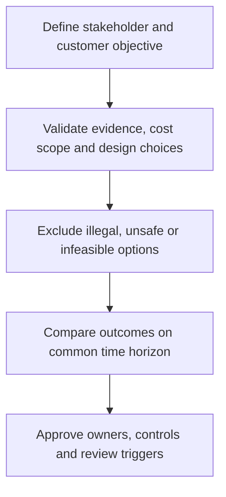

# 4. Business Plans, Value Propositions, and Core Competencies

## Learning objectives

Explain the specific decision scope of business plans, value propositions, and core competencies, evaluate the evidence and business trade-offs, and reject alternatives that fail mandatory quality, legal, safety, or feasibility conditions.

## Concept in plain English

Strategy must be translated into decisions about funding, resources, delivery capabilities and measurement. A **value proposition** describes why particular customers should choose an offer; it is not a vague commitment to provide every available service. The **business plan** connects this proposition with financial objectives, anticipated volume, assets, responsibilities and implementation timing. The **core competencies** are distinctive skills or systems that the organization can use to deliver the proposition reliably. These are interdependent: a plan promising fast, technically qualified repair service is not credible when the organization has neither engineering capability nor access to an appropriately qualified partner.

Core competence is not synonymous with owning an activity. Operating trucks, processing invoices and managing warehouse space may be necessary without being sources of sustained competitive advantage. Conversely, a product's qualification knowledge, ability to coordinate a unique service model or specialized engineering design may be differentiating. Leadership should test the evidence of that advantage and ask how it will endure as competitors, technology and customers change. Partner capabilities can be used strategically without abandoning accountability for the customer outcome.

A long-range strategic plan and a yearly operating budget serve different purposes. The first identifies where the organization intends to compete and invest; the second determines what it can commit during the budget period. S&OP aligns nearer-term demand, capacity and financial assumptions without pretending to replace strategic decisions. Revisions should identify whether the market promise, capability or investment case has changed rather than continuously resetting the organization's direction.

AlderGate Motion Products plans to offer emergency engineered assemblies. Its commercial team believes customers will pay for a verified rapid response, but its current production rules favor long batches of standard couplings. A business plan must identify qualified specialist labor, validation steps, common components, controlled capacity and a realistic demand ramp. Purchasing a planning application without these commitments would automate an unworkable promise.

## Why it matters

These strategic decisions cut across cost, customers and operating functions. A local improvement should not be described as enterprise value without a consistent baseline, a defined horizon and a credible accountable decision owner. The evidence must show both the result the business expects and the constraints that might prevent it.

## Decision model and workflow

Use the following retained records to turn the strategy into a reproducible decision. Each record should document a responsible owner and a dated assumption rather than merely asserting that the option looks attractive.

### Evidence retained through the workflow

| Decision record | Required evidence |
| --- | --- |
| Promise and target segment | State its source, owner, horizon and confidence |
| Competency and partner capability | State its source, owner, horizon and confidence |
| Budget and investment horizons | State its source, owner, horizon and confidence |
| Qualification and funding hard gates | State its source, owner, horizon and confidence |

## Practical process flow

## Realistic example — AlderGate Motion Products

The fictional AlderGate leadership team uses these records to decide whether its standard and engineered product lines need different investments. Quality and operations first establish what is feasible; commercial teams then identify which customer outcomes matter; Finance checks whether the assumptions are consistent. These roles prevent a single-function recommendation from becoming a misleading corporate strategy.

## Applied decision artifact or worked calculation

In a fictional annual business case, incremental service revenue is $420,000 and incremental variable expense is $250,000, leaving $170,000 contribution before dedicated fixed support. Annual engineering support of $92,000 and technology support of $24,000 lower the modeled incremental operating contribution to **$54,000**. This does not establish NPV or cash availability: training investments, working capital, taxes, financing and adoption uncertainty are outside the calculation. Finance must approve the complete horizon and Quality must confirm safe qualification before the launch can be authorized.

## Decision logic

- Define the relevant business promise, volume, horizon and decision rights before comparison.
- Document material assumptions and distinguish a modeled benefit from one that has been realized.
- Keep legal, safety, qualification and capacity limits as gates before economic ranking.
- Compare remaining options using consistently scoped outcomes and review triggers.

## Trade-offs

| Decision tension | Interpretation |
| --- | --- |
| C | a |
| M | a |
| I | n |
| A |   |

## Commonly confused with

Strategy states the long-run direction; a business plan translates it into an executable resource and financial commitment. Core competence means a demonstrated advantage, not simply an organizational department.

## Common mistakes

- Using one favorable metric to declare an entire business model optimal.
- Hiding untested operating assumptions inside a weighted ranking.
- Treating a hypothetical benefit as a booked or guaranteed financial result.
- Omitting the implementation owner and threshold for re-evaluation.

## Original knowledge check

**Question.** Which action best translates AlderGate's value proposition into an executable business plan?

A. Buy a planning tool and treat software deployment as the strategy

B. Document customer value, qualified capabilities, investment assumptions and accountable milestones

C. Declare every internally performed activity a core competency

D. Treat the $54,000 contribution estimate as fully discounted project NPV

Answer and rationale

### Correct answer

**B. Document customer value, qualified capabilities, investment assumptions and accountable milestones**

### Why it is correct

Only the second option connects the promise to owned resources, feasibility and explicit financial evidence.

### Why the other answers are wrong

- **A.** Technology does not substitute for process capability or accountability.
- **C.** Owning an activity does not prove it creates competitive advantage.
- **D.** A scoped annual contribution is not a multi-period discounted cash-flow calculation.

## Practitioner perspective

In an ERP-enabled supply chain the decision becomes visible through planning parameters, service promises, partner commitments, exception records and financial controls. Systems can support a chosen operating policy, but merely configuring them does not establish the commercial case. Preserve the decision's assumptions and owners so the policy can be revisited when demand or business priorities change.

## Related concepts

- [Previous topic](./03-product-segment-fit-and-multiple-supply-chains.md)
- [Module 2 — Connected network decisions](../../02-network-design-digital-connectivity-performance/README.md)
- [Module 7 — Risk and mandatory gates](../../07-supply-chain-risk/README.md)

---

[Previous topic](./03-product-segment-fit-and-multiple-supply-chains.md) · [Section overview](./README.md)
