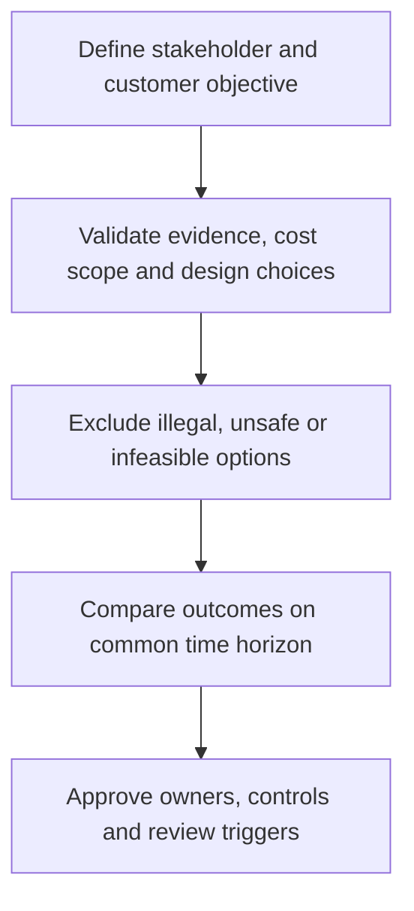

# 5. Cost Structure, Revenue Models, and Location/Tax Boundaries

## Learning objectives

Explain the specific decision scope of cost structure, revenue models, and location/tax boundaries, evaluate the evidence and business trade-offs, and reject alternatives that fail mandatory quality, legal, safety, or feasibility conditions.

## Concept in plain English

Supply-chain decisions should be evaluated against a consistent **cost structure** and **revenue model**. Costs differ by the activities that trigger them: some vary with orders or units, others remain fixed over a period, and some arise only when operations transition to a new configuration. A supplier quote, a warehouse lease or a freight tariff represents one cost element, not the full economic consequence. A revenue model explains how the customer proposition creates receipts, such as product sales, recurring service charges or an engineered repair premium.

Network design can move cost between functions. Opening a regional location may reduce outbound transportation and customer-delay exposure but increase staffing, facilities, systems integration, tax administration and inventory. Outsourcing replaces certain owned assets with service charges yet retains governance, exception management and contractual obligations. The right comparison considers all relevant parties and a defined horizon, rather than highlighting only the saving that justifies a particular department's proposal.

Tax, customs and location implications must be treated carefully. A fictional scenario may include a potential incentive for sensitivity analysis, but there is no universal tax rate or guaranteed advantage that follows simply from moving stock across a border. Transactions, legal entities, customs classification, labor rules and eligibility conditions need jurisdiction-specific professional verification. Mandatory legal and operating constraints are tested before any option is economically ranked.

Different financial measures answer different questions. Contribution margin is revenue less the defined variable-cost scope; it does not automatically include all overhead. Simple payback divides initial outlay by recurring modeled annual net benefit only when the assumptions support that comparison. Discounted NPV requires a dated series of cash flows and the chosen discount rate. A tax-saving hypothesis cannot be added to a spreadsheet as realized value without supporting evidence.

AlderGate considers moving part of its distributor fulfillment to a regional warehouse. The proposal looks attractive on freight expense alone, but Finance insists on including occupancy, duplicate safety stock, launch costs and service-related losses. Operations must verify permits, capacity and labor readiness before treating the network choice as feasible.

## Why it matters

These strategic decisions cut across cost, customers and operating functions. A local improvement should not be described as enterprise value without a consistent baseline, a defined horizon and a credible accountable decision owner. The evidence must show both the result the business expects and the constraints that might prevent it.

## Decision model and workflow

Use the following retained records to turn the strategy into a reproducible decision. Each record should document a responsible owner and a dated assumption rather than merely asserting that the option looks attractive.

### Evidence retained through the workflow

| Decision record | Required evidence |
| --- | --- |
| Full recurring cost scope | State its source, owner, horizon and confidence |
| Revenue and customer impact | State its source, owner, horizon and confidence |
| One-time launch expense | State its source, owner, horizon and confidence |
| Permit, legal and finance gates | State its source, owner, horizon and confidence |

## Practical process flow

## Realistic example — AlderGate Motion Products

The fictional AlderGate leadership team uses these records to decide whether its standard and engineered product lines need different investments. Quality and operations first establish what is feasible; commercial teams then identify which customer outcomes matter; Finance checks whether the assumptions are consistent. These roles prevent a single-function recommendation from becoming a misleading corporate strategy.

## Applied decision artifact or worked calculation

Central fulfillment's fictional annual cost is $280,000 facility expense + $220,000 transport + $85,000 carrying costs + $40,000 service-failure consequences = **$625,000**. A regional option models $365,000 + $130,000 + $65,000 + $15,000 = **$575,000**, for **$50,000** recurring annual saving under these assumptions. If launch costs $180,000 once, simple payback is **3.6 years**. This is not NPV and not a conclusion about taxes or statutory compliance.

## Decision logic

- Define the relevant business promise, volume, horizon and decision rights before comparison.
- Document material assumptions and distinguish a modeled benefit from one that has been realized.
- Keep legal, safety, qualification and capacity limits as gates before economic ranking.
- Compare remaining options using consistently scoped outcomes and review triggers.

## Trade-offs

| Decision tension | Interpretation |
| --- | --- |
| L | o |
| S | o |
| L | o |
| A |   |

## Commonly confused with

Variable contribution, recurring operating saving, simple payback and NPV are different measures. Tax strategy must be based on current legal advice, not a universal training percentage.

## Common mistakes

- Using one favorable metric to declare an entire business model optimal.
- Hiding untested operating assumptions inside a weighted ranking.
- Treating a hypothetical benefit as a booked or guaranteed financial result.
- Omitting the implementation owner and threshold for re-evaluation.

## Original knowledge check

**Question.** What does the $50,000 annual saving and $180,000 launch cost support?

A. A 3.6-year simple payback under the stated assumptions

B. A guaranteed positive NPV

C. Proof of regulatory and tax eligibility

D. A risk-free recommendation regardless of customer demand

Answer and rationale

### Correct answer

**A. A 3.6-year simple payback under the stated assumptions**

### Why it is correct

The arithmetic supports a simple payback, not a full discounted investment decision.

### Why the other answers are wrong

- **B.** The question gives no cash-flow profile or discount rate.
- **C.** Regulatory eligibility needs jurisdiction-specific evidence.
- **D.** Volume, implementation and demand risks still require sensitivity checks.

## Practitioner perspective

In an ERP-enabled supply chain the decision becomes visible through planning parameters, service promises, partner commitments, exception records and financial controls. Systems can support a chosen operating policy, but merely configuring them does not establish the commercial case. Preserve the decision's assumptions and owners so the policy can be revisited when demand or business priorities change.

## Related concepts

- [Previous topic](./business-plan-value-proposition-and-core-competencies.md)
- [Module 2 — Connected network decisions](../../02-network-design-digital-connectivity-performance/README.md)
- [Module 7 — Risk and mandatory gates](../../07-supply-chain-risk/README.md)

---

[Previous topic](./business-plan-value-proposition-and-core-competencies.md) · [Section overview](./README.md)
