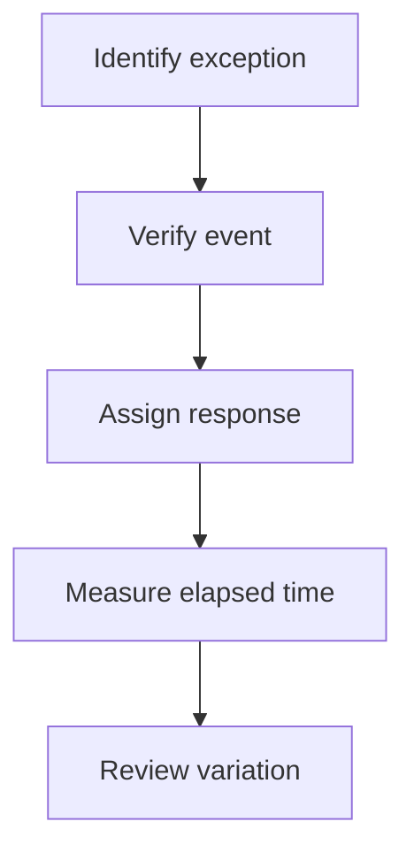

# 6. Three Vs: Visibility, Velocity, and Variability

## Learning objectives

Explain the specific decision scope of three vs: visibility, velocity, and variability, evaluate the evidence and business trade-offs, and reject alternatives that fail mandatory quality, legal, safety, or feasibility conditions.

## Concept in plain English

The Module 8 curriculum identifies three operating goals that support strategy: more useful **visibility**, better **velocity**, and less unmanaged **variability**. Visibility means obtaining accurate, relevant information when a business decision can still be changed. Velocity refers to how quickly and reliably work, decisions, information or material progress through a defined process. Variability concerns differences in demand, supply or execution that make consistent commitments difficult. The metrics must be distinguished even though the three goals reinforce one another.

A large volume of alerts is not necessarily good visibility. A trustworthy exception message must identify what happened, which orders are exposed, whether the information is current and who owns the response. Information shared across partners can reduce delayed decisions only if the event definitions and master-data identities align. The detailed integration architecture belongs to Module 2; here the focus is whether better information changes the strategic customer experience.

Faster transport is only one possible improvement in velocity. Removing avoidable approval delay or detecting a supplier shortage earlier may protect customer promises without buying expensive freight. Velocity must be measured between defined events, such as order receipt and firm customer response, not simply factory processing time. A business must not accelerate a process by bypassing required safety, testing, privacy or compliance steps.

Variability may arise from customer order volume, seasonal mix, supplier delivery, yield, inaccurate data or unstable scheduling policies. Some market volatility cannot be eliminated and should be handled through planned flexibility; internally generated nervousness may be reduced through governance and clearer decision rights. Improving data quality, processing latency and flow reliability can reduce the buffers necessary to meet service goals, but a causal business outcome must be demonstrated.

At AlderGate, suppliers report delayed delivery events after a two-day lag. The planning group creates multiple independent expediting requests because no one has a trusted shared event record. A controlled event-to-action process may accelerate response and reduce conflicting decisions without adding physical capacity.

## Why it matters

Visibility, velocity and variability affect decisions through different mechanisms. AlderGate can improve event coverage but still fail to respond if ownership is unclear; it can speed freight yet receive the wrong component. The quality gate is therefore a measurable connection from event evidence to a customer or operating result, not installation of another dashboard.

## Decision model and workflow

Measure each V independently using a defined population and timestamps. Visibility requires trusted events, velocity requires matched process boundaries, and variability needs a consistent sample and statistic. Relate improvements to downstream customer outcomes only after validating them.

### Evidence retained through the workflow

| Decision record | Required evidence |
| --- | --- |
| Time-stamped complete events | State its source, owner, horizon and confidence |
| Decision and exception ownership | State its source, owner, horizon and confidence |
| Order-to-response elapsed time | State its source, owner, horizon and confidence |
| Variability and service outcome definitions | State its source, owner, horizon and confidence |

## Practical process flow

## Realistic example — AlderGate Motion Products

At AlderGate, a supplier uploads shipment events in a portal, but the system often maps them to a retired material identifier. Planners see status updates but cannot tell which repair orders are threatened. The pilot fixes part identity and exception ownership first, then measures whether planners contact customers sooner. Its cost hypothesis remains unproven until those actions change service or expediting expense.

## Applied decision artifact or worked calculation

In a fictional sample of 200 monitored orders, 140 have trustworthy status events, giving **70%** visibility completeness. A revised process covers 185 orders, or **92.5%**. The order-to-promise update cycle falls from 12 hours to 9 hours, a **25%** time reduction. Separately, a demand coefficient of variation decreases from 0.40 to 0.25, a **37.5%** relative reduction. Each metric describes a different result; none alone proves that customers were retained or profit increased.

## Decision logic

- Define completeness and timestamp standards for visibility events.
- Measure elapsed time from a consistent start to end event.
- Separate customer, supplier and schedule-induced variability.
- Connect each process improvement to outcome measures and economic costs.

## Trade-offs

| Decision tension | Interpretation |
| --- | --- |
| M | o |
| V | o |
| F | a |
| N | o |

## Commonly confused with

Visibility is actionable information, not the number of screens. Velocity is a defined end-to-end elapsed time, not shipment speed alone. Variability describes uncertainty and inconsistency, not necessarily an error.

## Common mistakes

- Counting alert volume as visibility.
- Comparing different timestamp boundaries as a velocity improvement.
- Removing difficult demand observations to improve the variability score.
- Claiming control-tower ROI from coverage alone.

## Original knowledge check

**Question.** What can be concluded when trusted order-event coverage rises from 70% to 92.5%?

A. Supplier uncertainty has disappeared

B. All long-lead forecasts can be discarded

C. Data coverage has improved, but service and economics need separate evidence

D. The new control tower has proven positive ROI

Answer and rationale

### Correct answer

**C. Data coverage has improved, but service and economics need separate evidence**

### Why it is correct

The measure proves improved completeness within the stated sample, not a customer or financial effect.

### Why the other answers are wrong

- **A.** Visibility does not eliminate physical supplier risk.
- **B.** Long-lead materials may still require forecast planning.
- **D.** ROI requires incremental costs and realized economic benefits.

## Practitioner perspective

Integration specialists should maintain an event dictionary: material identity, status semantics, time source and accountable workflow. A technically correct feed is not enough if a planner cannot make a permitted response decision from it.

## Related concepts

- [Previous topic](./cost-revenue-location-and-tax-decision-boundaries.md)
- [Module 2 — Connected network decisions](../../02-network-design-digital-connectivity-performance/README.md)
- [Module 7 — Risk and mandatory gates](../../07-supply-chain-risk/README.md)

---

[Previous topic](./cost-revenue-location-and-tax-decision-boundaries.md) · [Section overview](./README.md)
