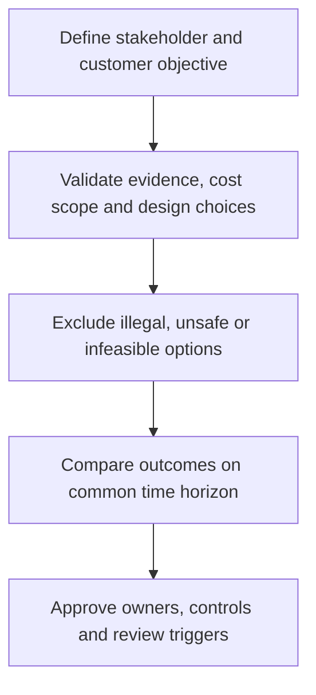

# 6. Three Vs: Visibility, Velocity, and Variability

## Learning objectives

Explain the specific decision scope of three vs: visibility, velocity, and variability, evaluate the evidence and business trade-offs, and reject alternatives that fail mandatory quality, legal, safety, or feasibility conditions.

## Concept in plain English

The Module 8 curriculum identifies three operating goals that support strategy: more useful **visibility**, better **velocity**, and less unmanaged **variability**. Visibility means obtaining accurate, relevant information when a business decision can still be changed. Velocity refers to how quickly and reliably work, decisions, information or material progress through a defined process. Variability concerns differences in demand, supply or execution that make consistent commitments difficult. The metrics must be distinguished even though the three goals reinforce one another.

A large volume of alerts is not necessarily good visibility. A trustworthy exception message must identify what happened, which orders are exposed, whether the information is current and who owns the response. Information shared across partners can reduce delayed decisions only if the event definitions and master-data identities align. The detailed integration architecture belongs to Module 2; here the focus is whether better information changes the strategic customer experience.

Faster transport is only one possible improvement in velocity. Removing avoidable approval delay or detecting a supplier shortage earlier may protect customer promises without buying expensive freight. Velocity must be measured between defined events, such as order receipt and firm customer response, not simply factory processing time. A business must not accelerate a process by bypassing required safety, testing, privacy or compliance steps.

Variability may arise from customer order volume, seasonal mix, supplier delivery, yield, inaccurate data or unstable scheduling policies. Some market volatility cannot be eliminated and should be handled through planned flexibility; internally generated nervousness may be reduced through governance and clearer decision rights. Improving data quality, processing latency and flow reliability can reduce the buffers necessary to meet service goals, but a causal business outcome must be demonstrated.

At AlderGate, suppliers report delayed delivery events after a two-day lag. The planning group creates multiple independent expediting requests because no one has a trusted shared event record. A controlled event-to-action process may accelerate response and reduce conflicting decisions without adding physical capacity.

## Why it matters

These strategic decisions cut across cost, customers and operating functions. A local improvement should not be described as enterprise value without a consistent baseline, a defined horizon and a credible accountable decision owner. The evidence must show both the result the business expects and the constraints that might prevent it.

## Decision model and workflow

Use the following retained records to turn the strategy into a reproducible decision. Each record should document a responsible owner and a dated assumption rather than merely asserting that the option looks attractive.

### Evidence retained through the workflow

| Decision record | Required evidence |
| --- | --- |
| Time-stamped complete events | State its source, owner, horizon and confidence |
| Decision and exception ownership | State its source, owner, horizon and confidence |
| Order-to-response elapsed time | State its source, owner, horizon and confidence |
| Variability and service outcome definitions | State its source, owner, horizon and confidence |

## Practical process flow

## Realistic example — AlderGate Motion Products

The fictional AlderGate leadership team uses these records to decide whether its standard and engineered product lines need different investments. Quality and operations first establish what is feasible; commercial teams then identify which customer outcomes matter; Finance checks whether the assumptions are consistent. These roles prevent a single-function recommendation from becoming a misleading corporate strategy.

## Applied decision artifact or worked calculation

In a fictional sample of 200 monitored orders, 140 have trustworthy status events, giving **70%** visibility completeness. A revised process covers 185 orders, or **92.5%**. The order-to-promise update cycle falls from 12 hours to 9 hours, a **25%** time reduction. Separately, a demand coefficient of variation decreases from 0.40 to 0.25, a **37.5%** relative reduction. Each metric describes a different result; none alone proves that customers were retained or profit increased.

## Decision logic

- Define the relevant business promise, volume, horizon and decision rights before comparison.
- Document material assumptions and distinguish a modeled benefit from one that has been realized.
- Keep legal, safety, qualification and capacity limits as gates before economic ranking.
- Compare remaining options using consistently scoped outcomes and review triggers.

## Trade-offs

| Decision tension | Interpretation |
| --- | --- |
| M | o |
| V | o |
| F | a |
| N | o |

## Commonly confused with

Visibility is actionable information, not the number of screens. Velocity is a defined end-to-end elapsed time, not shipment speed alone. Variability describes uncertainty and inconsistency, not necessarily an error.

## Common mistakes

- Using one favorable metric to declare an entire business model optimal.
- Hiding untested operating assumptions inside a weighted ranking.
- Treating a hypothetical benefit as a booked or guaranteed financial result.
- Omitting the implementation owner and threshold for re-evaluation.

## Original knowledge check

**Question.** What can be concluded when trusted order-event coverage rises from 70% to 92.5%?

A. Supplier uncertainty has disappeared

B. All long-lead forecasts can be discarded

C. Data coverage has improved, but service and economics need separate evidence

D. The new control tower has proven positive ROI

Answer and rationale

### Correct answer

**C. Data coverage has improved, but service and economics need separate evidence**

### Why it is correct

The measure proves improved completeness within the stated sample, not a customer or financial effect.

### Why the other answers are wrong

- **A.** Visibility does not eliminate physical supplier risk.
- **B.** Long-lead materials may still require forecast planning.
- **D.** ROI requires incremental costs and realized economic benefits.

## Practitioner perspective

In an ERP-enabled supply chain the decision becomes visible through planning parameters, service promises, partner commitments, exception records and financial controls. Systems can support a chosen operating policy, but merely configuring them does not establish the commercial case. Preserve the decision's assumptions and owners so the policy can be revisited when demand or business priorities change.

## Related concepts

- [Previous topic](./cost-revenue-location-and-tax-decision-boundaries.md)
- [Module 2 — Connected network decisions](../../02-network-design-digital-connectivity-performance/README.md)
- [Module 7 — Risk and mandatory gates](../../07-supply-chain-risk/README.md)

---

[Previous topic](./cost-revenue-location-and-tax-decision-boundaries.md) · [Section overview](./README.md)
