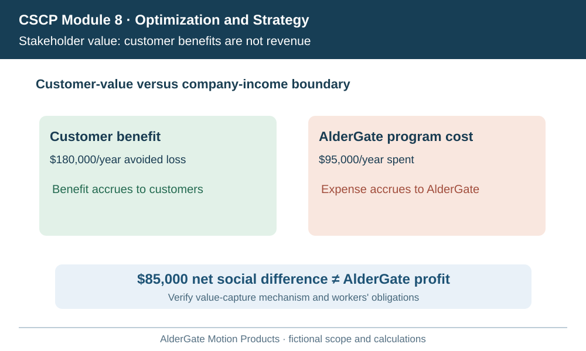
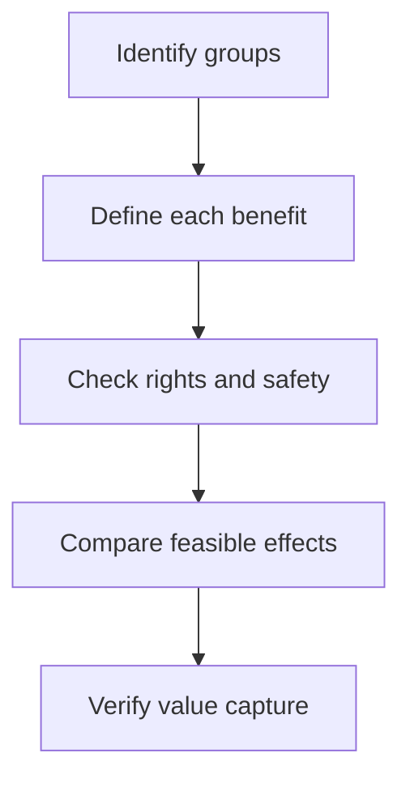

# 7. Financial, Customer, and Social Value Across Stakeholders

## Learning objectives

Explain the specific decision scope of financial, customer, and social value across stakeholders, evaluate the evidence and business trade-offs, and reject alternatives that fail mandatory quality, legal, safety, or feasibility conditions.

## Concept in plain English

A supply chain produces consequences for more than one group. Owners and lenders are concerned with long-term financial results and capital discipline. Customers care about the availability, value and reliability of the offer they buy. Workers, communities, suppliers and regulators may be affected by labor practices, safety, environmental conditions and local economic changes. The curriculum therefore distinguishes **financial**, **customer** and **social** value rather than treating supply-chain value as a single short-term cost number.

Financial outcomes require clear scope: changes in contribution, capital employed, financing, cash conversion, operating cost and avoidable losses may all matter. Lower inventory is not automatically value creation if it increases stockouts and lost contracts. Customer value depends on segment needs. A standard coupling distributor may favor predictable, economical replenishment; an emergency repair purchaser may value technical qualification and rapid response more than nominal unit price. Internal feature counts do not establish willingness to pay.

Social value emerges from normal operating decisions, not only from charitable activity. Shift design can affect fatigue and injury risk; transport patterns can affect local congestion and emissions; supplier choices can influence worker protections. A credible social claim specifies the population, time frame, measurable effect and evidence limitations. Environmental reporting and formal sustainability governance will be developed in Section B, but stakeholder interests already influence strategy selection.

A stakeholder ledger makes tensions visible. Faster premium service can benefit customers yet require investments that reduce the owners' short-run return. Shifting late-night freight routes may lower cost while increasing residential noise. These are not merely variables to average in a weighted score. Legal rights, safety requirements and contractual duties must be applied as mandatory feasibility gates before comparing discretionary trade-offs.

AlderGate examines adding a second shift for urgent repair demand. Finance models the additional labor and energy, commercial teams estimate retention, and operations reviews certified staffing and rest requirements. The decision cannot be based on an invented average stakeholder satisfaction score that hides an unacceptable safety condition.

## Why it matters

Different stakeholders capture different value from the same supply-chain intervention. AlderGate may bear service costs while customers receive avoided downtime, and workers may experience new shifts or workload exposure. Recording these effects separately prevents double counting, misleading claims and hidden mandatory obligations.

## Decision model and workflow

Finance,Customers,Workers,Community

Build an affected-party ledger before valuing alternatives. Label each financial quantity by the entity that bears or receives it, and separate contractual transfer mechanisms from estimated societal or customer benefits. Confirm labor and safety duties before discretionary comparison.

### Evidence retained through the workflow

| Decision record | Required evidence |
| --- | --- |
| Stakeholder and obligation register | State its source, owner, horizon and confidence |
| Owner-perspective economic case | State its source, owner, horizon and confidence |
| Customer-value evidence | State its source, owner, horizon and confidence |
| Workforce and community impact boundary | State its source, owner, horizon and confidence |

## Practical process flow

## Realistic example — AlderGate Motion Products

AlderGate proposes weekend emergency operations after customers describe expensive equipment outages. The proposal could reduce customer downtime but requires certified weekend test staff and reliable transport. Finance calculates AlderGate's own cost, commercial teams test service-contract pricing, and the worker safety lead approves staffing conditions. The executive decision keeps community, worker, customer and owner impacts in distinct columns.

## Applied decision artifact or worked calculation

[Working data: stakeholder-economic-boundaries.csv](../../assets/data/module-8/section-a/stakeholder-economic-boundaries.csv)

In a fictional annual scenario, emergency-service customers may avoid **$180,000 in downtime losses** if response improves, while AlderGate would spend **$95,000** on the program. The arithmetic difference is **$85,000**, but it is **not** AlderGate's profit because customer benefit is not automatically company revenue. Management needs a credible value-capture model—such as a service contract or retention evidence—and must assess which people or communities bear extra costs.

## Decision logic

- State whose benefit or cost is being measured.
- Document direct customer evidence rather than assuming willingness to pay.
- Apply labor, safety and contractual gates first.
- Count supplier revenue only when a credible commercial value-capture path exists.

## Trade-offs

| Decision tension | Interpretation |
| --- | --- |
| L | o |
| L | o |
| P | r |
| V | a |

## Commonly confused with

Customer value is not supplier recognized revenue. Social value is the effect on affected people and communities, not merely a donation budget. Mandatory obligations are not weighted preferences.

## Common mistakes

- Subtracting a supplier cost from customer savings and calling the difference profit.
- Reducing social value to public-relations donations.
- Treating mandatory worker protections as a soft score.
- Claiming all customers value premium service equally.

## Original knowledge check

**Question.** What is the proper treatment of $180,000 customer savings and $95,000 AlderGate cost?

A. Book $85,000 immediately as AlderGate net income

B. Keep customer benefit and supplier cost separate until commercial value capture is supported

C. Ignore worker conditions because benefits exceed costs

D. Assume every customer would pay the entire downtime saving

Answer and rationale

### Correct answer

**B. Keep customer benefit and supplier cost separate until commercial value capture is supported**

### Why it is correct

The two monetary figures belong to different stakeholders; the business needs real pricing, adoption and compliance evidence.

### Why the other answers are wrong

- **A.** Cross-entity benefits are not automatically recorded supplier earnings.
- **C.** Safety and labor duties cannot be eliminated by a favorable ratio.
- **D.** Willingness to pay is not demonstrated by estimated avoided downtime alone.

## Practitioner perspective

Cross-system reporting should retain the source and perspective of each metric. Customer avoided loss, company revenue, supplier expense, employee protection and community exposure cannot be summed indiscriminately into one financial KPI.

## Related concepts

- [Previous topic](./three-vs-visibility-velocity-and-variability.md)
- [Module 2 — Connected network decisions](../../02-network-design-digital-connectivity-performance/README.md)
- [Module 7 — Risk and mandatory gates](../../07-supply-chain-risk/README.md)

---

[Previous topic](./three-vs-visibility-velocity-and-variability.md) · [Section overview](./README.md)
