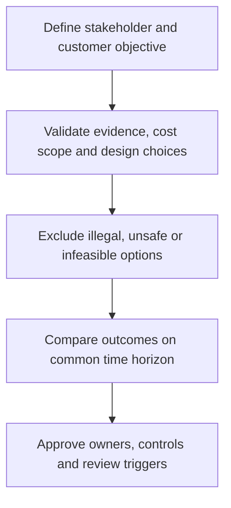

# 7. Financial, Customer, and Social Value Across Stakeholders

## Learning objectives

Explain the specific decision scope of financial, customer, and social value across stakeholders, evaluate the evidence and business trade-offs, and reject alternatives that fail mandatory quality, legal, safety, or feasibility conditions.

## Concept in plain English

A supply chain produces consequences for more than one group. Owners and lenders are concerned with long-term financial results and capital discipline. Customers care about the availability, value and reliability of the offer they buy. Workers, communities, suppliers and regulators may be affected by labor practices, safety, environmental conditions and local economic changes. The curriculum therefore distinguishes **financial**, **customer** and **social** value rather than treating supply-chain value as a single short-term cost number.

Financial outcomes require clear scope: changes in contribution, capital employed, financing, cash conversion, operating cost and avoidable losses may all matter. Lower inventory is not automatically value creation if it increases stockouts and lost contracts. Customer value depends on segment needs. A standard coupling distributor may favor predictable, economical replenishment; an emergency repair purchaser may value technical qualification and rapid response more than nominal unit price. Internal feature counts do not establish willingness to pay.

Social value emerges from normal operating decisions, not only from charitable activity. Shift design can affect fatigue and injury risk; transport patterns can affect local congestion and emissions; supplier choices can influence worker protections. A credible social claim specifies the population, time frame, measurable effect and evidence limitations. Environmental reporting and formal sustainability governance will be developed in Section B, but stakeholder interests already influence strategy selection.

A stakeholder ledger makes tensions visible. Faster premium service can benefit customers yet require investments that reduce the owners' short-run return. Shifting late-night freight routes may lower cost while increasing residential noise. These are not merely variables to average in a weighted score. Legal rights, safety requirements and contractual duties must be applied as mandatory feasibility gates before comparing discretionary trade-offs.

AlderGate examines adding a second shift for urgent repair demand. Finance models the additional labor and energy, commercial teams estimate retention, and operations reviews certified staffing and rest requirements. The decision cannot be based on an invented average stakeholder satisfaction score that hides an unacceptable safety condition.

## Why it matters

These strategic decisions cut across cost, customers and operating functions. A local improvement should not be described as enterprise value without a consistent baseline, a defined horizon and a credible accountable decision owner. The evidence must show both the result the business expects and the constraints that might prevent it.

## Decision model and workflow

Use the following retained records to turn the strategy into a reproducible decision. Each record should document a responsible owner and a dated assumption rather than merely asserting that the option looks attractive.

### Evidence retained through the workflow

| Decision record | Required evidence |
| --- | --- |
| Stakeholder and obligation register | State its source, owner, horizon and confidence |
| Owner-perspective economic case | State its source, owner, horizon and confidence |
| Customer-value evidence | State its source, owner, horizon and confidence |
| Workforce and community impact boundary | State its source, owner, horizon and confidence |

## Practical process flow

## Realistic example — AlderGate Motion Products

The fictional AlderGate leadership team uses these records to decide whether its standard and engineered product lines need different investments. Quality and operations first establish what is feasible; commercial teams then identify which customer outcomes matter; Finance checks whether the assumptions are consistent. These roles prevent a single-function recommendation from becoming a misleading corporate strategy.

## Applied decision artifact or worked calculation

In a fictional annual scenario, emergency-service customers may avoid **$180,000 in downtime losses** if response improves, while AlderGate would spend **$95,000** on the program. The arithmetic difference is **$85,000**, but it is **not** AlderGate's profit because customer benefit is not automatically company revenue. Management needs a credible value-capture model—such as a service contract or retention evidence—and must assess which people or communities bear extra costs.

## Decision logic

- Define the relevant business promise, volume, horizon and decision rights before comparison.
- Document material assumptions and distinguish a modeled benefit from one that has been realized.
- Keep legal, safety, qualification and capacity limits as gates before economic ranking.
- Compare remaining options using consistently scoped outcomes and review triggers.

## Trade-offs

| Decision tension | Interpretation |
| --- | --- |
| L | o |
| L | o |
| P | r |
| V | a |

## Commonly confused with

Customer value is not supplier recognized revenue. Social value is the effect on affected people and communities, not merely a donation budget. Mandatory obligations are not weighted preferences.

## Common mistakes

- Using one favorable metric to declare an entire business model optimal.
- Hiding untested operating assumptions inside a weighted ranking.
- Treating a hypothetical benefit as a booked or guaranteed financial result.
- Omitting the implementation owner and threshold for re-evaluation.

## Original knowledge check

**Question.** What is the proper treatment of $180,000 customer savings and $95,000 AlderGate cost?

A. Book $85,000 immediately as AlderGate net income

B. Keep customer benefit and supplier cost separate until commercial value capture is supported

C. Ignore worker conditions because benefits exceed costs

D. Assume every customer would pay the entire downtime saving

Answer and rationale

### Correct answer

**B. Keep customer benefit and supplier cost separate until commercial value capture is supported**

### Why it is correct

The two monetary figures belong to different stakeholders; the business needs real pricing, adoption and compliance evidence.

### Why the other answers are wrong

- **A.** Cross-entity benefits are not automatically recorded supplier earnings.
- **C.** Safety and labor duties cannot be eliminated by a favorable ratio.
- **D.** Willingness to pay is not demonstrated by estimated avoided downtime alone.

## Practitioner perspective

In an ERP-enabled supply chain the decision becomes visible through planning parameters, service promises, partner commitments, exception records and financial controls. Systems can support a chosen operating policy, but merely configuring them does not establish the commercial case. Preserve the decision's assumptions and owners so the policy can be revisited when demand or business priorities change.

## Related concepts

- [Previous topic](./three-vs-visibility-velocity-and-variability.md)
- [Module 2 — Connected network decisions](../../02-network-design-digital-connectivity-performance/README.md)
- [Module 7 — Risk and mandatory gates](../../07-supply-chain-risk/README.md)

---

[Previous topic](./three-vs-visibility-velocity-and-variability.md) · [Section overview](./README.md)
