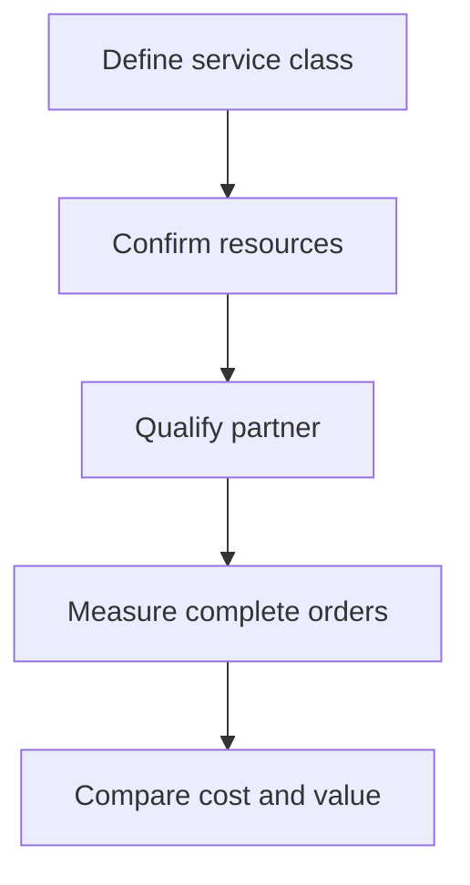

# 8. Customer Service, Resource Effectiveness, and Partner Competencies

## Learning objectives

Understand the decision techniques in customer service, resource effectiveness, and partner competencies, use explicit evidence and practical trade-offs, and test their physical and regulatory feasibility before choosing a solution.

## Concept in plain English

Supply-chain capabilities become strategically valuable when they help the organization satisfy customer expectations and use resources responsibly. The source curriculum identifies three complementary areas: excellence in customer service, effective and efficient use of systemwide resources, and sensible leveraging of partner core competencies. These do not compete in a simple winner-takes-all score. Leaders need to design a service capability that can be delivered at an acceptable total resource cost, often with contributions from independent firms.

Customer service has multiple dimensions. Product availability means the requested item or service can be provided; operational performance addresses response time, reliability and accommodation of reasonable exceptions; customer satisfaction reflects the actual customer's evaluation of that experience. A reported on-time shipment percentage does not automatically establish that the customer was satisfied: promised dates may be wrong, delivery may be incomplete, or the customer may have experienced poor communication during a disruption. Module 6 owns the full CRM and feedback methods. Here the strategic question is which service attributes a chosen market segment genuinely values.

Resource effectiveness asks whether the right output was achieved. Resource efficiency asks whether the operation used inputs productively relative to an appropriate standard. A factory can be highly efficient at producing goods customers do not need. Equally, an emergency shipment can protect a major customer relationship even if its transport cost is unusually high. The right systemwide judgment accounts for the agreed outcome, cost and opportunity cost of the decision; it cannot be inferred from a single facility's utilization.

Partners are part of the operating system. If a qualified logistics firm is better at specialized temperature-controlled handling, purchasing that service may strengthen the organization's customer offering. The business must still evaluate governance, confidentiality, capacity, interoperability, continuity and partner incentives. An alliance is not automatically better than a transactional contract; different service and dependency needs justify different relationship models.

AlderGate's engineering division promises qualified repairs in a short window. Its current factory has a strong product-testing capability but weak expedited distribution. It considers protecting internal qualification competence while contracting a provider with verified urgent-delivery operations. Success requires a joint service definition, exception ownership and evidence that the end-to-end customer promise improves.

## Why it matters

Service excellence is not fully described by internal efficiency or on-time shipment alone. AlderGate needs availability, credible promises and qualified partner performance to work together. The strategic test asks whether better service is valuable enough to justify the resources consumed and whether a partner model can deliver it reliably.

## Decision model and workflow

Compare service outcomes before and after a verified operating change, then reconcile the extra cost with customer retention and qualified service capacity. Test partner approval, qualification and continuity before a service model is called feasible.

### Evidence retained through the workflow

| Decision record | Purpose |
| --- | --- |
| Baseline and target | State the population, units, horizon and accountable owner |
| Operating constraints | Preserve capacity, customer, safety, partner and legal conditions |
| Candidate economics | Compare consistent cost, benefit and resource assumptions |
| Alternatives and sensitivity | Retain why each option passed or failed and when to review |

## Practical process flow

## Realistic example — AlderGate Motion Products

AlderGate's repair line uses a technically strong in-house testing operation, but the plant is weak at urgent final-mile delivery. A specialist carrier pilot improves complete and on-time orders. Supplier management verifies the carrier's contingency and escalation arrangements while Finance checks whether the premium service fees cover the extra delivery charges.

## Applied decision artifact or worked calculation

In a fictional month, 880 of 1,000 orders arrive complete and on time, giving **88%** complete-and-on-time attainment. A tested provider arrangement improves this to 955 of the same 1,000 orders, **95.5%**, for a **7.5-percentage-point** improvement. If the arrangement adds $36,000 monthly and the modeled retained incremental contribution is only $28,000, the preliminary operating effect is **−$8,000** before other avoided service costs. Management must not approve on percentage improvement alone; it should test customer value, contractual terms and financially justified service tiers.

## Decision logic

- Measure availability, reliable execution and direct customer experience separately.
- Keep physical and qualification constraints explicit.
- Use qualified partner strengths without outsourcing customer accountability.
- Compare incremental cost to realized segment value.

## Trade-offs

| Choice | Decision consequence |
| --- | --- |
| Greater analytical detail | Can better reflect reality but also increases maintenance and error risks |
| Greater flexibility | Can improve service but requires resource and governance costs |
| Narrow local optimization | Can improve one metric while worsening total enterprise value |

## Commonly confused with

Service **availability**, **operational performance** and **customer satisfaction** are complementary but distinct. **Effectiveness** asks whether the right customer outcome was achieved; **efficiency** asks how economically resources generated the result. A partner can strengthen both without owning the original customer promise.

## Common mistakes

- Assuming on-time delivery proves customer satisfaction.
- Treating high machine utilization as the whole service objective.
- Choosing an external partner only from its lowest quoted freight rate.
- Rolling premium service out to segments with no demonstrated willingness to pay.

## Original knowledge check

**Question.** What does a rise from 88% to 95.5% complete-and-on-time attainment establish?

A. Customer loyalty has been mathematically proven

B. A scoped 7.5-point service improvement requiring an economic and partner-feasibility check

C. Every product should receive the premium option

D. The provider can be selected without certification checks

Answer and rationale

### Correct answer

**B. A scoped 7.5-point service improvement requiring an economic and partner-feasibility check**

### Why it is correct

The measure shows a real change under the assumed population. Its commercial consequence and provider eligibility remain separate tests.

### Why the other answers are wrong

- **A.** Operational service evidence alone does not establish customer attitudes.
- **C.** Segment-dependent value does not justify universal premium treatment.
- **D.** Qualification and continuity conditions remain mandatory.

## Practitioner perspective

ERP, WMS and carrier events should link to a common order and service definition. Service owners need access to verified partner exceptions, while procurement preserves qualification records and Finance captures the true premium service cost.

## Related concepts

- [Previous topic](./07-financial-customer-and-social-stakeholder-value.md)
- [Module 2 — Network Performance](../../02-network-design-digital-connectivity-performance/README.md)
- [Module 7 — Risk Analysis](../../07-supply-chain-risk/README.md)

---

[Previous topic](./07-financial-customer-and-social-stakeholder-value.md) · [Section overview](./README.md)
