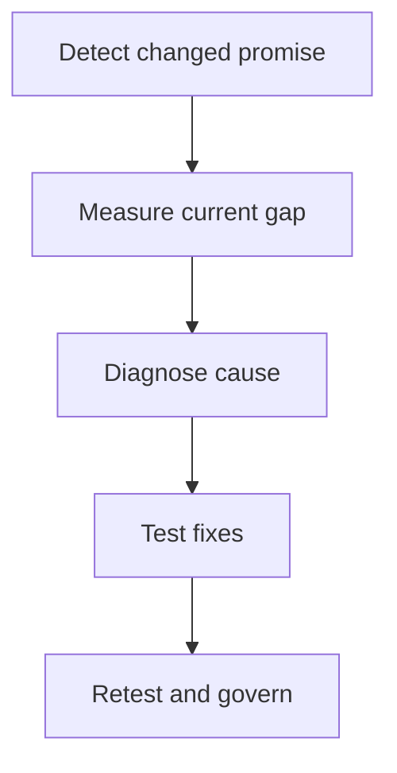

# 9. Strategy Fit, Gap Detection, and Redesign Governance

## Learning objectives

Understand the decision techniques in strategy fit, gap detection, and redesign governance, use explicit evidence and practical trade-offs, and test their physical and regulatory feasibility before choosing a solution.

## Concept in plain English

The strategic fit of a supply chain changes when the business, market or capabilities change. Misalignment can result from a new corporate direction, business combination, changing product life cycle, new channel, unforeseen demand behavior, disruptive technology or a supplier/transport shock. These triggers differ in origin. A redesign team should identify the cause before prescribing more inventory, another warehouse or a new planning platform.

A **gap** is a measurable difference between the required outcome or capability and what the current network delivers. The difference may concern customer lead time, available capacity, skill, data quality, financing, environmental performance or partner behavior. A gap statement requires a population, time horizon, verified baseline and a target. “Improve flexibility” is not enough to justify a costly initiative. “Protect five-day response for emergency customers when actual validated service is eight days” defines a testable gap.

A useful assessment examines the organization, processes, technology, people, metrics and partner commitments together. If sales changes the offer but supply contracts still assume twelve-week lead times, the company should not interpret every late order as a warehouse failure. Root-cause techniques may be borrowed from Module 4; supply disruption analysis from Module 7; supplier relationship controls from Module 6. Module 8 owns deciding whether the combined operating design still serves the strategy.

Redesign governance should not chase every short-term fluctuation. Changing the network frequently incurs transition cost and can destabilize planning. Leaders need a clear trigger: sustained measured gap, unacceptable compliance finding, loss of a critical supplier, a new market position or failure of the current design under tested conditions. Then they can decide whether to adjust a policy, invest in capability, change a partner arrangement or restructure the physical network. The least disruptive viable option deserves serious evaluation.

Complexity must be priced. Adding product variants, specialized fulfillment classes or redundant nodes can improve customer value, yet each adds master data, inventory, coordination and maintenance demands. A design improvement can therefore involve simplifying unnecessary variety rather than adding infrastructure. AlderGate's expansion plan includes product variants with very low observed demand; the team tests whether delayed differentiation and common subassemblies serve customers better than storing every finished variant.

## Why it matters

A supply chain that fit yesterday's market may not fit a newly acquired business, a new technology, a changed product life cycle or a revised customer promise. AlderGate should diagnose the difference between required and observed capability instead of treating every failure as an argument for more stock or a new warehouse.

## Decision model and workflow

Write the gap as a measured baseline, a target and a relevant period. Classify whether the mismatch comes from business direction, demand, assets, partner behavior, technology or governance, and choose the least disruptive viable corrective alternative.

### Evidence retained through the workflow

| Decision record | Purpose |
| --- | --- |
| Baseline and target | State the population, units, horizon and accountable owner |
| Operating constraints | Preserve capacity, customer, safety, partner and legal conditions |
| Candidate economics | Compare consistent cost, benefit and resource assumptions |
| Alternatives and sensitivity | Retain why each option passed or failed and when to review |

## Practical process flow

## Realistic example — AlderGate Motion Products

Following an acquisition, AlderGate's newly combined sales teams promise six-day service for repair parts once produced from independent facilities. Customer service records falling attainment, but the true bottleneck is incompatible product qualification records rather than a shortage of warehouse space. The team harmonizes certification evidence before investing in physical network expansion.

## Applied decision artifact or worked calculation

An illustrative customer-service target is **95%** complete-on-time delivery over a defined month, while actual performance is **88%**. The gap is **7 percentage points**, not a 7% relative change. Suppose 350 of 4,000 orders fail the stated completeness/timing requirement: attainment is 3,650/4,000 = **91.25%** for that separate sample, with a 3.75-point gap to 95%. These populations must not be combined without reconciling definitions and time windows. Record root cause, owner, target, measured counterfactual and reassessment date.

## Decision logic

- Name the changed strategic assumption that caused the gap.
- Separate a single anomaly from a persistent performance mismatch.
- Examine process, data, people, partner and physical capacity causes.
- Record alternatives rejected and remeasure the gap after intervention.

## Trade-offs

| Choice | Decision consequence |
| --- | --- |
| Greater analytical detail | Can better reflect reality but also increases maintenance and error risks |
| Greater flexibility | Can improve service but requires resource and governance costs |
| Narrow local optimization | Can improve one metric while worsening total enterprise value |

## Commonly confused with

A **strategic gap** compares required and available capability; a routine **operational exception** is a particular occurrence. A **design improvement** may be a policy change or product simplification, not necessarily an added facility. The change decision requires cause, cost and owner.

## Common mistakes

- Buying new software before identifying the source of misalignment.
- Adding product variants without quantifying complexity and demand.
- Calling a percentage-point gap a relative-percent gap.
- Changing the strategy after every isolated performance miss.

## Original knowledge check

**Question.** What is the strongest starting point for correcting a strategy-to-supply mismatch?

A. Buy a new system because technology changes faster than the market

B. Create a measurable gap statement, verify cause, then test least-disruptive feasible alternatives

C. Open a regional warehouse whenever there is a single missed order

D. Ignore stakeholder changes until every operating metric fails

Answer and rationale

### Correct answer

**B. Create a measurable gap statement, verify cause, then test least-disruptive feasible alternatives**

### Why it is correct

A defined measured gap and credible diagnosis prevent expensive remedies for the wrong underlying cause.

### Why the other answers are wrong

- **A.** Technology without an operating cause may automate the failure.
- **C.** A single event does not necessarily justify fixed asset expansion.
- **D.** Changes to the competitive promise can require proactive assessment.

## Practitioner perspective

Architecture assessments can trace service targets through product hierarchy, qualification, planned production and partner systems. The smallest viable correction should be considered before redesigning the network, and measured against a stable post-change baseline.

## Related concepts

- [Previous topic](./customer-service-resource-and-partner-competencies.md)
- [Module 2 — Network Performance](../../02-network-design-digital-connectivity-performance/README.md)
- [Module 7 — Risk Analysis](../../07-supply-chain-risk/README.md)

---

[Previous topic](./customer-service-resource-and-partner-competencies.md) · [Section overview](./README.md)
