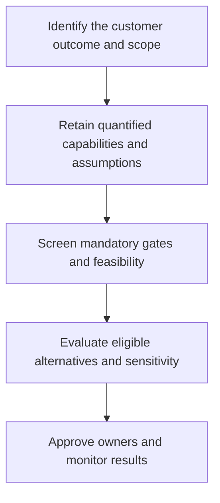

# 10. Network Alternatives, Capacity, and Facility Selection

## Learning objectives

Understand the decision techniques in network alternatives, capacity, and facility selection, use explicit evidence and practical trade-offs, and test their physical and regulatory feasibility before choosing a solution.

## Concept in plain English

Supply-chain network modeling turns business priorities into an explicit comparison of possible suppliers, facilities, transportation lanes, inventories and customer coverage. A network model is not the supply chain itself: it is a representation of selected decisions and constraints. It is only as useful as its scope, input reliability and ability to distinguish meaningful alternatives. A detailed model containing inaccurate lead times and impossible capacity assumptions can be less trustworthy than a smaller well-tested decision model.

A network candidate might centralize inventory, add a regional facility, use a qualified third-party node, or change the allocation of customers to existing warehouses. Each design affects fixed assets, variable transport cost, inventory positioning, response time, emissions and partner dependence. The right objective is conditioned by business strategy: lowest feasible total cost, quickest dependable response, reduced environmental exposure or an approved compromise across multiple objectives. Not every objective can be optimized simultaneously.

**Feasibility must precede ranking.** A design with the lowest modeled expense is not an acceptable choice if it cannot physically supply the customer volume, lacks required safety or regulatory approval, or breaches a contractual service commitment. Its cost figure remains useful as diagnostic evidence but cannot be declared a winning option. This is the same gated-decision principle carried forward from Module 7.

Facility capacity must be expressed with its unit and time period. Monthly nominal handling throughput cannot be compared directly with weekly forecast volume. A site may have enough dock slots but not enough certified staff or suitable storage. The weakest practical constraint often determines the deliverable output. Similarly, mean travel time alone may conceal unacceptable tail risk on the promised service route. The decision record should retain service distributions or conservative checks where the strategy demands them.

AlderGate tests three fictional distribution arrangements for one regional market. It maintains mandatory product qualification and delivery promises; it will not rank an alternative that is cheaper only because its declared capacity cannot cover required volume. The model should also reveal how much demand or fuel price change would overturn the decision, with an owner for periodic revalidation.

## Why it matters

This capability matters when a proposed local change creates consequences outside its sponsoring function. The chosen customer promise, common planning horizon, implementation owner and evidence quality must remain visible to management. An analytically attractive idea may still be premature when the affected network cannot execute it safely or economically.

## Decision model and workflow

The model record must preserve each annual cost component, weekly capacity, service promise, relevant licenses/qualifications and the source of route assumptions. The team also records the best rejected candidate and a scenario that would change the preferred design.

### Evidence retained through the workflow

| Decision record | Purpose |
| --- | --- |
| Baseline and target | State the population, units, horizon and accountable owner |
| Operating constraints | Preserve capacity, customer, safety, partner and legal conditions |
| Candidate economics | Compare consistent cost, benefit and resource assumptions |
| Alternatives and sensitivity | Retain why each option passed or failed and when to review |

## Practical process flow

## Realistic example — AlderGate Motion Products

AlderGate is an independent fictional industrial manufacturer with standard couplings and an engineered repair line. The operations team must reconcile production and service requirements, while Quality confirms process qualification and Finance checks resource economics. The case below uses deliberately selected training figures; no values imply a universal industry benchmark.

## Applied decision artifact or worked calculation

The **central** design has annual modeled facility $280,000, transport $220,000, inventory $85,000 and service-failure $40,000: total **$625,000**. The **regional** design totals $365,000 + $130,000 + $65,000 + $15,000 = **$575,000** and meets a fictional requirement of 1,000 units per week. A third **low-cost** design totals $315,000 + $120,000 + $75,000 + $10,000 = **$520,000**, but delivers only **850 units/week** against the 1,000-unit mandatory capacity requirement. It is **ineligible**, despite the lowest modeled cost. Among these assumptions, the regional option is the least-cost feasible design.

## Decision logic

- Frame one clear decision, with measurable output and the same time units for all options.
- Verify required regulatory, safety, quality, security, continuity and capacity conditions before ranking.
- Compare the remaining feasible alternatives against an explicit enterprise objective.
- Preserve uncertainty and implement an owner-led review trigger for changing assumptions.

## Trade-offs

| Choice | Decision consequence |
| --- | --- |
| Greater analytical detail | Can better reflect reality but also increases maintenance and error risks |
| Greater flexibility | Can improve service but requires resource and governance costs |
| Narrow local optimization | Can improve one metric while worsening total enterprise value |

## Commonly confused with

A business objective does not automatically become a valid mathematical objective function. A method's numerical output must be interpreted against the operating model it represents. Feasibility, efficiency and strategic effectiveness answer distinct questions.

## Common mistakes

- Optimizing a metric that does not reflect the target customer or economic objective.
- Mixing monthly and weekly capacities or inconsistent financial scopes.
- Assigning a weighted penalty to an alternative that actually fails a mandatory condition.
- Claiming that a model result eliminates the need for implementation and sensitivity testing.

## Original knowledge check

**Question.** What is the correct interpretation of the $520,000 option with 850 weekly capacity against a 1,000-unit mandatory requirement?

A. It must win because its cost is lowest

B. It should be assigned a small penalty and ranked anyway

C. It is infeasible until capacity changes and must not win a feasible-only ranking

D. It automatically becomes feasible if demand variability declines

Answer and rationale

### Correct answer

**C. It is infeasible until capacity changes and must not win a feasible-only ranking**

### Why it is correct

A hard capacity constraint cannot be overridden by a weighted economic score.

### Why the other answers are wrong

- **A.** Lowest cost matters only among feasible alternatives.
- **B.** A ranking penalty cannot replace an explicitly mandatory threshold.
- **D.** A hypothetical decline in variability does not change stated required capacity.

## Practitioner perspective

Before implementing a facility design, the supply-chain architect should reconcile modeled flow quantities against real transport calendars, inventory requirements, operating hours and supplier qualifications. Procurement or warehouse configuration updates must follow a verified physical capacity plan, not precede it.

## Related concepts

- [Previous topic](./strategy-fit-gap-detection-and-redesign-governance.md)
- [Module 2 — Network Performance](../../02-network-design-digital-connectivity-performance/README.md)
- [Module 7 — Risk Analysis](../../07-supply-chain-risk/README.md)

---

[Previous topic](./strategy-fit-gap-detection-and-redesign-governance.md) · [Section overview](./README.md)
