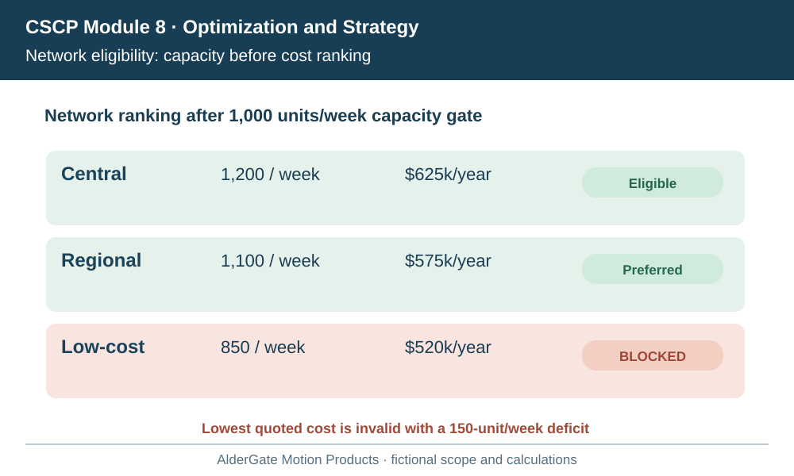
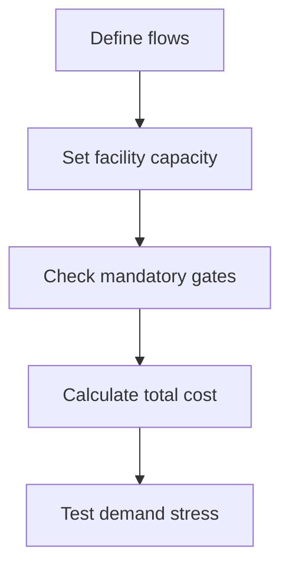

# 10. Network Alternatives, Capacity, and Facility Selection

## Learning objectives

Understand the decision techniques in network alternatives, capacity, and facility selection, use explicit evidence and practical trade-offs, and test their physical and regulatory feasibility before choosing a solution.

## Concept in plain English

Supply-chain network modeling turns business priorities into an explicit comparison of possible suppliers, facilities, transportation lanes, inventories and customer coverage. A network model is not the supply chain itself: it is a representation of selected decisions and constraints. It is only as useful as its scope, input reliability and ability to distinguish meaningful alternatives. A detailed model containing inaccurate lead times and impossible capacity assumptions can be less trustworthy than a smaller well-tested decision model.

A network candidate might centralize inventory, add a regional facility, use a qualified third-party node, or change the allocation of customers to existing warehouses. Each design affects fixed assets, variable transport cost, inventory positioning, response time, emissions and partner dependence. The right objective is conditioned by business strategy: lowest feasible total cost, quickest dependable response, reduced environmental exposure or an approved compromise across multiple objectives. Not every objective can be optimized simultaneously.

**Feasibility must precede ranking.** A design with the lowest modeled expense is not an acceptable choice if it cannot physically supply the customer volume, lacks required safety or regulatory approval, or breaches a contractual service commitment. Its cost figure remains useful as diagnostic evidence but cannot be declared a winning option. This is the same gated-decision principle carried forward from Module 7.

Facility capacity must be expressed with its unit and time period. Monthly nominal handling throughput cannot be compared directly with weekly forecast volume. A site may have enough dock slots but not enough certified staff or suitable storage. The weakest practical constraint often determines the deliverable output. Similarly, mean travel time alone may conceal unacceptable tail risk on the promised service route. The decision record should retain service distributions or conservative checks where the strategy demands them.

AlderGate tests three fictional distribution arrangements for one regional market. It maintains mandatory product qualification and delivery promises; it will not rank an alternative that is cheaper only because its declared capacity cannot cover required volume. The model should also reveal how much demand or fuel price change would overturn the decision, with an owner for periodic revalidation.

## Why it matters

Network redesign can commit an enterprise to years of facilities, freight patterns and inventory investment. The cost output is credible only when each candidate meets the same service, volume and period assumptions and survives explicit capacity and compliance checks. AlderGate must therefore separate feasibility from economic ranking.

## Decision model and workflow

Central $625k,Regional $575k,Low $520k,Capacity gate

Test the central, regional and low-cost concepts against a 1,000-unit weekly requirement, physical capacity and operating gates. Sum comparable annual cost components only for eligible options and preserve the rejected cheapest alternative as evidence of the hard-capacity boundary.

### Evidence retained through the workflow

| Decision record | Purpose |
| --- | --- |
| Baseline and target | State the population, units, horizon and accountable owner |
| Operating constraints | Preserve capacity, customer, safety, partner and legal conditions |
| Candidate economics | Compare consistent cost, benefit and resource assumptions |
| Alternatives and sensitivity | Retain why each option passed or failed and when to review |

## Practical process flow

## Realistic example — AlderGate Motion Products

AlderGate receives three regional distribution proposals. The lowest quote relies on a warehouse staffed for only 850 units a week while the mandatory customer commitment is 1,000 units. The procurement group wants to average the shortfall into a total score, but the operations owner rejects it as infeasible and asks the team to rank only the remaining options.

## Applied decision artifact or worked calculation

[Working data: location-design-alternatives.csv](../../assets/data/module-8/section-a/location-design-alternatives.csv)

The **central** design has annual modeled facility $280,000, transport $220,000, inventory $85,000 and service-failure $40,000: total **$625,000**. The **regional** design totals $365,000 + $130,000 + $65,000 + $15,000 = **$575,000** and meets a fictional requirement of 1,000 units per week. A third **low-cost** design totals $315,000 + $120,000 + $75,000 + $10,000 = **$520,000**, but delivers only **850 units/week** against the 1,000-unit mandatory capacity requirement. It is **ineligible**, despite the lowest modeled cost. Among these assumptions, the regional option is the least-cost feasible design.

## Decision logic

- Preserve the required demand, capacity units and period.
- Evaluate every network option on the same cost and service scope.
- Reject hard capacity and compliance failures before economic comparison.
- Stress-test the preferred feasible design under higher demand and cost.

## Trade-offs

| Choice | Decision consequence |
| --- | --- |
| Greater analytical detail | Can better reflect reality but also increases maintenance and error risks |
| Greater flexibility | Can improve service but requires resource and governance costs |
| Narrow local optimization | Can improve one metric while worsening total enterprise value |

## Commonly confused with

**Network feasibility** means the candidate can meet mandatory constraints; **network optimality** means it is best for the modeled objective among feasible candidates. The lowest theoretical cost may be invalid if the model omits capacity, legal requirements or customer-service thresholds.

## Common mistakes

- Converting an infeasible network into a winner through a weighted score.
- Mixing weekly volume with monthly capacity.
- Omitting inventory or failure costs to favor one proposal.
- Trusting an unvalidated model more than physical throughput evidence.

## Original knowledge check

**Question.** What is the correct interpretation of the $520,000 option with 850 weekly capacity against a 1,000-unit mandatory requirement?

A. It must win because its cost is lowest

B. It should be assigned a small penalty and ranked anyway

C. It is infeasible until capacity changes and must not win a feasible-only ranking

D. It automatically becomes feasible if demand variability declines

Answer and rationale

### Correct answer

**C. It is infeasible until capacity changes and must not win a feasible-only ranking**

### Why it is correct

A hard capacity constraint cannot be overridden by a weighted economic score.

### Why the other answers are wrong

- **A.** Lowest cost matters only among feasible alternatives.
- **B.** A ranking penalty cannot replace an explicitly mandatory threshold.
- **D.** A hypothetical decline in variability does not change stated required capacity.

## Practitioner perspective

A design study must reconcile facility throughput with real shifts, qualified labor, inventory space and carrier coverage before integration or master-data updates. Operating calendars and actual lanes need to confirm the model's assumptions.

## Related concepts

- [Previous topic](./09-strategy-fit-gap-detection-and-redesign-governance.md)
- [Module 2 — Network Performance](../../02-network-design-digital-connectivity-performance/README.md)
- [Module 7 — Risk Analysis](../../07-supply-chain-risk/README.md)

---

[Previous topic](./09-strategy-fit-gap-detection-and-redesign-governance.md) · [Section overview](./README.md)
