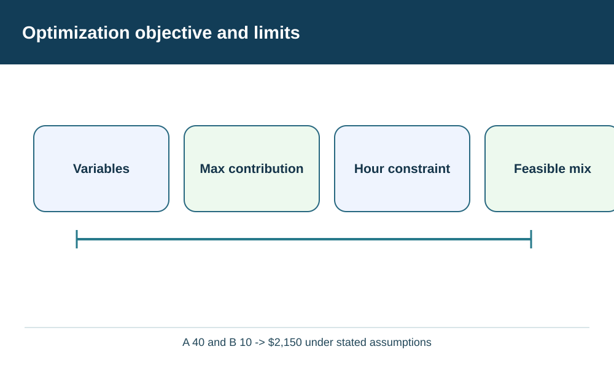
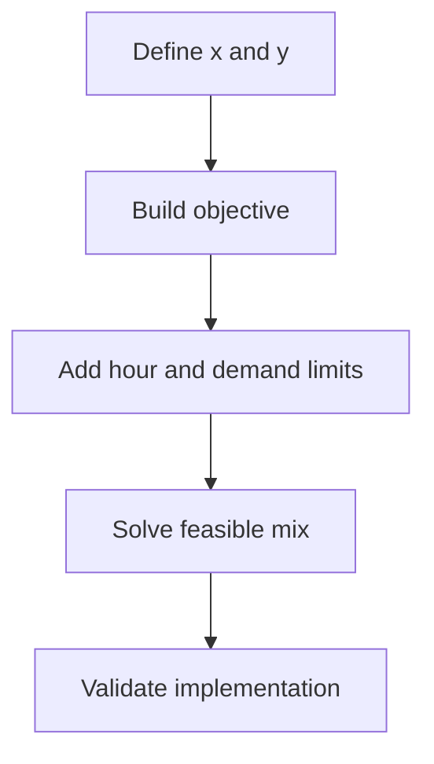

# 11. Operations Research: Objectives, Constraints, and Model Validity

## Learning objectives

Understand the decision techniques in operations research: objectives, constraints, and model validity, use explicit evidence and practical trade-offs, and test their physical and regulatory feasibility before choosing a solution.

## Concept in plain English

**Operations research** provides quantitative methods for formulating and solving management decisions. Supply-chain applications may minimize cost, maximize contribution, allocate scarce capacity, choose facilities, schedule resources or simulate disruption outcomes. The mathematical **objective function** expresses what should improve. **Decision variables** represent controllable choices; **constraints** represent limits or conditions the solution must respect. A numerical optimum is meaningful only for the model that was actually specified.

The objective must be aligned with business strategy. Minimizing purchasing expense without including quality and delivery consequences can produce a bad network design even if the algorithm works correctly. Maximizing contribution without accounting for scarce capacity can favor the wrong product mix. Some limits are mandatory, such as permits, safe operating range and minimum service; these belong in the feasible set rather than in a score that allows a large economic benefit to compensate for a failed safety requirement.

A model should be as detailed as necessary, not as complicated as possible. Input units and periods must be consistent. If labor is measured in hours per unit but supplier capacity is reported in units per week, converting to one common basis is a prerequisite. A feasible-looking result can be invalid when two products compete for the same resource but the model gives each its full standalone capacity. Analysts must also distinguish deterministic assumptions from uncertainty in demand, disruptions and yields.

Model verification and validation are different tasks. Verification asks whether the coded formulas or solver execute the intended equations correctly. Validation asks whether those equations and data represent the real operating decision adequately. A perfectly solved incorrect model should not authorize a costly plant investment. A good review therefore includes known-case checks, boundary scenarios, independent arithmetic and inspection by people who understand the actual operations.

Linear programming is useful when objective and constraint relationships are appropriately linear. Other supply-chain problems may require discrete decisions, routing, queuing, simulation or scenario analysis. Monte Carlo simulation evaluates uncertainty across repeated possible outcomes rather than guaranteeing an optimal operating choice; Module 7 introduces risk-simulation concepts. In Module 8 the focus is whether the selected technique matches the strategic question and the result can be safely implemented.

AlderGate uses a constrained production-mix example to show why total contribution, labor demand and order commitments must be expressed in the same planning horizon. The model is intentionally small enough for a reader to verify without a solver.

## Why it matters

An optimizer can produce a precise-looking answer even when its objective, resource assumptions or constraints represent the wrong business question. AlderGate needs formulation and independent verification before any solver result can be used as an execution decision. The value of operations research lies in a defendable choice, not mathematical complexity alone.

## Decision model and workflow

Variables,Max contribution,Hour constraint,Feasible mix

Declare controllable variables, objective, hours per product and order caps first. Verify that the computed mix is feasible, then assess whether the simplified linear model covers the service, safety and other conditions needed for production approval.

### Evidence retained through the workflow

| Decision record | Purpose |
| --- | --- |
| Baseline and target | State the population, units, horizon and accountable owner |
| Operating constraints | Preserve capacity, customer, safety, partner and legal conditions |
| Candidate economics | Compare consistent cost, benefit and resource assumptions |
| Alternatives and sensitivity | Retain why each option passed or failed and when to review |

## Practical process flow

## Realistic example — AlderGate Motion Products

AlderGate has one constrained finishing cell serving two product lines. A planner proposes maximizing units, but the finance owner wants contribution under a fixed weekly labor-hour limit. The team formulates a two-product model, solves it manually and records excluded effects such as minimum campaign size and setup time. An implementation test is required before scheduling systems are changed.

## Applied decision artifact or worked calculation

[Working data: production-mix.csv](../../assets/data/module-8/section-a/production-mix.csv)

For one fictional **weekly** work center, let x = units of Product A and y = Product B. The contribution objective is **maximize 40x + 55y dollars**. Each A uses 2 hours and each B 4 hours, with **2x + 4y ≤ 120 hours**. Demand caps are **x ≤ 40**, **y ≤ 25**, and x,y are nonnegative integers. Since A yields $20 per constrained hour versus B's $13.75, use A to its 40-unit cap (80 hours) and allocate the remaining 40 hours to 10 units of B. The feasible solution **(x=40, y=10)** returns **$2,150**. This conclusion depends on these objective, limits and assumptions; it is not an enterprise-wide profit optimum.

## Decision logic

- Write objective units, decision variables and feasible constraint set explicitly.
- Use one consistent weekly horizon for available and consumed hours.
- Verify the mathematical solution independently of solver output.
- Validate the underlying operating assumptions before deployment.

## Trade-offs

| Choice | Decision consequence |
| --- | --- |
| Greater analytical detail | Can better reflect reality but also increases maintenance and error risks |
| Greater flexibility | Can improve service but requires resource and governance costs |
| Narrow local optimization | Can improve one metric while worsening total enterprise value |

## Commonly confused with

**Optimization** chooses the best feasible value of a specified objective. **Simulation** explores possible behaviors under assumptions and uncertainty. **Verification** checks the implemented equations; **validation** checks whether the model represents the real decision adequately.

## Common mistakes

- Maximizing total units when the actual goal is contribution.
- Omitting a shared-hour constraint used by both products.
- Assuming a solver's numerical optimum automatically meets quality rules.
- Failing to record exclusions such as setups and order sequencing.

## Original knowledge check

**Question.** What does a solver's $2,150 contribution solution for the specified weekly model prove?

A. It is optimal for the stated constrained model if the equations and solver are correct, but business validity still needs checking

B. It guarantees customer satisfaction and safety

C. The model can drop all real-world capacity and quality checks

D. Every supply-chain optimization problem is linear

Answer and rationale

### Correct answer

**A. It is optimal for the stated constrained model if the equations and solver are correct, but business validity still needs checking**

### Why it is correct

The solution is meaningful within its tested objective, available hours, demand caps and integer rules. Real implementation needs validated data and business gates.

### Why the other answers are wrong

- **B.** The model does not include every service or safety dimension.
- **C.** Dropping constraints changes and may invalidate the problem.
- **D.** Routing, facility-location, stochastic and nonlinear decisions can need other techniques.

## Practitioner perspective

Maintain a small auditable calculation beside any production optimization service. Before releasing a plan to ERP or MES, validate resource calendars, product qualification, order commitments and the exceptions not included in the simplified equations.

## Related concepts

- [Previous topic](./network-alternatives-capacity-and-feasibility.md)
- [Module 2 — Network Performance](../../02-network-design-digital-connectivity-performance/README.md)
- [Module 7 — Risk Analysis](../../07-supply-chain-risk/README.md)

---

[Previous topic](./network-alternatives-capacity-and-feasibility.md) · [Section overview](./README.md)
