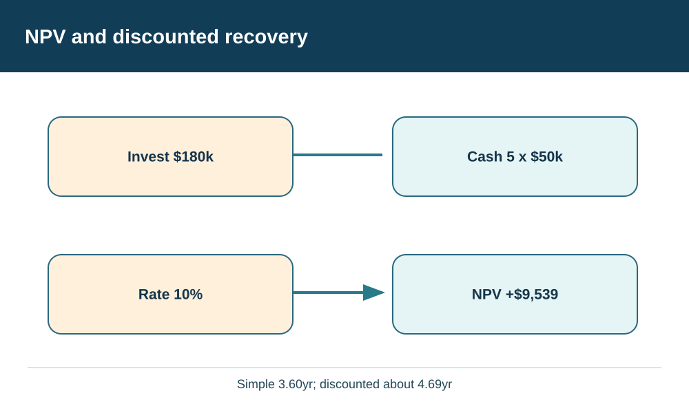
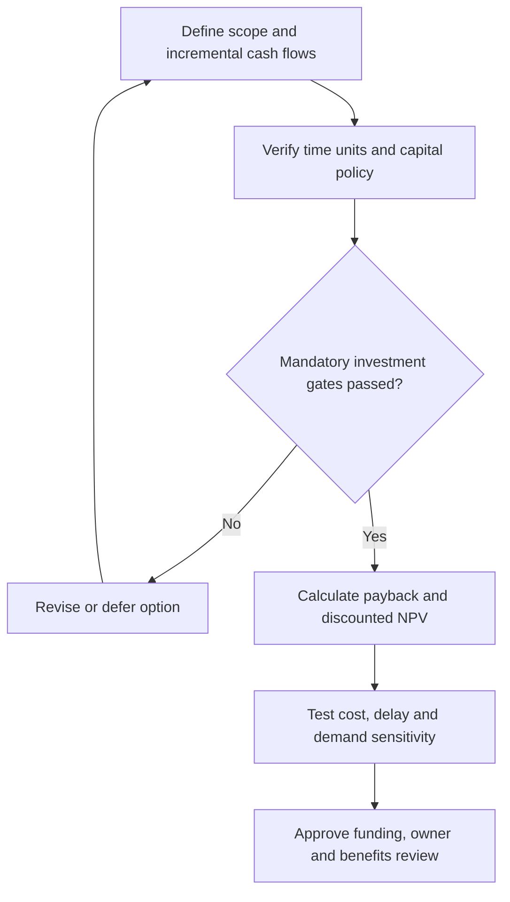

# 12. Capital Investment, NPV, Payback, and Economic Value

## Learning objectives

Compare simple payback, discounted cash-flow evaluation and economic-value measures; distinguish forecast benefits from realized cash flows; and test a capital investment's strategic and physical feasibility before making an approval recommendation.

## Concept in plain English

A strategic supply-chain redesign often needs capital long before the resulting benefits are realized. A regional distribution node, flexible production cell or technology investment may produce annual savings, but those savings do not arrive at the same time as the initial cash expense. **Financial modeling** makes the timing, scope and uncertainty explicit. It is especially important when several credible projects compete for the same investment funding.

**Simple payback** asks how long recurring modeled annual benefits would take to recover the initial investment. It is intuitive but does not account for the time value of money, cash flows after recovery or volatility in timing. **Net present value (NPV)** converts expected future cash inflows and outflows into today's monetary equivalent using a chosen discount rate. If correctly scoped and supported, a positive NPV indicates that a project exceeds the discounted investment hurdle embodied in that rate. It does not prove that the project is legal, technically feasible, risk-free or preferable to all alternatives.

**Discounted payback** applies the time value of money to the payback calculation, usually resulting in a longer recovery period than simple payback for positive discount rates and level positive benefits. It still lacks some information about cash flows after recovery, so it is a complementary rather than universal decision rule. **Return on investment (ROI)** can be defined in multiple ways in practice; before comparing ratios, Finance must agree on numerator, denominator and measurement period. An undefined percentage labeled ROI is not reliable evidence.

**Economic value added (EVA)** is concerned with operating profit above a capital charge. Conceptually it helps prevent a company from calling an investment value-creating merely because it earns positive accounting profit while consuming expensive capital. A formal EVA calculation requires the organization's approved profit measure, capital employed and cost-of-capital policy; it should not be guessed from a sales or gross-margin figure.

These methods are decision aids, not substitutes for strategy. A theoretically attractive NPV can depend on unrealistic customer adoption, a permit that has not been secured, a supplier that cannot qualify, or a technology implementation that takes twice the proposed time. Mandatory safety, quality, environmental, privacy, legal and continuity gates must be passed before a discounted ranking has operational meaning.

The same cash benefit should not be counted twice. If a service improvement is already represented as increased contract revenue, Finance should ensure that the same outcome is not separately recorded as full customer downtime avoidance earned by AlderGate. Working capital and residual asset value need explicit treatment, and the project owner's sensitivity cases should include delayed launch, lost volume and recurring cost increases.

## Why it matters

Network and technology investments lock the enterprise into costs, assets and operating models over several years. A one-year savings figure may sound persuasive while hiding a long recovery period or a fragile benefit assumption. A reproducible cash-flow model lets management compare capital proposals without confusing annual contribution, payback and value creation.

## Decision model and workflow

Invest $180k,Cash 5 x $50k,Rate 10%,NPV +$9,539

The investment decision starts from the customer and strategic objective, establishes a dated incremental cash-flow model, screens hard eligibility conditions, and then compares economic criteria and sensitivities. Record a financial approver, technical qualification owner and date at which benefits will be checked against actual results.

### Evidence retained through the workflow

| Evidence | Decision use |
| --- | --- |
| Approved initial investment and timing | Separates one-time outlay from recurring operating expense |
| Year-specific net cash flows | Makes forecast savings and implementation delay auditable |
| Discount rate and policy owner | Prevents arbitrary NPV comparisons |
| Legal, capacity and quality gates | Rejects options that cannot be implemented |
| Sensitivities, residual value and review triggers | Shows where the recommendation may change |

## Practical process flow

## Realistic example — AlderGate Motion Products

AlderGate is deciding whether to establish a regional service point. An initial estimate shows reduced freight and failure cost but does not say when the launch outlay occurs or how long savings persist. Finance prepares a five-year incremental cash-flow comparison. Operations verifies the service node has adequate throughput and certified processes, and the legal team checks that the operating site is eligible for the proposed activity. The annual savings remain an illustrative estimate until the node begins serving customers.

## Applied decision artifact or worked calculation

[Working data: capital-investment-cash-flows.csv](../../assets/data/module-8/section-a/capital-investment-cash-flows.csv)

The fictional investment has an initial outlay of **$180,000 at time zero** and **$50,000 of net cash benefit at the end of each of years 1–5**, with no modeled terminal value. At the hypothetical approved discount rate of **10% annually**, the value of each cash inflow is $50,000 / (1.10)^t for t = 1 through 5.

- **Simple payback** = $180,000 / $50,000 = **3.60 years**.
- **NPV** = −$180,000 + Σ [$50,000 / (1.10)^t] for t=1..5 = approximately **+$9,539.34**.
- The discounted inflows through year 4 total approximately **$158,493.27**. Year 5's discounted inflow is approximately **$31,046.07**, so interpolated **discounted payback** is approximately **4.69 years**.

These are training assumptions and not an assertion of tax deductibility or guaranteed returns. If recurring net benefits fall or the go-live slips, the decision must be recalculated. Annual $50,000 savings may also be insufficient for a business whose maximum permitted payback period is shorter; policy and feasibility gates remain separate from the NPV result.

## Decision logic

- Convert every option's incremental costs and benefits to the same currency and timeline.
- Separate customer benefits from company cash flows and validate the adopted discount rate.
- Apply hard quality, financial and regulatory requirements before comparing feasible NPVs.
- Use at least one demand or delivery-delay sensitivity and state who owns each assumption.
- Report simple payback, discounted payback and NPV as different questions, not competing definitions of one quantity.

## Trade-offs

| Choice | Decision consequence |
| --- | --- |
| Short recovery versus long-term return | Payback emphasizes early cash recovery; NPV incorporates more of the investment horizon |
| Higher modeled benefit versus uncertain adoption | Optimistic benefits can reverse rankings when volumes underperform |
| Rich model versus false precision | Greater detail helps only if assumptions remain verifiable and relevant |

## Commonly confused with

**Contribution margin** is not necessarily available project cash. **Simple payback** ignores discounting; **discounted payback** does not. **Positive NPV** indicates modeled value under the chosen assumptions, not automatically a passed capital budget or all regulatory approvals. **EVA** requires an explicit capital charge and defined accounting scope, not just a revenue-minus-cost subtraction.

## Common mistakes

- Applying one annual saving to an indefinite period with no stated horizon.
- Calling simple payback a discounted measure.
- Substituting a customer's modeled benefit for company cash receipts.
- Double-counting the same avoided loss under separate benefit categories.
- Approving a mathematically positive project while necessary quality or site permissions remain missing.

## Original knowledge check

**Question.** An AlderGate option has a 3.60-year simple payback and 4.69-year discounted payback under a 10% model. Which interpretation is correct?

A. The discounted payback must be shorter than simple payback.

B. The option has guaranteed positive realized cash profit in every year.

C. The original investment is ignored when calculating NPV.

D. Discounting reduces the present value of later savings, lengthening the modeled recovery period.

Answer and rationale

### Correct answer

**D. Discounting reduces the present value of later savings, lengthening the modeled recovery period.**

### Why it is correct

The same nominal $50,000 future inflow has a lower present value than its face amount when the positive annual discount rate is applied.

### Why the other answers are wrong

- **A.** Discounting future cash inflows generally extends, rather than shortens, recovery in this positive-rate level-payment case.
- **B.** The figures are forecasts dependent on customer demand, implementation and feasibility.
- **C.** The time-zero outlay of $180,000 is essential to the investment's NPV.

## Practitioner perspective

Supply-chain solution owners should connect any modeled savings to measurable baseline transactions, operating policies and project milestones, while Finance governs cash-flow timing and discount criteria. An ERP cost estimate or optimized network result is one input; it cannot replace a verified implementation plan or post-launch benefit measurement.

## Related concepts

- [Network Alternatives and Feasibility](./10-network-alternatives-capacity-and-feasibility.md)
- [Operations Research Model Validity](./11-operations-research-objectives-constraints-and-model-validity.md)
- [Module 2 — Network and Performance](../../02-network-design-digital-connectivity-performance/README.md)

---

[Previous: Operations Research](./11-operations-research-objectives-constraints-and-model-validity.md) · [Section overview](./README.md)
