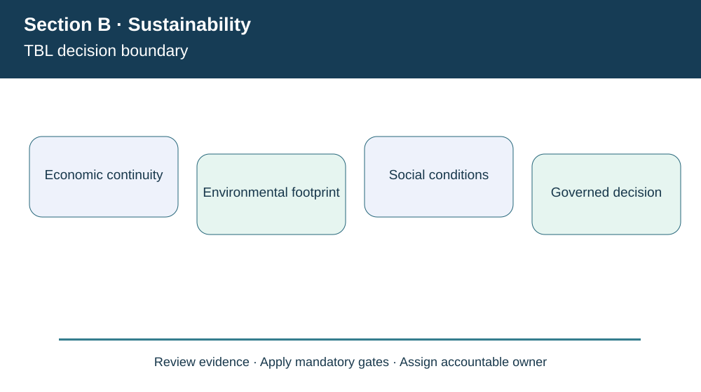
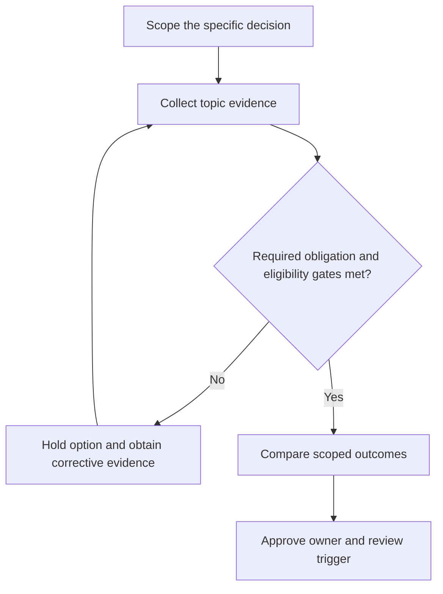

# 1. Sustainable Supply Chains and the Triple Bottom Line

## Learning objectives

Explain the decision boundary of sustainable supply chains and the triple bottom line, preserve suitable evidence, and identify where law or certification rules require verification beyond this fictional case.

## Concept in plain English

The **triple bottom line (TBL)** treats economic viability, environmental stewardship and social outcomes as material elements of a continuing enterprise. Economic sustainability asks whether the business can maintain its ability to operate, invest and satisfy customers over time. Environmental sustainability asks how resource extraction, production, packaging, transportation and disposal affect ecosystems. Social sustainability concerns people and communities, including safe work, fair treatment and the consequences of business practices. None of the three means that a company may compensate for a serious violation in one category with a high score in another.

For AlderGate Motion Products, a fictional manufacturer of mechanical couplings, a cheap new distribution option may look financially appealing. But if the carrier lacks required hazardous-material authorization, its theoretical economic advantage does not make it an eligible option. Likewise, a recyclable shipping material is not automatically environmentally preferable if it requires substantially more energy, creates excessive damage or cannot be recovered in the destinations served. The appropriate comparison begins by defining the actual product system and impacts.

The point of three simultaneous perspectives is to prevent narrow functional choices. Finance can document economic resources, operations can document energy and waste, and human resources and suppliers can document worker-related outcomes. Leadership then chooses measures with credible baselines, time periods and accountability. Sustainability is a long-term management issue embedded in business plans and operations, not a once-yearly publicity statement.

**Curriculum alignment.** The 2026 CSCP Module 8 Section B establishes economic, environmental and social sustainability as three complementary dimensions. A business may have statutory duties and voluntary commitments; the training model must distinguish the two. The wording, example and decision artifact below are original learning content rather than a reproduction of the APICS text.

## Why it matters

AlderGate's strategy meeting used to approve logistics changes based only on delivered cost. The TBL structure forces the team to record what that decision does to emissions, packaging, safety and customer access as well as money. This is not a license to invent a single universal sustainability score; some obligations are non-negotiable.

## Decision model and workflow

The visual identifies four subject-specific evidence stages. For this topic, the business decision proceeds as follows:

1. Identify the stakeholders affected and time boundary.
2. Report separate economic, environmental and social baselines.
3. Apply legal, safety and ethics gates before trade-offs.
4. Approve a balanced improvement plan and outcome owners.

### Evidence retained through the workflow

| Evidence record | Audit boundary |
| --- | --- |
| Annual contribution ledger with cost exclusions | Retain source, current date, owner and review state |
| Metered electricity and production denominator | Retain source, current date, owner and review state |
| Worker-safety incident definitions and exposure hours | Retain source, current date, owner and review state |
| Applicable permits and stakeholder obligations | Retain source, current date, owner and review state |

## Practical process flow

## Realistic example — AlderGate Motion Products

AlderGate Motion Products is a fictional industrial manufacturer used throughout Module 8. In the present scenario its sustainability team must document tbl decision boundary, while Finance, Operations and Compliance independently test the customer promise, data quality and applicable obligations. The affected suppliers or workers are not described as verified in the real world. The decision is an illustrative governance exercise only.

## Applied decision artifact or worked calculation

[Directly linked fictional input dataset](../../assets/data/module-8/section-b/tbl-baseline.csv)

In a fictional year, AlderGate records **$2,000,000 revenue** and **$1,600,000 defined operating expense**, giving **$400,000 operating contribution within that limited cost scope**. It also records **1,200 MWh** of electricity and **six safety events**. The financial subtraction cannot be converted into a complete environmental or social result; the latter figures require production output, risk severity and historical context before targets can be interpreted.

## Decision logic

- Identify the stakeholders affected and time boundary.
- Report separate economic, environmental and social baselines.
- Apply legal, safety and ethics gates before trade-offs.
- Approve a balanced improvement plan and outcome owners.

## Trade-offs

| Relevant tension | Decision implication |
| --- | --- |
| Low short-term cost | Possible delayed cleanup, injury or customer costs |
| More recyclable material | Potential increase in transport mass or failed recovery |
| More safety controls | Requires investment yet protects people and continuity |

## Commonly confused with

This topic involves **tbl decision boundary**, which should not be presented as the entire sustainability program. A modeled measurement is not verified external reporting, and a chosen voluntary program is not equivalent to legal permission. Requirements must be checked for their edition, geography, entity and applicable product/operation.

## Common mistakes

- Treating positive profit as proof of all three sustainability outcomes.
- Subtracting a safety incident from a cash benefit as though the units matched.
- Assuming voluntary sustainability activity removes statutory duties.

## Original knowledge check

**Question.** AlderGate's lowest-cost carrier lacks required authorization for a regulated load. What does a triple-bottom-line assessment permit?

A. Accepting the carrier if emissions are lowest

B. Rejecting or correcting the ineligible option before comparing benefits

C. Averaging the permit failure with customer satisfaction

D. Claiming certification because annual profits are positive

Answer and rationale

### Correct answer

**B. Rejecting or correcting the ineligible option before comparing benefits**

### Why it is correct

Mandatory authorization is a gate, not a negotiable contribution to a weighted sustainability score.

### Why the other answers are wrong

- **A.** Environmental performance cannot cure an unlicensed shipment.
- **C.** A weighted average cannot authorize noncompliance.
- **D.** Profit is unrelated to the carrier's required certification.

## Practitioner perspective

A solution architect should preserve a trace from policy or obligation to the affected material, partner, shipment or operational process. A dashboard count or report submission does not prove the underlying process operates safely. Controls need evidence fields, responsible owners and a rule for unresolved records before release.

## Related concepts

- [Previous study step](../README.md)
- [Module 7 supply-chain risk gates](../../07-supply-chain-risk/README.md)
- [Module 8 overall strategy](../README.md)
- [ASCM public standards and tools](https://www.ascm.org/corporate-solutions/standards-tools/scor-ds/)

---

[Section B overview](./README.md) · [Previous study step](../README.md)
