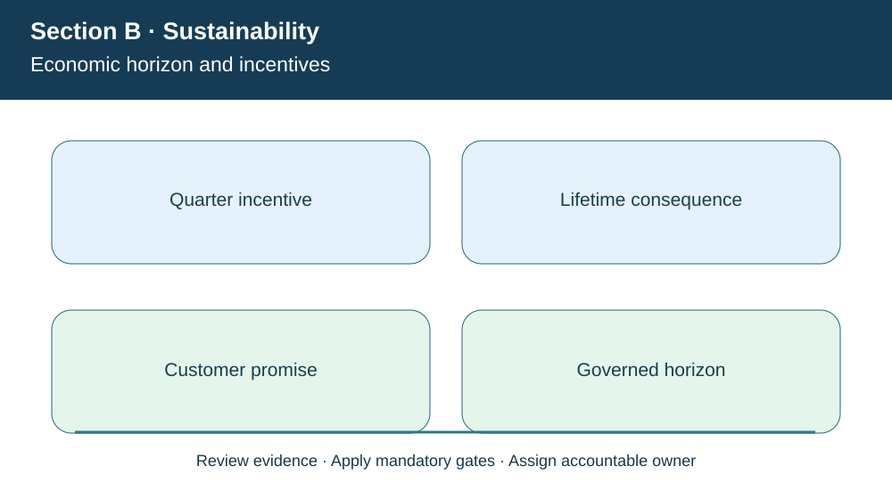
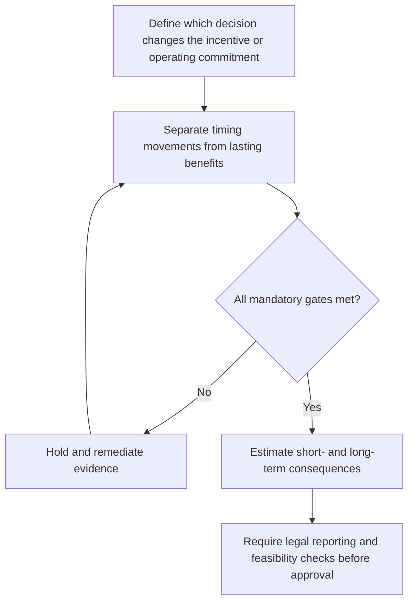

# 2. Micro/Macroeconomics and Short- versus Long-Term Sustainability

## Learning objectives

Explain the decision boundary of micro/macroeconomics and short- versus long-term sustainability, preserve suitable evidence, and identify where law or certification rules require verification beyond this fictional case.

## Concept in plain English

At a **microeconomic** level, supply-chain decisions change production cost, stock, service, incentive structure and firm-level investment. At a **macroeconomic** level, firms operate within broader labor, energy, interest-rate, infrastructure, trade and climate conditions. These external forces can alter feasible network strategies even if the firm's operating methods remain unchanged. A sustainable plan distinguishes influences an organization can directly control from the external scenarios for which it must prepare.

Financial reporting periods can create damaging incentives. Management that prizes only current-quarter cost reduction may defer maintenance, use unreliable suppliers or lower buffers below the level required for a committed customer service. Some temporary reductions are sensible; others merely shift costs into later periods or different functions. A robust business case separates recurring economic improvements from timing effects and recognizes what assumptions drive future savings.

A classic example is bringing orders forward, delaying deliveries or building stocks to make one reporting period look attractive. Such behavior can disturb demand signals upstream and create avoidable variability. Reporting accuracy and lawful revenue recognition are mandatory; leadership should measure customer performance and economic returns alongside financial periods to avoid dysfunctional behavior.

Strategic sustainability requires deliberate reinvestment. A manufacturer that runs equipment into failure may look efficient for one quarter but lose capacity, safety and customer trust over the year. Positive long-run outcomes still require a financing plan; discounting cash flow and capital thresholds belong to Section A lesson 12. Here the decision is about the proper horizon and incentive alignment, not restating NPV mathematics.

**Curriculum alignment.** The CSCP Section B covers micro- and macroeconomic drivers and the consequences of prioritizing quarterly appearance over long-term value. Its examples include inventory, order timing and demand distortion. The wording, example and decision artifact below are original learning content rather than a reproduction of the APICS text.

## Why it matters

The difference between an actual productivity gain and a quarter-end shift in orders can determine whether a proposed saving continues or reverses. Incentives must reward real value creation over an appropriately long period, not artificial timing of transactions.

## Decision model and workflow

The visual identifies four subject-specific evidence stages. For this topic, the business decision proceeds as follows:

1. Define which decision changes the incentive or operating commitment.
2. Separate timing movements from lasting benefits.
3. Estimate short- and long-term consequences.
4. Require legal reporting and feasibility checks before approval.

### Evidence retained through the workflow

| Evidence record | Audit boundary |
| --- | --- |
| Quarterly versus multiyear service trends | Retain source, current date, owner and review state |
| Date-specific investment and operating benefit assumptions | Retain source, current date, owner and review state |
| Customer commitments and any deferred-maintenance backlog | Retain source, current date, owner and review state |
| External macroeconomic scenarios and confidence levels | Retain source, current date, owner and review state |

## Practical process flow

## Realistic example — AlderGate Motion Products

At AlderGate's quarterly close, sales wants to delay a completed customer shipment into the next period to smooth the reported results. Supply planning anticipates a false demand spike in the following week and escalating inventory at the distributor. The governance team rejects artificial scheduling and instead evaluates an independently costed reliability investment using actual demand and a multiyear review horizon.

## Applied decision artifact or worked calculation

[Directly linked fictional input dataset](../../assets/data/module-8/section-b/horizon-economics.csv)

A fictional reliability investment requires **$250,000 upfront** and is expected to yield **$85,000 annual net operating benefits for five years**. Total **undiscounted** nominal benefits are $425,000, exceeding the initial expense by **$175,000**. This does not establish a positive NPV, which requires dated cash flows and an approved discount rate; it also does not demonstrate the benefits will occur. The short-horizon budget still needs funding and capacity-readiness gates.

## Decision logic

- Define which decision changes the incentive or operating commitment.
- Separate timing movements from lasting benefits.
- Estimate short- and long-term consequences.
- Require legal reporting and feasibility checks before approval.

## Trade-offs

| Relevant tension | Decision implication |
| --- | --- |
| Short-run accounting target | May conflict with maintenance, service and future capacity |
| Large early investment | May create durable savings but requires financing |
| Stable incentives | Avoids demand-shaping behavior that generates artificial variability |

## Commonly confused with

**Short-run reported savings** may be a timing shift rather than reduced lifetime cost. **Microeconomic effects** describe organizational costs and incentives; **macroeconomic forces** include broader energy, inflation and infrastructure changes. **Undiscounted nominal benefit** cannot be called NPV without a dated cash-flow calculation.

## Common mistakes

- Calling deferred expense permanent efficiency.
- Claiming the undiscounted $175,000 is project NPV.
- Treating external interest rates or tariff changes as management-controlled.

## Original knowledge check

**Question.** Which statement about AlderGate's five-year $85,000 annual maintenance benefit is supported?

A. It proves that five-year project NPV is +$175,000

B. It makes all current-quarter budget constraints irrelevant

C. It yields $175,000 nominal benefit less initial outlay before discounting

D. It allows management to delay customer orders to improve a financial snapshot

Answer and rationale

### Correct answer

**C. It yields $175,000 nominal benefit less initial outlay before discounting**

### Why it is correct

Five times $85,000 minus $250,000 gives the nominal figure. No discount rate or full cash-flow uncertainty assessment was provided.

### Why the other answers are wrong

- **A.** NPV requires appropriately dated and discounted cash flows.
- **B.** A project still needs funding and qualified implementation.
- **D.** Artificial order timing harms customers and reporting integrity.

## Practitioner perspective

When finance calendars and ERP shipping statuses interact, planners must not create shipment events for reporting convenience. The solution architect keeps promised dates, actual goods movement and investment forecasts as distinct data streams, and exposes orders deliberately rescheduled for financial-period reasons to appropriate compliance review.

## Related concepts

- [Previous study step](./01-sustainable-supply-chains-and-triple-bottom-line.md)
- [Module 7 supply-chain risk gates](../../07-supply-chain-risk/README.md)
- [Module 8 overall strategy](../README.md)
- [ASCM supply-chain standards](https://www.ascm.org/corporate-solutions/standards-tools/scor-ds/)

---

[Section B overview](./README.md) · [Previous study step](./01-sustainable-supply-chains-and-triple-bottom-line.md)
