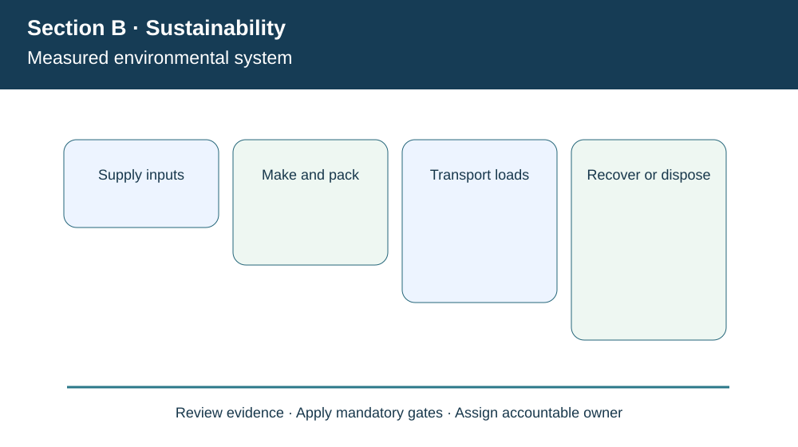
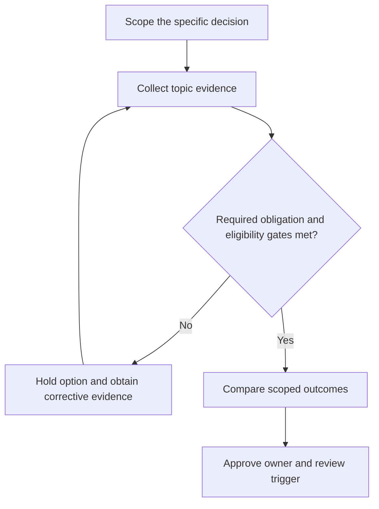

# 3. Environmental Footprint, Energy, Packaging, and Reverse Flows

## Learning objectives

Explain the decision boundary of environmental footprint, energy, packaging, and reverse flows, preserve suitable evidence, and identify where law or certification rules require verification beyond this fictional case.

## Concept in plain English

Environmental responsibility in a supply chain covers the entire chain of relevant activities, not merely electricity consumed inside a plant. Procurement affects raw material extraction and substitutability; manufacturing affects energy, hazardous materials and waste; transportation influences fuel, emissions and local air quality; packaging shapes damage, reuse and disposal. Reverse flows can recapture products and materials, but the recovery process itself consumes energy and can create safety hazards. An apparent improvement should be measured over a consistent scope rather than by moving emissions or waste from one supplier to another.

**Lifecycle thinking** is useful even when a full formal life-cycle assessment is not warranted. The team maps the major inputs, outputs, return routes and end-of-life assumptions. It distinguishes reductions at the source, product reuse, material recycling and disposal. A lightweight package may reduce transport energy but cause greater product breakage; that damage can dominate the environmental benefit of a few grams of saved packaging. Likewise, a reusable pallet has a different profile depending on actual recovery cycles and cleaning requirements.

Carbon calculations demand discipline in units. Distance multiplied by tonnage and an emission factor expressed in kg CO2e per tonne-km yields a modeled transport footprint in kg CO2e. A number reported without load, route, factor source, period and empty-return treatment is not decision-grade. Real public sustainability reporting requires approved methodologies and applicable scopes; this lesson uses a transparent fictional factor only to demonstrate arithmetic.

When shipping goods on regulated wood packaging, relevant phytosanitary requirements such as ISPM 15 may apply; recycling benefits cannot excuse failures to meet the applicable import conditions. Hazardous materials returned for recycling likewise require suitable handling and transport. Module 5 owns the detailed reverse logistics choices; Section B adds the environmental consequence and evidence boundary.

**Curriculum alignment.** The module describes environmental consequences across procurement, manufacturing, warehousing, transportation and reverse logistics, and calls attention to packaging and wood-pallet pest treatment such as ISPM 15. The wording, example and decision artifact below are original learning content rather than a reproduction of the APICS text.

## Why it matters

AlderGate wishes to replace heavy disposable packaging. Procurement claims the new material is greener, but transport and Quality need to measure return rates and product damage before making the claim. The decision combines product protection, physical flows and verified disposal practices.

## Decision model and workflow

The visual identifies four subject-specific evidence stages. For this topic, the business decision proceeds as follows:

1. Draw the system boundary and all material flows.
2. Check permits, packaging treatment and safe transport.
3. Quantify comparable factors and recovery assumptions.
4. Compare cost, service, damage and environmental results.

### Evidence retained through the workflow

| Evidence record | Audit boundary |
| --- | --- |
| Actual shipment loads and route distance | Retain source, current date, owner and review state |
| Documented energy and emissions factors, scopes and dates | Retain source, current date, owner and review state |
| Damaged products, packaging weights and actual recovery rates | Retain source, current date, owner and review state |
| Import treatment and waste-handler qualifications | Retain source, current date, owner and review state |

## Practical process flow

## Realistic example — AlderGate Motion Products

AlderGate Motion Products is a fictional industrial manufacturer used throughout Module 8. In the present scenario its sustainability team must document measured environmental system, while Finance, Operations and Compliance independently test the customer promise, data quality and applicable obligations. The affected suppliers or workers are not described as verified in the real world. The decision is an illustrative governance exercise only.

## Applied decision artifact or worked calculation

[Directly linked fictional input dataset](../../assets/data/module-8/section-b/freight-environment.csv)

For a fictional quarter with 60 shipments of 1 tonne each travelling 500 km, the baseline factor **0.062 kg CO2e/(tonne·km)** implies **1,860 kg CO2e**. The alternative factor **0.040** implies **1,200 kg CO2e**, a modeled **660 kg CO2e** reduction at **$7,500 added transport cost**. The illustrative incremental expense is **$11.36 per kg CO2e modeled reduction**; this is *not* a universal abatement cost because changes in vehicle utilization, return trips, product loss and factor validity are omitted.

## Decision logic

- Draw the system boundary and all material flows.
- Check permits, packaging treatment and safe transport.
- Quantify comparable factors and recovery assumptions.
- Compare cost, service, damage and environmental results.

## Trade-offs

| Relevant tension | Decision implication |
| --- | --- |
| Lightweight disposable packaging | Lower outbound mass but possible damage or waste |
| Reusable pallets | Potential lower waste if recovery cycles really occur |
| Lower-carbon lane | May increase cost or require different service buffers |

## Commonly confused with

This topic involves **measured environmental system**, which should not be presented as the entire sustainability program. A modeled measurement is not verified external reporting, and a chosen voluntary program is not equivalent to legal permission. Requirements must be checked for their edition, geography, entity and applicable product/operation.

## Common mistakes

- Using a factor without its unit or source.
- Ignoring damage/returns while claiming a net lifecycle benefit.
- Claiming a modeled shipping figure is the full corporate footprint.

## Original knowledge check

**Question.** Which statement best describes the modeled change from 1,860 to 1,200 kg CO2e?

A. It is a 660 kg CO2e transport-scope reduction under the stated fictional factor assumptions

B. It proves net-zero emissions for AlderGate

C. It automatically proves improved product sustainability across lifecycle

D. It permits imports using untreated regulated wood pallets

Answer and rationale

### Correct answer

**A. It is a 660 kg CO2e transport-scope reduction under the stated fictional factor assumptions**

### Why it is correct

The arithmetic supports a specific transport-scope modeled reduction, not an enterprise-wide or lifecycle certification.

### Why the other answers are wrong

- **B.** A reduction within one transport boundary is not net zero.
- **C.** Manufacturing, returns, damage and other lifecycle effects remain outside the calculation.
- **D.** Phytosanitary rules remain mandatory regardless of the sustainability claim.

## Practitioner perspective

A solution architect should preserve a trace from policy or obligation to the affected material, partner, shipment or operational process. A dashboard count or report submission does not prove the underlying process operates safely. Controls need evidence fields, responsible owners and a rule for unresolved records before release.

## Related concepts

- [Previous study step](./02-micro-macro-economics-and-time-horizon.md)
- [Module 7 supply-chain risk gates](../../07-supply-chain-risk/README.md)
- [Module 8 overall strategy](../README.md)
- [IPPC ISPM 15 reference](https://www.ippc.int/en/core-activities/standards-setting/ispms/)

---

[Section B overview](./README.md) · [Previous study step](./02-micro-macro-economics-and-time-horizon.md)
