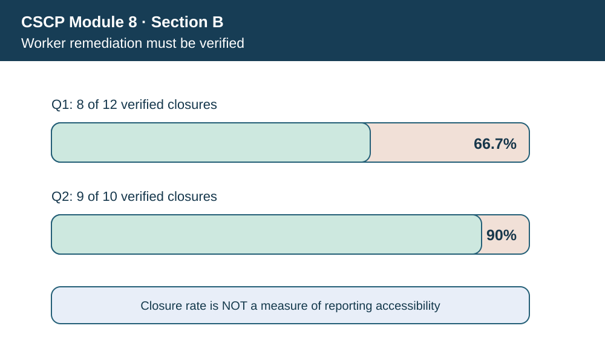
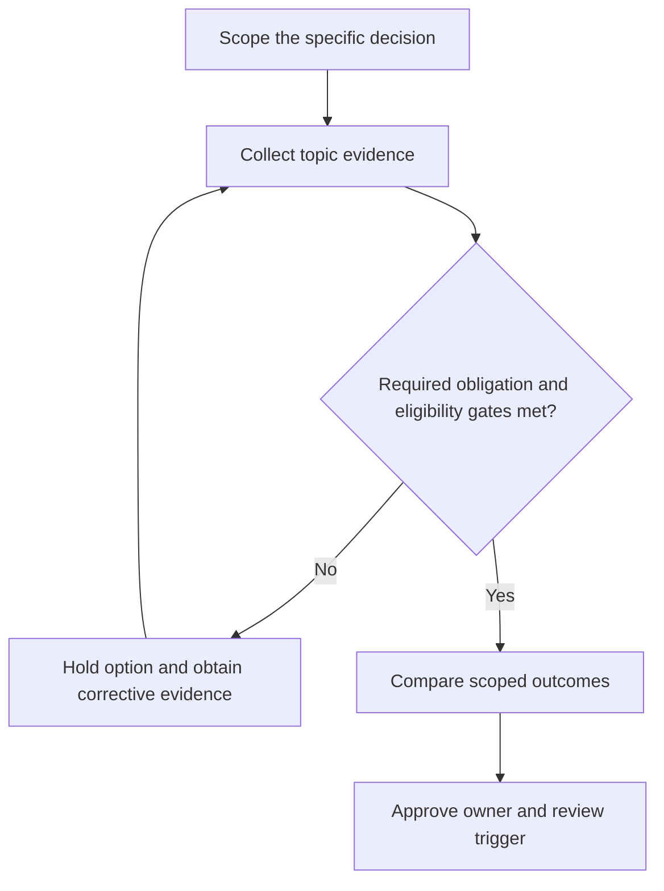

# 4. Corporate Social Responsibility, Labor, and Community Impact

## Learning objectives

Explain the decision boundary of corporate social responsibility, labor, and community impact, preserve suitable evidence, and identify where law or certification rules require verification beyond this fictional case.

## Concept in plain English

**Corporate social responsibility (CSR)** asks how business conduct affects people and stakeholders, and how responsibility is embedded in governance rather than treated as occasional donations. In supply chains, social matters include safe and healthy workplaces, worker voice, fair recruitment, working hours, equal opportunity, non-discrimination and the impacts of suppliers and subcontractors. Reputational campaigns do not replace verified action where people are affected.

The first decision is what duty applies and to whom. A legal prohibition, a contractual safeguard and an aspirational improvement target have different consequences. A buyer cannot automatically assume a supplier's signed code of conduct establishes good practice on a factory floor. Policies need credible implementation, worker-level evidence, safe grievance paths, oversight and remediation when violations arise.

Social impacts extend beyond the factory gate. Warehousing and transportation affect road safety and surrounding communities; sourcing decisions can influence labor outcomes at distant suppliers. The company should map affected groups, describe severity and likelihood of adverse outcomes, and be clear about how sensitive evidence will be collected and protected. A supplier's low price does not compensate for a serious unresolved worker-protection condition.

For AlderGate, a plant expansion requires additional shifts and temporary labor. Management should evaluate workload, qualified supervision, safe onboarding, working-time rules and communication channels before optimizing the number of hours per unit. Affected people are not merely a "cost of compliance" line. Some necessary controls are gates that cannot be traded for a faster delivery promise.

**Curriculum alignment.** The source discusses corporate social responsibility alongside environmental and economic performance; social responsibility includes relationships with employees, suppliers, customers and communities. The wording, example and decision artifact below are original learning content rather than a reproduction of the APICS text.

## Why it matters

Because difficult labor problems are often underreported, a declining incident count can reflect less reporting rather than better conditions. The organization must verify the process for identifying, escalating and resolving issues, including access for contracted labor.

## Decision model and workflow

The visual identifies four subject-specific evidence stages. For this topic, the business decision proceeds as follows:

1. Identify rights, affected groups and mandatory obligations.
2. Provide safe ways to report and verify impacts.
3. Assign remedy owners and qualification gates.
4. Review whether issues remain resolved and recurrence occurs.

### Evidence retained through the workflow

| Evidence record | Audit boundary |
| --- | --- |
| Defined worker population and contractor coverage | Retain source, current date, owner and review state |
| Grievance intake, confidentiality and non-retaliation controls | Retain source, current date, owner and review state |
| Verified remedy date and severity classification | Retain source, current date, owner and review state |
| Community concerns and accountable response owners | Retain source, current date, owner and review state |

## Practical process flow

## Realistic example — AlderGate Motion Products

AlderGate Motion Products is a fictional industrial manufacturer used throughout Module 8. In the present scenario its sustainability team must document rights and affected people, while Finance, Operations and Compliance independently test the customer promise, data quality and applicable obligations. The affected suppliers or workers are not described as verified in the real world. The decision is an illustrative governance exercise only.

## Applied decision artifact or worked calculation

[Directly linked fictional input dataset](../../assets/data/module-8/section-b/social-remediation.csv)

The fictional HSE register has **12** reported issues in Q1 and **eight** verified closures, giving a **66.7% closure rate** for that period's issue cohort. Q2 records **nine closures out of ten reported**, or **90%**. Different issue cohorts, closure definitions and severity may make the periods noncomparable without reconciliation. A better closure percentage alone does not demonstrate fewer actual hazards or a safe grievance environment.

## Decision logic

- Identify rights, affected groups and mandatory obligations.
- Provide safe ways to report and verify impacts.
- Assign remedy owners and qualification gates.
- Review whether issues remain resolved and recurrence occurs.

## Trade-offs

| Relevant tension | Decision implication |
| --- | --- |
| Rapid capacity ramp | Potential strain on training and safe supervision |
| Low-price supplier | Possible undisclosed labor risk requiring due diligence |
| High issue-reporting rate | Could reflect greater trust, not necessarily worsening conditions |

## Commonly confused with

This topic involves **rights and affected people**, which should not be presented as the entire sustainability program. A modeled measurement is not verified external reporting, and a chosen voluntary program is not equivalent to legal permission. Requirements must be checked for their edition, geography, entity and applicable product/operation.

## Common mistakes

- Assuming zero complaints proves workers are safe.
- Counting a signed supplier code as proof of implementation.
- Including forced labor or a serious hazard as a weighted penalty.

## Original knowledge check

**Question.** A supplier reports zero grievances after removing its anonymous complaint channel. What should AlderGate conclude?

A. The supplier is now clearly risk-free

B. Audit effort can cease

C. The company should reward fewer complaints immediately

D. The reporting mechanism may be less accessible; examine worker evidence and retaliation safeguards

Answer and rationale

### Correct answer

**D. The reporting mechanism may be less accessible; examine worker evidence and retaliation safeguards**

### Why it is correct

A drop in complaints can reflect suppression of reporting rather than fewer underlying problems.

### Why the other answers are wrong

- **A.** Absence of reports does not demonstrate absence of hazards.
- **B.** Duty of care and oversight do not disappear when reporting declines.
- **C.** The metric lacks credibility without a functioning reporting route.

## Practitioner perspective

A solution architect should preserve a trace from policy or obligation to the affected material, partner, shipment or operational process. A dashboard count or report submission does not prove the underlying process operates safely. Controls need evidence fields, responsible owners and a rule for unresolved records before release.

## Related concepts

- [Previous study step](./03-environmental-footprint-energy-packaging-reverse-flows.md)
- [Module 7 supply-chain risk gates](../../07-supply-chain-risk/README.md)
- [Module 8 overall strategy](../README.md)
- [ASCM supply-chain standards](https://www.ascm.org/corporate-solutions/standards-tools/scor-ds/)

---

[Section B overview](./README.md) · [Previous study step](./03-environmental-footprint-energy-packaging-reverse-flows.md)
