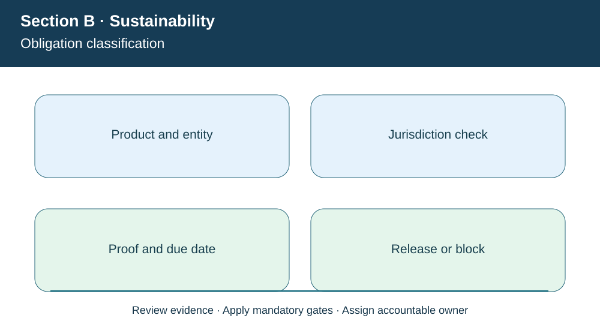
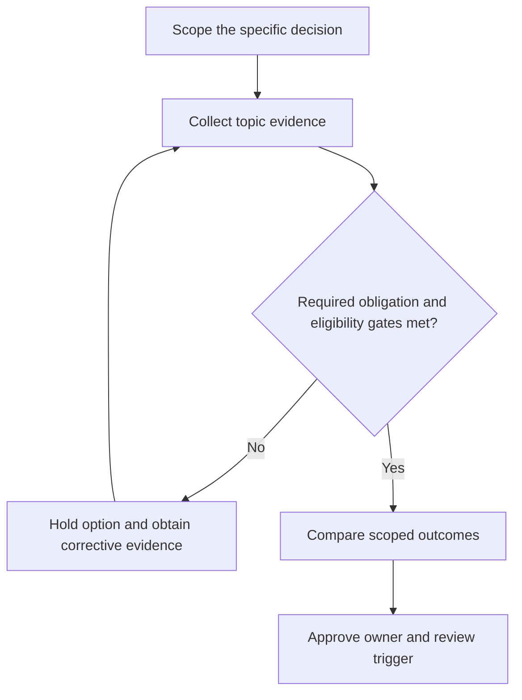

# 5. Mandatory Regulations, Voluntary Programs, and Compliance Gates

## Learning objectives

Explain the decision boundary of mandatory regulations, voluntary programs, and compliance gates, preserve suitable evidence, and identify where law or certification rules require verification beyond this fictional case.

## Concept in plain English

A sustainable supply-chain policy may combine **mandatory** requirements and **voluntary** initiatives. Mandatory requirements arise from applicable statutes, regulations and enforceable conditions for a jurisdiction, product, organization or transaction. Voluntary programs include chosen environmental commitments, industry codes, management-system certifications and reporting frameworks where law or contract has not made them obligatory. A voluntary label is not an instruction to ignore a contract: participation requirements can become binding through customer agreements or procurement terms.

A regulatory applicability matrix is more reliable than a universal list of supposedly mandatory rules. The team must record product type, destination, entity, reporting period and operation; then legal and compliance owners determine which requirements apply. The European Union's electronics-related rules (such as RoHS and WEEE) govern different aspects of material restrictions and end-of-life responsibilities, subject to scope and jurisdiction. Other rules concern packing wood, transport of hazardous goods or labor practices. Exact current obligations, exemptions, thresholds and implementation dates require primary source verification.

**Disclosure obligations** and **improvement ambitions** also differ. A company might voluntarily report sustainability performance using GRI while certain regulated entities have mandatory corporate reports under applicable law. The EU's CSRD and associated ESRS requirements have been revised and narrowed by changes through 2026, making unqualified claims that "every EU business must report" misleading. Use the responsible regulator and counsel for an entity-specific conclusion.

A mandatory hard gate belongs *before* financial ranking. If one proposed packaging supplier cannot provide an applicable product-material declaration or legally required treatment proof, the organization should not approve the supply merely because it lowers cost. When an actual obligation is unresolved, the appropriate state is blocked or pending verification, not "low risk" by default.

**Curriculum alignment.** The curriculum expressly distinguishes legally mandatory from voluntary sustainability programs. Examples include hazardous substances, electronic waste, wood packaging and sustainability disclosure duties; their actual applicability depends on law and geography. The wording, example and decision artifact below are original learning content rather than a reproduction of the APICS text.

## Why it matters

AlderGate sells into multiple markets; one blanket checklist cannot determine every product's legal treatment. Making the regulation-to-SKU mapping explicit avoids both accidental noncompliance and unnecessary blanket restrictions.

## Decision model and workflow

The visual identifies four subject-specific evidence stages. For this topic, the business decision proceeds as follows:

1. Determine actual scope by product, country, entity and date.
2. Differentiate law/contract from voluntary objectives.
3. Retain credible documentary proof or documented exemption.
4. Block uncovered transactions until the requirement is resolved.

### Evidence retained through the workflow

| Evidence record | Audit boundary |
| --- | --- |
| Current applicable legislation and entity mapping | Retain source, current date, owner and review state |
| Product/BOM and destination information | Retain source, current date, owner and review state |
| Control, proof record, expiration and owner | Retain source, current date, owner and review state |
| Scope exception and legal review decisions | Retain source, current date, owner and review state |

## Practical process flow

## Realistic example — AlderGate Motion Products

AlderGate Motion Products is a fictional industrial manufacturer used throughout Module 8. In the present scenario its sustainability team must document obligation classification, while Finance, Operations and Compliance independently test the customer promise, data quality and applicable obligations. The affected suppliers or workers are not described as verified in the real world. The decision is an illustrative governance exercise only.

## Applied decision artifact or worked calculation

[Directly linked fictional input dataset](../../assets/data/module-8/section-b/compliance-gate-register.csv)

In a purely fictional screening of four proposed shipping lanes, **three are eligible** and one requires further evidence, giving **75% documented eligibility** for this batch. This ratio is *not* a compliance rate for a real legal regime; the gates were invented for instruction. The lane lacking required proof must remain on hold regardless of potential price or carbon advantages.

## Decision logic

- Determine actual scope by product, country, entity and date.
- Differentiate law/contract from voluntary objectives.
- Retain credible documentary proof or documented exemption.
- Block uncovered transactions until the requirement is resolved.

## Trade-offs

| Relevant tension | Decision implication |
| --- | --- |
| Voluntary leadership target | May justify investment beyond legal minimum |
| Mandatory import condition | Cannot be waived for a weighted cost score |
| Changing regulatory scope | Requires continuous applicability review |

## Commonly confused with

This topic involves **obligation classification**, which should not be presented as the entire sustainability program. A modeled measurement is not verified external reporting, and a chosen voluntary program is not equivalent to legal permission. Requirements must be checked for their edition, geography, entity and applicable product/operation.

## Common mistakes

- Assuming every sustainability guideline is a legal requirement.
- Stating a 2026 reporting scope from an older textbook edition without checking law.
- Allowing an ineligible shipment because another KPI is favorable.

## Original knowledge check

**Question.** AlderGate proposes a cheaper shipping lane but cannot verify a required destination document. What is the defensible decision?

A. Approve because the savings offset the missing paper

B. Mark the lane pending or blocked until the applicable proof is verified

C. Assume a voluntary reporting standard provides customs authorization

D. Count all four lanes as compliant because three have evidence

Answer and rationale

### Correct answer

**B. Mark the lane pending or blocked until the applicable proof is verified**

### Why it is correct

Where the stated condition is mandatory, proof or a valid exemption must be established before release.

### Why the other answers are wrong

- **A.** Financial preference does not remove a legal gate.
- **C.** Reporting participation is not import authorization.
- **D.** Each lane's evidence and eligibility must be judged separately.

## Practitioner perspective

A solution architect should preserve a trace from policy or obligation to the affected material, partner, shipment or operational process. A dashboard count or report submission does not prove the underlying process operates safely. Controls need evidence fields, responsible owners and a rule for unresolved records before release.

## Related concepts

- [Previous study step](./04-corporate-social-responsibility-labor-and-community.md)
- [Module 7 supply-chain risk gates](../../07-supply-chain-risk/README.md)
- [Module 8 overall strategy](../README.md)
- [European Commission sustainability reporting updates](https://finance.ec.europa.eu/news/commission-adopts-revised-sustainability-reporting-standards-2026-07-03_en)

---

[Section B overview](./README.md) · [Previous study step](./04-corporate-social-responsibility-labor-and-community.md)
