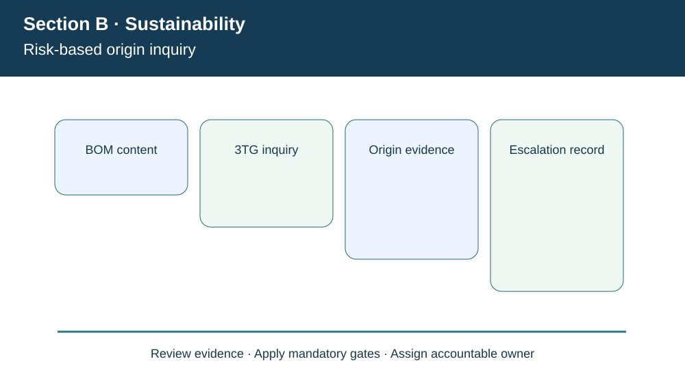
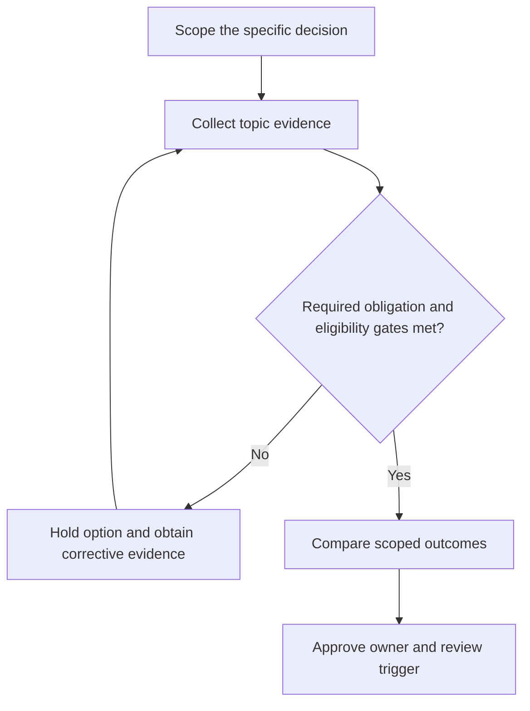

# 6. Conflict Minerals, 3TG, and Responsible Materials Due Diligence

## Learning objectives

Explain the decision boundary of conflict minerals, 3tg, and responsible materials due diligence, preserve suitable evidence, and identify where law or certification rules require verification beyond this fictional case.

## Concept in plain English

**Conflict minerals** are discussed in the APICS curriculum in the context of armed conflict, human-rights abuses, supply-chain traceability and disclosure requirements. The U.S. SEC's conflict minerals rule concerns certain reporting companies manufacturing or contracting to manufacture products with necessary **tin, tantalum, tungsten or gold (3TG)**. The precise legal analysis can require considering whether 3TG is necessary to functionality or production, where it originated and the filing entity's status.

It is incorrect to say that every company handling a metal must file Form SD or that every part containing 3TG is illicit. The reporting requirement follows specified legal scope. A company subject to the rule may need reasonable country-of-origin inquiry and, in defined situations, further due diligence and reporting. Other firms may still need supplier information to satisfy customer contracts, ethical sourcing policies or other rules. The supplier-facing data collection can be important even when the company itself is not an SEC registrant.

A credible inquiry starts with product design and material content. A response consisting only of a supplier's office address is insufficient to establish a metal's smelter and origin. Buyers may request part-level declarations, smelter/refiner information, processing country context, evidence of due diligence and a date that makes the response useful. The team should distinguish a genuinely absent mineral from unknown content, and an identified mineral from a supported origin determination.

If information is incomplete, uncertainty must remain explicit. The firm can seek clarification, perform risk-based escalation, substitute qualified materials or suppliers if appropriate and follow applicable reporting decisions. A lower purchase price does not remove worker-rights issues. It is also inaccurate to describe a nonresponding vendor as conflict-free solely because no adverse finding was documented.

**Curriculum alignment.** Section B covers conflict minerals (tin, tantalum, tungsten and gold) and Dodd-Frank/SEC disclosure pathways. Applicability is not identical for every importer or supplier; legal determination is necessary. The wording, example and decision artifact below are original learning content rather than a reproduction of the APICS text.

## Why it matters

AlderGate's engineered assembly BOM includes electronic and metal components. Its procurement team needs traceable supplier responses, quality-reviewed technical substitutions and ownership for unresolved declarations before describing the sourcing program as responsible.

## Decision model and workflow

The visual identifies four subject-specific evidence stages. For this topic, the business decision proceeds as follows:

1. Establish which company and products fall within inquiry scope.
2. Collect and validate supplier material and source records.
3. Distinguish unknown, verified and potentially higher-risk evidence.
4. Escalate and report according to verified requirements.

### Evidence retained through the workflow

| Evidence record | Audit boundary |
| --- | --- |
| Scoped product list and required 3TG content assessment | Retain source, current date, owner and review state |
| Supplier and smelter evidence with date and source | Retain source, current date, owner and review state |
| Unknowns, refusals and escalation findings | Retain source, current date, owner and review state |
| Legal applicability and company-specific Form SD review | Retain source, current date, owner and review state |

## Practical process flow

## Realistic example — AlderGate Motion Products

AlderGate Motion Products is a fictional industrial manufacturer used throughout Module 8. In the present scenario its sustainability team must document risk-based origin inquiry, while Finance, Operations and Compliance independently test the customer promise, data quality and applicable obligations. The affected suppliers or workers are not described as verified in the real world. The decision is an illustrative governance exercise only.

## Applied decision artifact or worked calculation

[Directly linked fictional input dataset](../../assets/data/module-8/section-b/responsible-minerals-screen.csv)

Of **120** fictional parts screened, **110** have adequate documentation under AlderGate's internally defined evidence rule and **ten** remain pending. The documentation coverage is **91.67%**. This is not a determination that 91.67% of parts are conflict-free, and it is not a claim about statutory Form SD filing. The remainder requires specified evidence and risk-based escalation, not an automatic favorable classification.

## Decision logic

- Establish which company and products fall within inquiry scope.
- Collect and validate supplier material and source records.
- Distinguish unknown, verified and potentially higher-risk evidence.
- Escalate and report according to verified requirements.

## Trade-offs

| Relevant tension | Decision implication |
| --- | --- |
| Wide supplier surveys | Can improve coverage but may be poorly targeted |
| Product substitution | May reduce exposure but triggers design qualification |
| Incomplete supplier answers | Require follow-up rather than presumed safe origin |

## Commonly confused with

This topic involves **risk-based origin inquiry**, which should not be presented as the entire sustainability program. A modeled measurement is not verified external reporting, and a chosen voluntary program is not equivalent to legal permission. Requirements must be checked for their edition, geography, entity and applicable product/operation.

## Common mistakes

- Equating a supplier street address with mineral source.
- Assuming all 3TG use implies prohibited material.
- Treating 110 documented parts as 110 certified conflict-free parts.

## Original knowledge check

**Question.** AlderGate receives adequate declarations for 110 of 120 parts. What is supported?

A. Documentation coverage is 91.67%; ten parts need further inquiry

B. Exactly 91.67% of parts are legally conflict-free

C. Every supplier must file SEC Form SD

D. No follow-up is necessary because the sample is mostly complete

Answer and rationale

### Correct answer

**A. Documentation coverage is 91.67%; ten parts need further inquiry**

### Why it is correct

The measure expresses documentation completion under the hypothetical screening policy, not a legal origin conclusion.

### Why the other answers are wrong

- **B.** A sufficient declaration does not necessarily mean every potential sourcing risk is absent.
- **C.** SEC filing scope does not automatically transfer to every supplier.
- **D.** The outstanding ten parts remain evidence gaps.

## Practitioner perspective

A solution architect should preserve a trace from policy or obligation to the affected material, partner, shipment or operational process. A dashboard count or report submission does not prove the underlying process operates safely. Controls need evidence fields, responsible owners and a rule for unresolved records before release.

## Related concepts

- [Previous study step](./05-regulatory-voluntary-programs-and-compliance-gates.md)
- [Module 7 supply-chain risk gates](../../07-supply-chain-risk/README.md)
- [Module 8 overall strategy](../README.md)
- [SEC conflict-minerals staff guidance](https://www.sec.gov/rules-regulations/staff-guidance/corporation-finance-interpretations-cfis/dodd-frank-wall-street-reform-consumer-protection-act-frequently-asked-questions)

---

[Section B overview](./README.md) · [Previous study step](./05-regulatory-voluntary-programs-and-compliance-gates.md)
