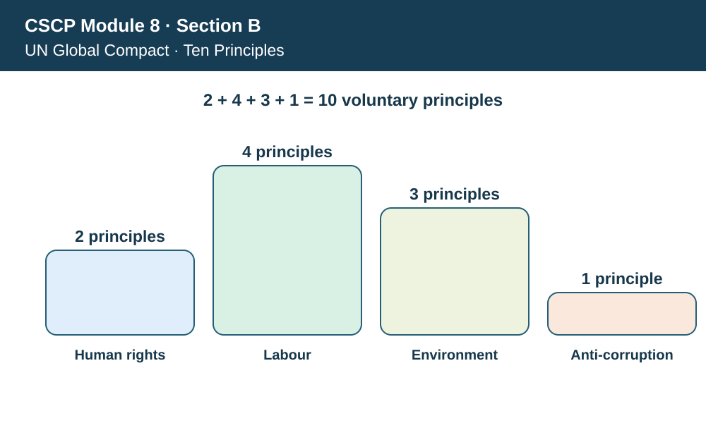
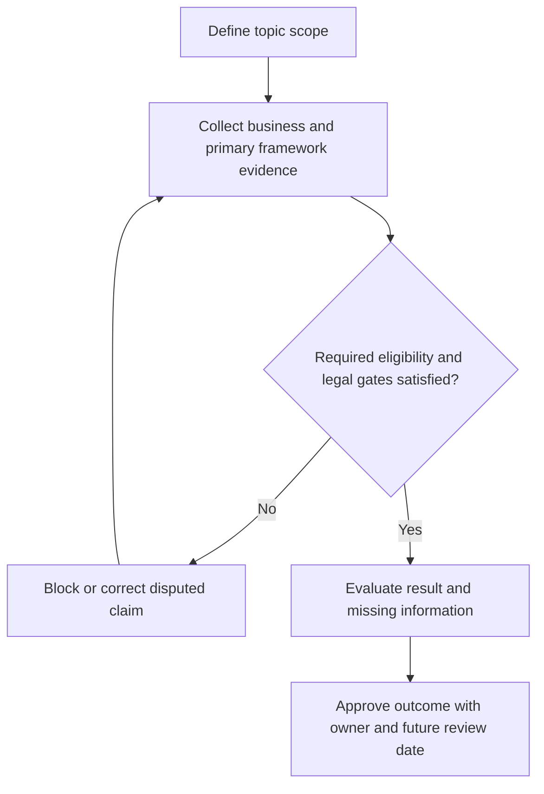

# 7. UN Global Compact: Ten Principles and Operating Controls

## Learning objectives

Explain the current framework and decision scope for un global compact: ten principles and operating controls, distinguish source-edition terminology from official newer material, and apply verifiable evidence before making claims.

## Concept in plain English

The UN Global Compact is a **voluntary, principles-based initiative**, not an international permit or a universal independent certification of responsible conduct. Its ten principles are organized around human rights, labour, environmental protection and anti-corruption. For supply-chain managers, its value lies in showing how these commitments should affect partner selection, worker protections, purchasing incentives, disclosures and practical escalation.

The human-rights principles emphasize respecting rights and avoiding complicity in abuses. Labor principles address association and collective bargaining, elimination of forced labor and child labor, and nondiscrimination. Environmental principles include precaution, responsibility and environmentally sound technology. The anti-corruption principle addresses bribery and extortion. A supplier code may address these topics, but a signature is not proof of implementation.

AlderGate should identify which partners and processes pose the material risks relevant to each pillar. Procurement might request evidence of safe labor recruitment and grievance routes from a contract manufacturer while maintenance teams evaluate environmental controls at facilities handling hazardous material. The same company may need anti-bribery controls for customs intermediaries. A broad pledge must be accompanied by owners, training, verification and remediation.

The UN principles do not specify a universal quantitative score, carbon factor or legal exemption. In particular, an improvement in environmental records cannot neutralize a credible forced-labor allegation. The team must report unresolved findings by pillar and apply mandatory rights-related and legal conditions before approving a supplier. Supplier capability and source records are more persuasive than marketing claims.

Source edition awareness also matters. The voluntary framework has continuity in its ten pillars and principles, whereas separate regulatory demands may change by jurisdiction. Conflating those responsibilities could cause the buying team to assume that Global Compact participation means customs, labor and environmental permits are automatically satisfied.

**Learning source and edition checkpoint.** The APICS Module 8 material presents the UN Global Compact and its ten principles. The UNGC's primary website groups them into human rights (two), labour (four), environment (three) and anti-corruption (one). AlderGate figures, workflows and assessments are independently constructed and illustrative, not content quoted from the APICS source.

## Why it matters

AlderGate wants its sustainability pledge to change what buyers and suppliers do. Pillar-specific evidence makes a policy usable in sourcing, corrective action and executive review instead of allowing a favorable averaged score to conceal serious findings.

## Decision model and workflow

The topic-specific labels in the visual represent stages of the evidence and response process. A supply-chain manager should undertake these actions in order, preserving evidence of why an option could or could not proceed.

### Evidence retained through the workflow

| Evidence | Minimum control |
| --- | --- |
| Pillar-to-policy and affected-supplier mapping | Include source, owner, period and disposition |
| Worker voice, recruitment and nondiscrimination evidence | Include source, owner, period and disposition |
| Environmental monitoring and permit controls | Include source, owner, period and disposition |
| Anti-bribery training and escalation log | Include source, owner, period and disposition |

## Practical process flow

## Realistic example — AlderGate Motion Products

AlderGate is a fictional company with its own factories and suppliers. This scenario tests **un global compact: ten principles and operating controls** and requires the named decision makers to validate the standard and its business relevance. An attractive report does not replace a recorded review of implementation, scope and limitations. No actual supplier is identified or evaluated by this example.

## Applied decision artifact or worked calculation

[Download/view the directly linked fictional inputs](../../assets/data/module-8/section-b/ungc-principles.csv)

The framework has **2 + 4 + 3 + 1 = 10 principles**. AlderGate's fictional register tracks eight evidenced controls from ten expected records, giving **80% internal evidence coverage**. This is neither an official UNGC rating nor proof of ethical outcomes; the missing labor and environmental records require separate investigation.

## Decision logic

- Identify the affected partner operations and relevant principles.
- Compare implemented controls with signed commitments.
- Escalate adverse findings and validate remediation.
- Retain disaggregated findings and owner review dates.

## Trade-offs

| Topic-specific concern | Consequence |
| --- | --- |
| Policy signature | Simple evidence of acknowledgment, not real practice |
| Risk-based supplier review | Effort must follow severity, not just annual spend |
| Voluntary alignment | Cannot replace statutory duties |

## Commonly confused with

UN Global Compact: Ten Principles and Operating Controls establishes particular guidance, control or reporting meaning; it does not mean any reported percentage is an official sustainability score. **Accreditation**, **certification**, **voluntary alignment**, and **legal approval** are different terms, with distinct evidence requirements. Review their scope and edition before interpreting external claims.

## Common mistakes

- Claiming UNGC-certified status.
- Averaging a serious harm finding into a favorable total.
- Assuming a supplier policy demonstrates implementation.

## Original knowledge check

**Question.** What does eight evidenced records out of ten establish about AlderGate?

A. Official UNGC certification at 80%

B. A complete proof of rights protection across all suppliers

C. An internally defined 80% documentation coverage, with unresolved evidence gaps

D. An exemption from labor compliance in high-risk countries

Answer and rationale

### Correct answer

**C. An internally defined 80% documentation coverage, with unresolved evidence gaps**

### Why it is correct

The ratio measures a fictional internal control ledger; the initiative does not certify that evidence ratio.

### Why the other answers are wrong

- **A.** The UNGC principles initiative does not issue such a certificate.
- **B.** Document counts cannot establish substantive worker outcomes.
- **D.** Voluntary pledges do not waive laws.

## Practitioner perspective

The supplier or operational evidence in ERP and connected applications needs validity dates, covered sites, current standard edition, data-source identifiers and exception owners. A reviewer must distinguish a verified operating practice from a submitted PDF or marketing promise. An unresolved control blocks the specific claim or activity where relevant, rather than being converted into a favorable default.

## Related concepts

- [Previous sustainability lesson](./06-conflict-minerals-and-responsible-material-due-diligence.md)
- [Module 7 risk governance](../../07-supply-chain-risk/README.md)
- [Module 8 overall path](../README.md)
- [Official primary reference 1](https://unglobalcompact.org/what-is-gc/mission/principles)

---

[Section B overview](./README.md) · [Previous sustainability lesson](./06-conflict-minerals-and-responsible-material-due-diligence.md)
