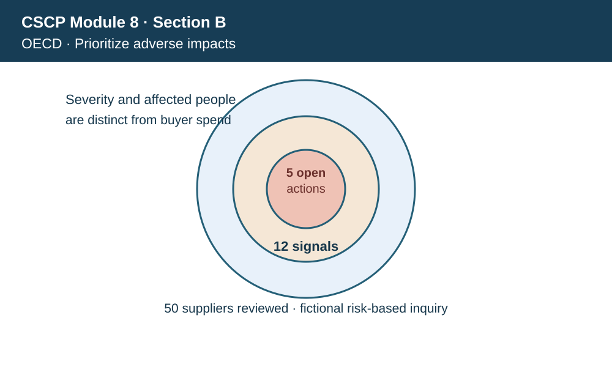
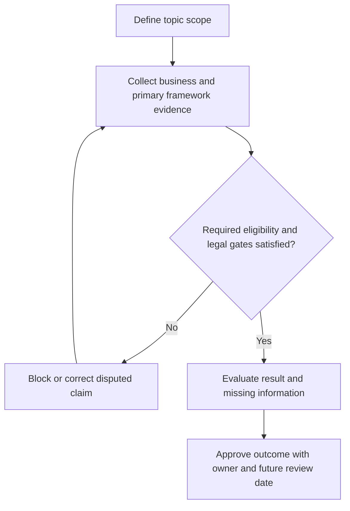

# 8. OECD Guidelines and Adverse-Impact Due Diligence

## Learning objectives

Explain the current framework and decision scope for oecd guidelines and adverse-impact due diligence, distinguish source-edition terminology from official newer material, and apply verifiable evidence before making claims.

## Concept in plain English

The OECD Guidelines are recommendations from adhering governments to multinational enterprises about responsible business conduct. Their themes include human rights, workers, environmental matters, disclosure, consumer interests, bribery, technology, competition and taxation. They should not be described as a universal certification or legal substitute for the applicable laws of countries in which firms operate.

**Adverse-impact due diligence** is not the same as a routine purchase price or delivery scorecard. It focuses on identifying actual and potential harms associated with activities, products, services and business relationships, then taking actions to prevent, mitigate and where appropriate enable remedy. Prioritization considers severity and likelihood of adverse impacts; the severity of harm to people or ecosystems may be substantial even when the direct cost to AlderGate is small.

Business relationships matter. A buyer may have limited power over a subcontractor, but it can use supplier engagement, contractual levers, collaboration and capacity building to seek improvement. Immediate disengagement can sometimes be necessary, yet poorly managed exit can leave affected workers worse off. Qualified decision makers should document why engagement, suspension or termination is most responsible in the specific situation.

The 2023 version also raises responsible conduct issues associated with technology and data. As supply chains adopt digital sourcing and traceability systems, they need to consider privacy, impacts and protection of affected people rather than treating a more detailed monitoring system as risk-free.

AlderGate's fictitious castings supply base has favorable commercial performance but several reports of poor labor protections. Procurement should record evidence sources, the alleged impact, affected population, confidence and correction process. A high on-time delivery rating cannot serve as a surrogate for worker-rights evidence. The appropriate governance record distinguishes the potential adverse impact from the company's own supply continuity risk.

**Learning source and edition checkpoint.** The course introduces the OECD Guidelines for Multinational Enterprises. The official OECD's 2023 update renamed the work Guidelines for Multinational Enterprises on Responsible Business Conduct and strengthened due-diligence, technology, climate and biodiversity recommendations. AlderGate figures, workflows and assessments are independently constructed and illustrative, not content quoted from the APICS source.

## Why it matters

Supplier performance reports often omit harms that do not immediately threaten delivery. A due-diligence process ensures purchasing governance examines harms and credible remediation in their own right.

## Decision model and workflow

The topic-specific labels in the visual represent stages of the evidence and response process. A supply-chain manager should undertake these actions in order, preserving evidence of why an option could or could not proceed.

### Evidence retained through the workflow

| Evidence | Minimum control |
| --- | --- |
| Affected people and impact type | Include source, owner, period and disposition |
| Impact severity, likelihood and source confidence | Include source, owner, period and disposition |
| Engagement leverage, corrective steps and worker protections | Include source, owner, period and disposition |
| Independent outcome and remediation review | Include source, owner, period and disposition |

## Practical process flow

## Realistic example — AlderGate Motion Products

AlderGate is a fictional company with its own factories and suppliers. This scenario tests **oecd guidelines and adverse-impact due diligence** and requires the named decision makers to validate the standard and its business relevance. An attractive report does not replace a recorded review of implementation, scope and limitations. No actual supplier is identified or evaluated by this example.

## Applied decision artifact or worked calculation

[Download/view the directly linked fictional inputs](../../assets/data/module-8/section-b/oecd-diligence.csv)

In a fictional review, **50 suppliers** produce **12 adverse-impact signals** (24% of those reviewed), with **five open corrective actions**. A signal is not automatically a verified violation. Five open actions require severity-ranked review; the 24% ratio is not representative of suppliers outside this selected group.

## Decision logic

- Identify potential and actual impact in relevant relationships.
- Prioritize severity and validate evidence.
- Develop prevention, mitigation, leverage or remedy actions.
- Track affected-party outcomes and communicate appropriately.

## Trade-offs

| Topic-specific concern | Consequence |
| --- | --- |
| Immediate disengagement | May reduce buyer exposure but harm affected workers |
| Structured remediation | Requires verified milestones and sustained oversight |
| Low commercial risk | Does not imply low human-rights risk |

## Commonly confused with

OECD Guidelines and Adverse-Impact Due Diligence establishes particular guidance, control or reporting meaning; it does not mean any reported percentage is an official sustainability score. **Accreditation**, **certification**, **voluntary alignment**, and **legal approval** are different terms, with distinct evidence requirements. Review their scope and edition before interpreting external claims.

## Common mistakes

- Prioritizing solely by supplier spend.
- Equating a one-time questionnaire with ongoing due diligence.
- Calling the 2023 OECD recommendations a legal license.

## Original knowledge check

**Question.** A low-cost supplier has credible reports of severe labor harm. What should AlderGate prioritize?

A. Award based on price and delivery

B. Ignore the issue because OECD guidelines are recommendations

C. Calculate only buyer stockout cost

D. Assess the adverse impacts and require verified prevention or remediation before a normal award

Answer and rationale

### Correct answer

**D. Assess the adverse impacts and require verified prevention or remediation before a normal award**

### Why it is correct

Responsible diligence separately addresses harm associated with the supplier; purchasing price cannot offset severe adverse impacts.

### Why the other answers are wrong

- **A.** Commercial success does not demonstrate safe labor practices.
- **B.** Nonbinding guidelines do not negate relevant ethical and legal duties.
- **C.** Buyer losses are not a proxy for affected people's harm.

## Practitioner perspective

The supplier or operational evidence in ERP and connected applications needs validity dates, covered sites, current standard edition, data-source identifiers and exception owners. A reviewer must distinguish a verified operating practice from a submitted PDF or marketing promise. An unresolved control blocks the specific claim or activity where relevant, rather than being converted into a favorable default.

## Related concepts

- [Previous sustainability lesson](./07-un-global-compact-ten-principles.md)
- [Module 7 risk governance](../../07-supply-chain-risk/README.md)
- [Module 8 overall path](../README.md)
- [Official primary reference 1](https://www.oecd.org/en/publications/2023/06/oecd-guidelines-for-multinational-enterprises-on-responsible-business-conduct_a0b49990.html)

---

[Section B overview](./README.md) · [Previous sustainability lesson](./07-un-global-compact-ten-principles.md)
