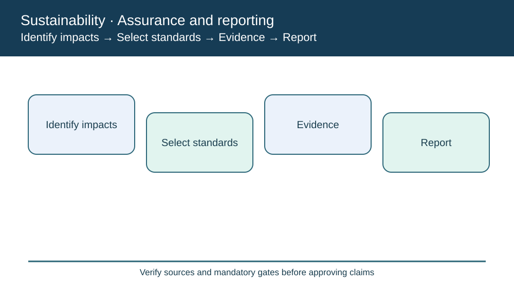
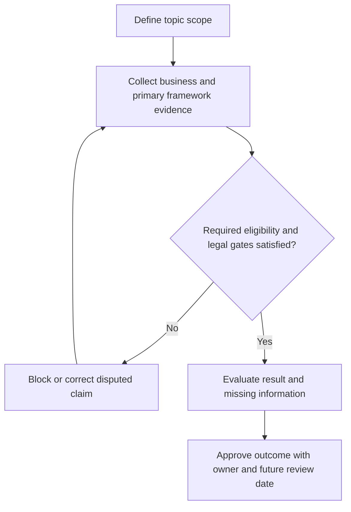

# 9. GRI Standards, Impact Materiality, and Disclosure Traceability

## Learning objectives

Explain the current framework and decision scope for gri standards, impact materiality, and disclosure traceability, distinguish source-edition terminology from official newer material, and apply verifiable evidence before making claims.

## Concept in plain English

The Global Reporting Initiative provides standards for reporting organizations' impacts on the economy, environment and people, including human rights. Reporting is intended to make impacts transparent and comparable, subject to scope, method and evidence limitations. A sustainability report should not be treated as independent proof that every reported practice is favorable.

The GRI architecture includes **Universal Standards** (GRI 1, GRI 2 and GRI 3, published in 2021), supplemented by Sector Standards and Topic Standards. GRI 1 establishes core foundations and application requirements; GRI 2 covers general disclosures and organization information; GRI 3 addresses the process for determining **material topics**, their identification and the way they are managed. Sector standards can point to significant topics in the industry, while specific topics have their own disclosures.

Impact materiality focuses on significant impacts, actual or potential, on people, environment and the economy. It should not simply select the happiest metrics or largest near-term financial returns. A serious labor-practice concern can be material even when the cost to the reporting company appears negligible. The team should document the methodology, stakeholder involvement, findings, excluded areas and residual uncertainty.

Reporting boundaries matter. A plant electricity figure may be accurate but inappropriate to label "total supply-chain energy" if contract manufacturing and transport are excluded. Data owners should retain source records, meter dates, supplier attestations and any estimation method. Missing records are an explicit completeness issue, not evidence of low impact.

AlderGate's environment and worker-safety teams use a content index to connect material topics with specific disclosures and source records. A report approval must recognize incomplete fields, the cited edition of each standard and changed disclosure codes. GRI's 2026 public standards listing includes climate and energy topic editions published in 2025, so an older Universal/Topic code should never be carried forward solely from a screenshot in the study manual.

**Learning source and edition checkpoint.** The APICS module discusses GRI reporting. Official current GRI Universal Standards include GRI 1 Foundation 2021, GRI 2 General Disclosures 2021 and GRI 3 Material Topics 2021. Earlier GRI 101/102/103 Universal references in older material are historic, while similarly numbered newer Topic Standards can have different meanings. AlderGate figures, workflows and assessments are independently constructed and illustrative, not content quoted from the APICS source.

## Why it matters

A polished sustainability dashboard may conceal a missing denominator or outdated GRI disclosure identifier. Source lineage and edition control make the report suitable for transparent review.

## Decision model and workflow

The topic-specific labels in the visual represent stages of the evidence and response process. A supply-chain manager should undertake these actions in order, preserving evidence of why an option could or could not proceed.

### Evidence retained through the workflow

| Evidence | Minimum control |
| --- | --- |
| Documented materiality process and identified impacts | Include source, owner, period and disposition |
| Applicable GRI Universal, Sector and Topic editions | Include source, owner, period and disposition |
| Scope, site and supplier inclusion/exclusion | Include source, owner, period and disposition |
| Disclosure record, estimation and review ownership | Include source, owner, period and disposition |

## Practical process flow

## Realistic example — AlderGate Motion Products

AlderGate is a fictional company with its own factories and suppliers. This scenario tests **gri standards, impact materiality, and disclosure traceability** and requires the named decision makers to validate the standard and its business relevance. An attractive report does not replace a recorded review of implementation, scope and limitations. No actual supplier is identified or evaluated by this example.

## Applied decision artifact or worked calculation

[Download/view the directly linked fictional inputs](../../assets/data/module-8/section-b/gri-disclosure-evidence.csv)

AlderGate verifies **18 of 20** required energy records and **12 of 15** worker-safety records. It has **30 of 35**, or **85.71% internal documentation coverage**; individual topic coverage is 90% and 80%. This is neither a GRI score nor evidence of positive environmental performance. The five unresolved evidence exceptions must be considered in any claim.

## Decision logic

- Evaluate material impacts using affected-stakeholder evidence.
- Choose standards applicable to the material topics.
- Reconcile source records and period boundaries.
- Disclose material limitations and management responses.

## Trade-offs

| Topic-specific concern | Consequence |
| --- | --- |
| More extensive boundaries | Greater transparency but additional data collection |
| Reporting speed | Cannot justify unsupported claims |
| Topic-specific evidence | Improves comparability but requires version control |

## Commonly confused with

GRI Standards, Impact Materiality, and Disclosure Traceability establishes particular guidance, control or reporting meaning; it does not mean any reported percentage is an official sustainability score. **Accreditation**, **certification**, **voluntary alignment**, and **legal approval** are different terms, with distinct evidence requirements. Review their scope and edition before interpreting external claims.

## Common mistakes

- Treating old GRI 101 Foundation as today's GRI 1.
- Claiming GRI certification from completed records.
- Omitting material negative impacts to improve the report.

## Original knowledge check

**Question.** Which current GRI Universal standard deals with material topics?

A. GRI 3: Material Topics 2021

B. Old GRI 103 as the only current Universal Standard

C. ISO 26000 certification

D. GRI 101: Biodiversity 2024 as Universal Foundation

Answer and rationale

### Correct answer

**A. GRI 3: Material Topics 2021**

### Why it is correct

GRI 3: Material Topics 2021 covers determining and managing material topics under the current Universal system.

### Why the other answers are wrong

- **B.** That is superseded Universal terminology.
- **C.** ISO 26000 is separate guidance and not certifiable.
- **D.** GRI 101: Biodiversity 2024 is a Topic Standard.

## Practitioner perspective

The supplier or operational evidence in ERP and connected applications needs validity dates, covered sites, current standard edition, data-source identifiers and exception owners. A reviewer must distinguish a verified operating practice from a submitted PDF or marketing promise. An unresolved control blocks the specific claim or activity where relevant, rather than being converted into a favorable default.

## Related concepts

- [Previous sustainability lesson](./08-oecd-guidelines-and-impact-due-diligence.md)
- [Module 7 risk governance](../../07-supply-chain-risk/README.md)
- [Module 8 overall path](../README.md)
- [Official primary reference 1](https://www.globalreporting.org/standards)
- [Official primary reference 2](https://www.globalreporting.org/publications/documents/english/gri-3-material-topics-2021/)

---

[Section B overview](./README.md) · [Previous sustainability lesson](./08-oecd-guidelines-and-impact-due-diligence.md)
