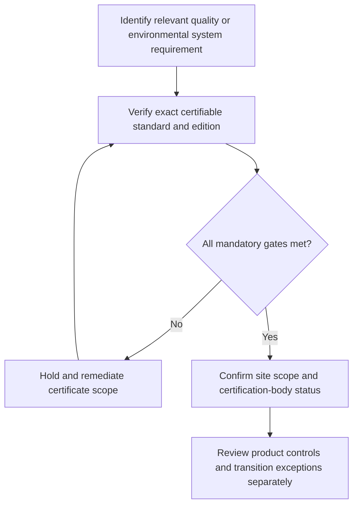

# 10. ISO Quality and Environmental Management Systems

## Learning objectives

Explain the current framework and decision scope for iso quality and environmental management systems, distinguish source-edition terminology from official newer material, and apply verifiable evidence before making claims.

## Concept in plain English

ISO management systems establish disciplined ways to set policies, control processes, verify results and improve operations. The **ISO 9000 family** relates to quality management; **ISO 9001** is the requirements standard used for quality-system certification. The **ISO 14000 family** addresses environmental management; **ISO 14001** is the environmental management-system requirements standard that can support certification. The family label and the certifiable requirements standard are different.

Environmental management includes identification of environmental aspects, compliance obligations, objectives, operational controls, audits and management review. Certification generally indicates a conformity-assessment process within the certificate's scope and edition; it does not promise zero pollution, product-level lifecycle neutrality or legal compliance for every possible shipment. Likewise ISO 9001 certification does not independently prove every manufactured part meets its precise technical specification.

The edition matters. Older course text discussed 2015-era requirements, but current ISO references identify **2026 editions** for both ISO 14001 and ISO 9001. A business with an older certificate should plan its transition through the relevant certification body, confirm the accepted audit cycle and check the actual certificate status. A certificate to ISO 14001:2015 is not automatically a certificate to ISO 14001:2026.

Site and process scope are equally important. A certificate for one factory does not necessarily cover other legal entities, warehouses, transport partners or product lines. AlderGate must verify the certificate issuer, relevant accreditation where applicable, site names, covered activities, expiry date and applicable edition before marking a supplier as qualified. It must still evaluate material traceability, transport permits and product-specific requirements under the separate legal or contractual gates.

A supplier selection system should record the exact standard designation and scope rather than an unqualified "ISO certified" checkbox. The goal is confidence based on auditable assurance, not claiming a certificate can replace every other operational control.

**Learning source and edition checkpoint.** The CSCP source covers ISO 9000 and ISO 14000 families and certification to ISO 9001 and ISO 14001. Current ISO official pages identify ISO 9001:2026 and ISO 14001:2026, so the earlier 2015 editions cited historically must not be represented as the latest without a transition review. AlderGate figures, workflows and assessments are independently constructed and illustrative, not content quoted from the APICS source.

## Why it matters

A certificate with a respectable logo but wrong facility scope can create an unjustified supplier-approval decision. Edition-specific and site-specific checks prevent that misuse.

## Decision model and workflow

The diagram for **10** maps the sustainability decision to four distinct areas of responsibility. Each stage requires its own evidence and a clear stop or escalation condition before an unsupported approval can occur.

### Evidence retained through the workflow

| Evidence | Minimum control |
| --- | --- |
| Full edition and certifying issuer | Include source, owner, period and disposition |
| Site and process covered by certificate | Include source, owner, period and disposition |
| Accreditation, status and expiry record | Include source, owner, period and disposition |
| Product/permit requirements separate from the certificate | Include source, owner, period and disposition |

## Practical process flow

## Realistic example — AlderGate Motion Products

AlderGate receives a supplier brochure claiming ISO environmental certification for a multinational parent company. The actual certificate covers a different plant and an earlier standard edition. Supplier Quality checks the certifier, scope and transition status, then keeps the target plant's approval pending. A separate team examines whether the offered component meets product, transport and environmental laws.

## Applied decision artifact or worked calculation

[Download/view the directly linked fictional inputs](../../assets/data/module-8/section-b/iso-scope-example.csv)

In an invented three-supplier register, only **one** claim is marked current and site-matched in the scenario, so **1/3 = 33.33%** is *immediately usable evidence*. The remaining entries are out of scope or require transition verification. This is not an ISO quality score or an assertion about any real supplier.

## Decision logic

- Identify relevant quality or environmental system requirement.
- Verify exact certifiable standard and edition.
- Confirm site scope and certification-body status.
- Review product controls and transition exceptions separately.

## Trade-offs

| Topic-specific concern | Consequence |
| --- | --- |
| Management-system certification | Supports process assurance but not every product release |
| Earlier standard edition | Needs accurate transition evidence |
| Supplier self-declaration | May be useful but is not always equivalent to independent audit |

## Commonly confused with

**ISO 9000** and **ISO 14000** are families; **ISO 9001** and **ISO 14001** are specific certifiable management-system requirements standards. A certificate has a scope and edition, not an unlimited company-wide guarantee. The 2026 versions require an explicit transition review for holders of older certificates.

## Common mistakes

- Referring to ISO 14000 as an all-encompassing certificate.
- Treating a 2015-edition certificate as automatically 2026-edition compliant.
- Applying plant certification to an unrelated site.

## Original knowledge check

**Question.** A supplier offers a genuine scoped ISO 14001 certificate. What can AlderGate appropriately infer?

A. All supplied items are automatically compliant with every regulation

B. Its total lifecycle emissions are net zero

C. An environmental management system has been assessed within the cited edition and scope; separate product checks remain

D. Every subcontractor has identical certification

Answer and rationale

### Correct answer

**C. An environmental management system has been assessed within the cited edition and scope; separate product checks remain**

### Why it is correct

Certifications have specific scope and edition; they do not substitute for all product, regulatory and partner checks.

### Why the other answers are wrong

- **A.** Management-system certification is not blanket statutory approval.
- **B.** ISO 14001 does not certify net-zero products.
- **D.** Certificates do not automatically cover unrelated subcontractors.

## Practitioner perspective

Quality and environmental master data should identify which certification pertains to which legal entity, facility, process and edition. Certificates require an issuer and expiry/status check. A management-system conformance record cannot automatically release every product variant or cover sub-tier locations outside the documented scope.

## Related concepts

- [Previous sustainability lesson](./09-gri-standards-and-impact-materiality.md)
- [Module 7 risk governance](../../07-supply-chain-risk/README.md)
- [Module 8 overall path](../README.md)
- [Official primary reference 1](https://www.iso.org/standard/14001)
- [Official primary reference 2](https://www.iso.org/standard/9001)

---

[Section B overview](./README.md) · [Previous sustainability lesson](./09-gri-standards-and-impact-materiality.md)
