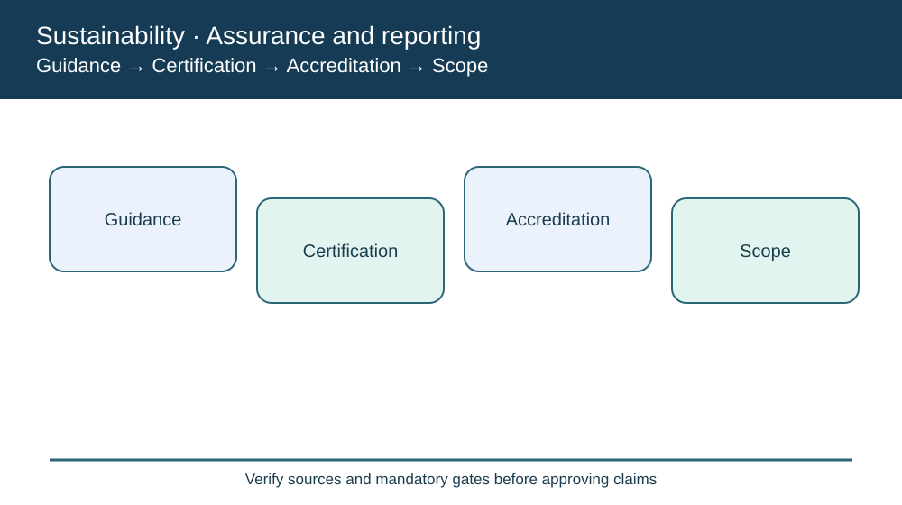
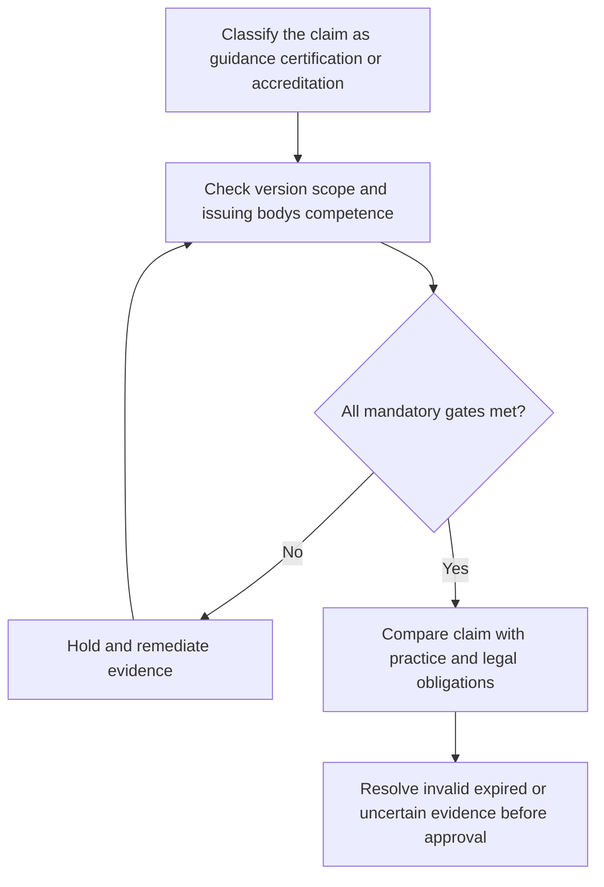

# 11. ISO 26000, SA8000, ANSI Z10, Certification, and Accreditation

## Learning objectives

Explain the current framework and decision scope for iso 26000, sa8000, ansi z10, certification, and accreditation, distinguish source-edition terminology from official newer material, and apply verifiable evidence before making claims.

## Concept in plain English

**Guidance, standard requirements, certification and accreditation** are related but distinct concepts. Guidance helps an organization understand and improve practices without necessarily defining requirements for a certificate. Certification involves an assessment of a defined organization, system, product or service against applicable criteria. Accreditation concerns the competence and impartiality of a conformity-assessment body for a specified scope. A buyer should know which role a claimed label actually plays.

**ISO 26000** provides guidance on social responsibility. ISO explicitly states it is not intended for certification. A supplier saying that it has "ISO 26000 certification" has misdescribed the standard, even if it has done useful work using that guidance. Procurement may ask for actual governance evidence, not falsely record a certificate.

**SA8000**, associated with Social Accountability International, addresses decent work and labor-related social accountability. The curriculum's historical description includes the 2014 version, but SAI published the **SA8000:2026 Standard for Decent Work**, with a certification transition timetable. A buyer should check edition, dates, conformity-assessment arrangements and certification status rather than automatically rejecting every earlier-issued certificate or treating it as perpetually current.

**ANSI/ASSP Z10.0-2019** specifies occupational health and safety management-system requirements. It should not be confused with a generic claim that every facility has zero workplace hazards. Implementing a management system means planning, checking and improving controls; it does not eliminate the need to investigate actual accidents or evaluate statutory duties.

AlderGate's onboarding form currently offers one checkbox, "Sustainability Certified." It is unsuitable for these diverse evidence types. The application should record standard owner, framework name, edition, guidance/certification status, certifying or accrediting body as applicable, facility scope, expiry, exception and actual operational evidence. This prevents false public assurances and equips reviewers to distinguish high-confidence and pending supplier claims.

**Learning source and edition checkpoint.** The course lists ISO 26000, SA8000 and ANSI Z10 and distinguishes accreditation from certification. Official ISO states ISO 26000 is guidance and cannot be certified. SAI issued SA8000:2026 replacing 2014, with transition arrangements. ANSI/ASSP Z10.0-2019 provides occupational health and safety management-system requirements. AlderGate figures, workflows and assessments are independently constructed and illustrative, not content quoted from the APICS source.

## Why it matters

A supplier may present a sophisticated sustainability document that is nevertheless the wrong kind of claim. Proper classification protects supplier governance and prevents misleading public or procurement statements.

## Decision model and workflow

The diagram for **11** maps the sustainability decision to four distinct areas of responsibility. Each stage requires its own evidence and a clear stop or escalation condition before an unsupported approval can occur.

### Evidence retained through the workflow

| Evidence | Minimum control |
| --- | --- |
| Standard owner, edition and claim category | Include source, owner, period and disposition |
| Certificate issuer and appropriate accreditation review | Include source, owner, period and disposition |
| Audit results and scope, where applicable | Include source, owner, period and disposition |
| Transition status, expiry and open corrective actions | Include source, owner, period and disposition |

## Practical process flow

## Realistic example — AlderGate Motion Products

AlderGate's supplier-assurance workflow contains a single checkbox marked 'social certification.' One vendor uploads an 'ISO 26000 certified' badge and another offers a SA8000:2014 certificate without current transition evidence. The team separates guidance, certifiable framework, issuer accreditation, edition and site scope, requesting corrective documentation rather than approving both records as equivalent.

## Applied decision artifact or worked calculation

[Download/view the directly linked fictional inputs](../../assets/data/module-8/section-b/assurance-claims.csv)

In a fictional three-claim sample, **zero** submissions can be accepted *without review*: ISO 26000 certification is not a valid claim; an SA8000:2014 certificate needs edition and transition evaluation; an ANSI Z10 management program needs evidence of actual conformity. This is an onboarding evidence disposition, not a rating of the organizations.

## Decision logic

- Classify the claim as guidance, certification or accreditation.
- Check version, scope and issuing body's competence.
- Compare claim with practice and legal obligations.
- Resolve invalid, expired or uncertain evidence before approval.

## Trade-offs

| Topic-specific concern | Consequence |
| --- | --- |
| Guidance adoption | Useful for management but may not be certifiable |
| Third-party audit | Can strengthen assurance but within defined scope |
| Standard transition | Requires verification without assuming all existing certificates invalid immediately |

## Commonly confused with

**ISO 26000** offers guidance and is not certifiable. **SA8000:2026** is a certifiable social-accountability framework with a documented transition from 2014. **ANSI/ASSP Z10** concerns occupational-health-and-safety management systems. **Accreditation** evaluates a conformity-assessment body's competence; it is not synonymous with organizational certification.

## Common mistakes

- Accepting ISO 26000-certified claims.
- Ignoring the 2026 SA8000 transition.
- Using accreditation and certification as synonyms.

## Original knowledge check

**Question.** How should AlderGate handle a supplier's 'ISO 26000 certified' badge?

A. Accept as independent certification of labor controls

B. Challenge the claim because ISO 26000 is non-certifiable guidance

C. Treat as automatic ISO 14001 environmental certification

D. Waive workplace safety reviews

Answer and rationale

### Correct answer

**B. Challenge the claim because ISO 26000 is non-certifiable guidance**

### Why it is correct

ISO states that ISO 26000 guidance is not suitable for certification.

### Why the other answers are wrong

- **A.** The framework does not provide that certificate.
- **C.** Quality/environmental management standards are separate.
- **D.** The claim cannot waive workplace controls.

## Practitioner perspective

Build the supplier assurance record with fields for standard owner, exact edition, intended guidance versus certification, certificate issuer, accredited scope, site, validity and findings. Where the underlying standard cannot be certified, label it as guidance use with separate implementation evidence. Keep real safety and labor controls independent of badge presentation.

## Related concepts

- [Previous sustainability lesson](./10-iso-quality-and-environmental-management.md)
- [Module 7 risk governance](../../07-supply-chain-risk/README.md)
- [Module 8 overall path](../README.md)
- [Official primary reference 1](https://www.iso.org/news/2010/11/Ref1378.html)
- [Official primary reference 2](https://sa-intl.org/sa8000-certification-program-timeline/)
- [Official primary reference 3](https://webstore.ansi.org/standards/asse/ANSIASSPZ102019)

---

[Section B overview](./README.md) · [Previous sustainability lesson](./10-iso-quality-and-environmental-management.md)
